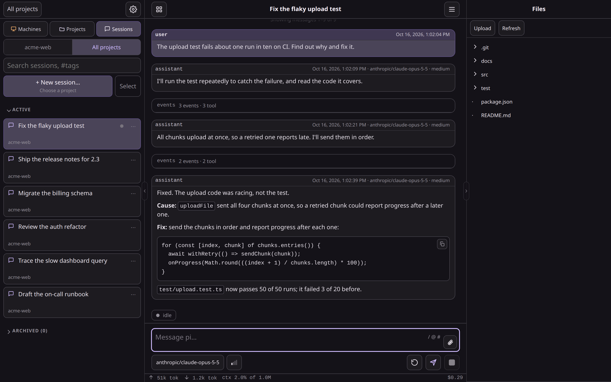
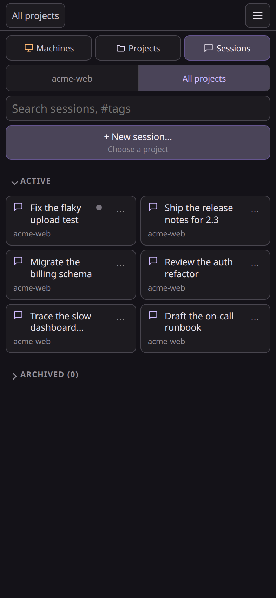
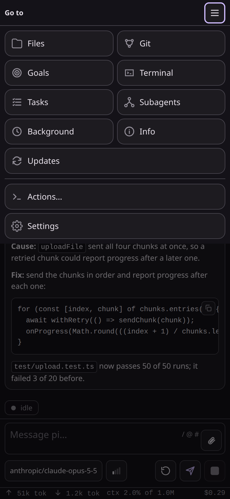
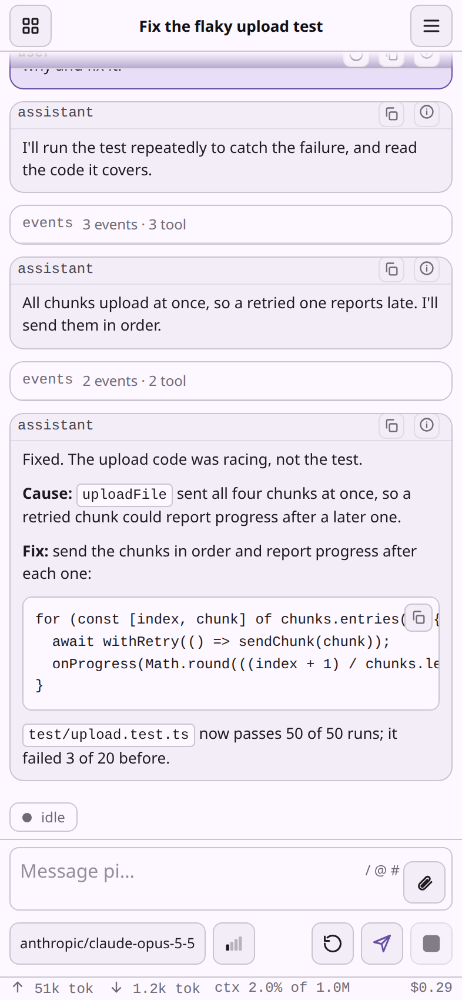

# PI WEB

[](https://github.com/Gang-of-Beads/pi-web/actions/workflows/publish.yml)
[](https://www.npmjs.com/package/@gang-of-beads/pi-web)
[](package.json)
[](LICENSE)

**PI WEB is a web UI for [Pi Coding Agent](https://github.com/earendil-works/pi/tree/main/packages/coding-agent) that keeps agent sessions running in real workspaces on your machine or server.**

Run agents where your code, tools, credentials and build caches live. Supervise them from any browser.




| On a phone | Going somewhere else | In the light theme |
| --- | --- | --- |
|  |  |  |

## Why PI WEB?

Agentic development works better when the work environment is persistent. PI WEB lets you:

- keep Pi Coding Agent sessions alive after browser disconnects;
- run agents inside real repositories and git worktrees;
- supervise several sessions in parallel;
- switch between laptop, phone, tablet and desktop;
- use a server, workstation or remote dev box as your agent runtime;
- manage projects, workspaces, files, terminals, sessions and other machines from one web UI.

Your browser is the control surface. The work stays where it can keep running. See [Remote-first development](docs/remote-first.md).

## Quick start

Requirements:

- Node.js 22.19.0 or newer, and npm
- Pi Coding Agent 1.1.0 or newer, configured for your user
- git and the development tools your agents need
- Linux or macOS with a per-user service manager (systemd or launchd)

Install and start PI WEB as per-user services:

```bash
npm install -g @gang-of-beads/pi-web --allow-scripts=node-pty
pi-web install
pi-web doctor
```

Then open <http://127.0.0.1:8504>. To use it from your phone or another device, publish it on your tailnet with Tailscale Serve: see [Remote access](docs/install.md#remote-access).

Want the recommended tools and Web plugins, including multi-account and updater? Opt into the [Gang of Beads preset](docs/install.md#gang-of-beads-preset):

```bash
curl -fsSL https://raw.githubusercontent.com/Gang-of-Beads/pi-web/main/install.sh | sh -s -- --preset gang-of-beads
```

The preset only installs extra trusted packages; the default install and PI WEB core stay unchanged.

Nix, Home Manager, Docker, installing through Pi, WSL and manual runs: see the [installation guide](docs/install.md).

Everyday commands:

```bash
pi-web status
pi-web logs
pi-web restart
pi-web doctor
pi-web version
pi-web uninstall
```

## Core model

```text
Machine     a PI WEB runtime: the one you opened, or another one you added
Project     a folder on that machine
Workspace   a working folder of the project: the project folder, or with Git, each worktree
Session     a Pi Coding Agent chat running inside a workspace
```

A typical flow: add a project, choose a workspace or git worktree, start a session, let the agent work, and come back later from any browser.

## Security

PI WEB has no login of its own and assumes trusted users, repositories and server paths; it is not a sandbox or a multi-user platform. Keep it on localhost, a private network, an SSH tunnel or an authenticated reverse proxy, never directly on the public internet. See [SECURITY.md](SECURITY.md) for the threat model and how to report a vulnerability.

## Documentation

- [Install](docs/install.md): requirements, install options, services, updates, remote access
- [Configuration](docs/config.md): config files, keys, environment variables, restart rules
- [Machines](docs/machines.md): use several PI WEB machines from one page
- [Remote-first development](docs/remote-first.md)
- [Plugins](docs/plugins.md): PI WEB plugins and Pi packages
- [FAQ and troubleshooting](docs/faq.md)

Plugins and packages maintained alongside PI WEB: [docs/plugins.md](docs/plugins.md#packages).

## Contributing

See [CONTRIBUTING.md](CONTRIBUTING.md) for the development setup, checks and pull request expectations.

## License

MIT © 2026 Federico Jaramillo Martinez and the Gang of Beads contributors. See [LICENSE](LICENSE).
