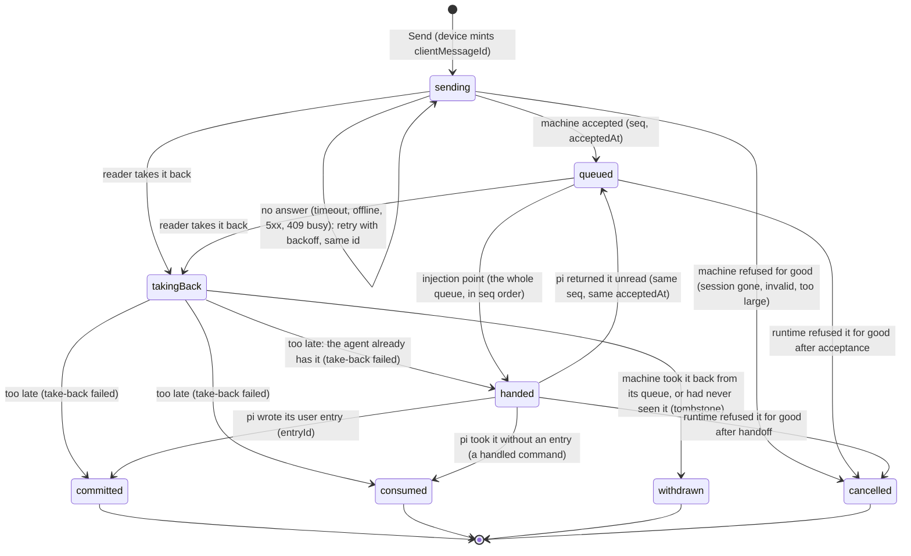

# Message states: a message is never lost and never fails for good

Status: implemented 2026-10-13 (device and daemon), with the operation log the
owner asked for that day (see Order). Approved by the owner (2026-10-04), with the details below (time,
the queue list, a failed take-back, and the state-merging rule). Revises D1 in
`state-diagram.md`.

## The owner's rules (2026-10-04)

- A send is retried, idempotently, until the machine answers. A message does
  not fail for good: it is either still on its way (in the queue, sending) or
  cancelled.
- Retry and Discard go. The one thing a reader does to a message on its way is
  take it back.
- A take-back of a message whose arrival is unknown is a request, not a fact.
  If the machine turns out to have taken the message, the message counts as
  taken and the take-back failed.
- A message's time is the time the machine actually took it, as the machine
  reports it.
- Every state a message can be in is named, with when it holds, what moves it,
  and what happens when the device and the machine disagree or a request is
  repeated. Which states the device knows and which the machine has confirmed
  are kept apart, and so is order.

## Two owners, one record

One record per `clientMessageId`, minted by the device when the reader presses
Send. It has exactly one state at a time, which the row, the pending block and
the queue list all draw.

- **The device owns** the record until the machine has answered about it once:
  `sending`, `takingBack`.
- **The machine owns** it from its first answer on: `queued`, `handed`,
  `committed`, `consumed`, `withdrawn`, `cancelled`.

The device never moves a machine-owned record by itself. It learns every
machine move from a frame or from a reconciliation read (below), and a later
device action (take back) is a request the machine answers.

## Device states

### `sending`

The device holds the record in its durable outbox (survives reloads and
restarts of the browser) and sends it until the machine answers.

- **Order.** One session's outbox on one device is sent strictly in order: the
  next record is not sent until the one before it is answered (accepted,
  cancelled or withdrawn). Without this, a retry of message 1 could arrive after
  message 2 and the machine would queue them reversed.
- **Retry schedule.** At once; then 1 s, doubling to 30 s; reset to "at once"
  whenever the link comes back (socket open, `online`, page load, session open).
  No age limit: a message written offline yesterday is delivered when this
  device next reaches the machine, unless taken back first. It shows as
  "Sending…" all that time.
- **Which answers end it.**

  | Answer | Meaning | Next |
  |---|---|---|
  | accepted, or "already have it" with the ledger's state | the machine owns it | that machine state |
  | no answer: timeout, network error, 5xx, 409 busy, 429 | unknown | stay `sending`, retry |
  | 404 session gone, 400 invalid, 413 too large | can never succeed | `cancelled` with that reason |

  A definite refusal is the only way a message on its way ends without the
  reader, and it is always a cancellation with a reason, never "failed, retry".
- **Before the session exists** (sent while a new session starts): the same
  state, held until the session answers; nothing new.

### `takingBack`

The reader pressed Take back on a message the machine has not yet answered
about. The device sends `withdraw(clientMessageId)` (idempotent, retried on the
same schedule) and keeps the row, marked "Taking back…". The words return to the
composer only when the machine confirms.

## Machine states

These exist today (D1, B33) and keep their meaning: `queued` (with `seq` and
`acceptedAt`), `handed`, `committed` (with `entryId`), `consumed`, `withdrawn`.
Two changes:

- **`cancelled`** replaces `refused`: a terminal refusal by the runtime after
  acceptance. The words go back to the composer, and a notice names the session
  and the reason. Nothing offers Retry; sending the words again makes a new
  message.
- **Take-back of an id the machine never saw** writes a tombstone: the ledger
  records the id as `withdrawn`. A send of that id arriving later (a request
  that was slow on the wire) is answered `withdrawn` and not run. Today the
  answer is `recalled: false` and a late send would be accepted.

### Take-back answers

`withdraw(id)` answers with the record's state after the attempt:

| Machine had | Answer | Reader sees |
|---|---|---|
| nothing | `withdrawn` (tombstone) | words back in the composer |
| `queued` | `withdrawn` | words back in the composer |
| `handed`, `committed`, `consumed` | that state | the message stays where it is; a notice: "Already with the agent; it could not be taken back." |
| `withdrawn` (a repeat) | `withdrawn` | nothing new |

## Time

A message's time is the moment the agent got it (`handedAt`), owner
2026-10-04: until then it sits in the queue, where it can still be taken back,
so it has not been sent to the agent yet.

- `sending`, `takingBack` and `queued` rows show no clock: "Sending…",
  "Taking back…", "Queued · n".
- The daemon stamps `handedAt` when it hands the message to pi, writes it on
  pi's committed copy (the throat that stamps `clientMessageId` today), and
  every device shows it after every reload.
- A message pi returns unread (`handed -> queued`) loses its `handedAt`; the
  next handoff stamps a new one.
- This replaces B5's rule (the device's send time, clamped to acceptance).
- Message info shows all three: written on this device, accepted by the
  machine, handed to the agent.

## The queue list

Everything that has not reached the agent is in the queue list, which is where
the reader controls it (owner: "用户如果不想发则应该在message queue里面选择撤回"):
this device's `sending` and `takingBack` records first in their written
order, then the machine's `queued` records by `seq`. Each has Take back. A
message leaves the list the moment the device learns it reached the agent
(`handed`, `committed`, `consumed`), was withdrawn, or was cancelled; it does
not wait for any other answer.

## One merge rule for every update

A record's state can be reported by several sources that race: the answer to
the send, the answer to a take-back, socket frames, and the reconciliation read
after a reconnect. They are applied by one rule, so the order they arrive in
does not matter:

- The machine stamps every transition of a record with a revision `rev`
  (1, 2, 3, … per record, persisted with the inbox and the ledger). Every frame
  and every answer carries `(state, rev)`.
- The device keeps the highest `rev` it has applied, and applies an update only
  if its `rev` is higher. A stale frame, a late answer or a replayed read is
  dropped.
- Device-only states (`sending`, `takingBack`) are rev 0: any machine report
  wins over them.
- `handed -> queued` (pi returned it unread) is an ordinary later revision, so
  it applies even though it looks like a step back.

This is the pattern of an idempotent outbox with a monotonic version per record
(a last-writer-wins register ordered by the machine's revision). The state
machine above stays the single place that says which transitions exist; the
merge rule only decides whether an update is new.

**A take-back that turns out too late**, under this rule:

1. The reader presses Take back on a queued message. The device records the
   request (`takingBack`, rev unchanged) and sends `withdraw(id)`.
2. A frame arrives first: `(handed, rev 3)`. It is newer, so it applies: the
   message leaves the queue list at once and appears in the conversation as
   handed. The pending take-back is now moot.
3. The take-back's answer arrives later: `(handed, rev 3)` or
   `(committed, rev 4)`. It applies or is dropped by `rev` like anything else;
   because the device had requested a take-back for this record, it also shows
   the notice "Already with the agent; it could not be taken back." once.

If the answer arrives before the frame, step 3 happens first and step 2 is
dropped as stale. Either way the end state and the notice are the same.

## Order: one operation log per device, acknowledged both ways

Owner, 2026-10-13: a later message was "Queued" while an earlier one from the
same phone read "Not received". The device kept its sends in order only as long
as each was answered; a send that timed out let the next one go, and nothing on
the machine could tell that one was missing. Order is now a protocol, not a
habit of the device: an operation log with numbers, the way the machine already
numbers the frames it sends (`seq` with gap replay). The owner chose the full
protocol on 2026-10-14 ("按这个方案做"): the machine's check is real, not a
formality, acknowledgements travel both ways, and operations go in ordered
batches.

### Devices

- **A device is one browser profile** with a fixed id (`pi-web:device-id`), so a
  reload, or closing the page and coming back, keeps sending what was left
  (owner, 2026-10-14: "如果有固定设备号刷新/关闭页面再回来也能继续发送了"). Every
  tab of the profile is the same device and writes the same outbox.
- **Every operation is its own stored record**, never one array rewritten:
  appending writes a new key and an answer deletes its own key, so two tabs that
  write at once never overwrite each other (owner, 2026-10-14: "既能满足多端写，又
  能满足消息一致"). The outbox of a session is its records in the order they were
  written (write time, then a per-tab counter). No locks: it holds on plain
  `http` too.
- **Two tabs may send the same records.** Same identity and number, so the
  machine runs it once and answers the repeat; the cost is a request.
- **Reading is the machine's.** A page shows what the machine sends it; another
  tab's operation appears there when the machine has it (owner: "写和读都是独立和
  server交互").

### Operations

- **Every operation the machine runs is numbered**: a message, a take-back, a
  slash command the machine runs, a `!` shell command. A command the browser
  handles itself (sign-in, settings) takes no number.
- **Operations go in batches** (owner, 2026-10-14: "批量可以"). One request
  carries every unsent operation of one session, in order; the next batch goes
  only once the machine has answered the last. Within a request the transport
  delivers everything, in order; across requests it promises nothing - a
  request can vanish, an answer can vanish, and the browser may send a POST
  twice - so a batch nobody answered is sent again whole, and the machine
  answers what it already ran by identity without running it again.
- **A number is taken when the operation is first sent**, from where the
  machine last said it stands, so the numbers the machine sees have no holes.
  Each batch also carries `ackedThrough`, the highest number this device has
  seen the machine confirm - a recorded value.
- **A take-back of a message still in this browser's outbox is local**
  (owner, 2026-10-14: "能不能做到本地撤回"): its words return at once, and its
  record turns, in its place, into a take-back, so the machine hears of it before
  anything written after the message. That happens only while the machine is not
  answering; on a live link a message leaves the outbox as soon as the machine
  answers. A batch that went unanswered may still have reached the machine, and
  another tab may be sending the message this instant, so the take-back still
  goes: the machine refuses the message if it never had it, recalls it if it
  waits, and says when the agent already has it - then "Already with the agent"
  shows under it, the words being in the composer already. A message the
  machine already answered is taken back by the machine, after everything
  written before the take-back, and its words return once the machine confirms.
- **An operation carries the scope it belongs to**: machine, session and cwd,
  and for a draft session the launch it needs (project, workspace, startup
  token). The device sends every outbox, not only the open session's: a session
  left with unsent operations keeps sending in the background (owner,
  2026-10-14: "后台继续发"). A draft's first operation launches its session
  (idempotent by the startup token) and its records move to the session's id.

### The machine

- **Per session and device it keeps the highest number applied**
  (`sequence-cursors.json` beside the ledger, with the time each was last
  used; entries unused for 30 days are dropped). The cursor is the higher of
  the file and the batch's `ackedThrough`, so a lost file costs nothing.
- **A batch is applied in order and stops at the first operation it cannot
  apply.** Verdicts are decided before an operation runs and recorded only once
  it is accepted (a refused operation takes no number):

  | number against the cursor | identity | verdict | the batch |
  |---|---|---|---|
  | next | any | `next` | run it; the cursor moves to it; go on |
  | at or below | known to the ledger | `repeat` | its recorded answer; nothing runs twice; go on |
  | at or below | lost to a restart | `rerun` | run it again; go on |
  | at or below | unknown | `stale` | stop |
  | past the next | any | `gap` | stop |
  | refused for good (400, 404, 413) | | | stop |

  The answer lists each operation's result - applied (and what it came to),
  refused (and why), or not attempted - and where the device stands. It is the
  device's instruction: what was applied leaves the outbox, a refused operation
  is cancelled with its words back, and the rest are numbered again from
  `appliedThrough` and go in the next batch at once. The machine never asks for
  a resend on its own: it cannot know of a request that never reached it.
- **Every answer says where the machine stands**: `appliedThrough` for this
  device, and the session stream's head (epoch and frame number).
- **Acknowledgement travels both ways.** As it accepts each operation the
  machine publishes `operation.applied` (device, number, identity, outcome) on
  the session's stream, so a device whose HTTP answer is lost learns what landed
  without waiting to resend. In the other direction, an answer that reports a
  stream head beyond the frames this page has applied makes the page ask for
  what it missed.
- **A command is acknowledged when it is accepted**, not when it finishes; its
  result is read separately, by identity, so a slow command is never mistaken
  for an unanswered one, and a repeated command returns the result it returned
  the first time and runs once. A result that needs the page - a session to
  switch to, a picker, words for the composer - and that arrives while the
  reader is in another session waits until the reader returns to the session
  (owner, 2026-10-14: "后台发送，结果等你回来再处理"). Any other result shows
  under the command's row.
- **Machine order is acceptance order** (`seq`), across all devices; within one
  device it is that device's outbox order.
- **The transcript tail** (unchanged shape): committed rows at their entries;
  then the pending block: `queued` and `handed` by `seq`, then this device's
  `sending` and `takingBack` rows in the order they were written.

## Staying in step

Owner, 2026-10-14: there are two states besides normal, one per direction, each
named by a fact rather than guessed.

- **Trying to sync with *m*** - the page does not know whether what it sent
  reached *m*. The oldest operation for *m* still unacknowledged was first sent
  more than *n* ago (10 s, counting only time the page is in view; a resend does
  not restart it), or a probe to *m* went unanswered for *n*, or a read went
  unanswered for *n* while nothing at all came from *m* since it was sent (a
  slow read on a live link is not an outage). When the page cannot reach the
  machine that serves it at all, the row says "Trying to reach *p*…".
- **Syncing with *m*** - the page knows it is behind *m* and is fetching what it
  missed: a frame number skipped, a probe or an answer reported a head beyond
  what was applied, or *m* restarted (another epoch) and the view is read
  again. It shows once the fetch has taken more than 1 s (owner: "补数超过1秒").
- **Normal** - everything else, including a list drawn from what this browser
  remembered: not knowing is not being behind, and the first read after the page
  opens is a probe, bounded by *n* like any other.
- **Every machine counts**, the one on screen and any the page sends to in the
  background, and the row names each one it is about (owner: "都显示机器名").
  Precedence: a notice the reader must act on, then Trying, then Syncing.
- **An answer is never an outage.** A machine that answered with an error has
  stated a fact, which shows as "*m*: *reason*".

**The probe.** When nothing has come from *m* on its stream for *x* (the quiet
window, a setting per device, 15 s by default, distinct from *n*), the page asks
*m* for everything after the last frame it applied. The answer is empty (in
step), the missed frames (applied in order), or "read again" (Syncing). The
machine sends a quiet stream a heartbeat carrying its head every 0.6 *x*, so a
healthy idle link never needs a probe. Only frames on the stream restart *x*:
an HTTP answer does not, because a stream can die while requests still work.
Events probe at once too (owner: "流水线消息可以由事件触发"): the page coming
into view, the browser going online, the stream reconnecting, a session or
machine opening, and an answer reporting a head beyond what was applied. Probes
for one machine coalesce into one in flight.

The machine answers "already have it" from two sources, so idempotency outlives
the ledger's age limit:

- the acceptance ledger, whose retention goes from 24 hours to 30 days;
- the session file: every committed user entry carries its `clientMessageId`
  (stamped at `message_start`), and the daemon indexes them when it opens the
  session.

## What goes away

- The reader states `notSent`, `unverifiable` and `refused`, and their words
  ("Not received · Retry", "Not accepted · Retry", "Receiving…").
- Retry and Discard.
- The 10-minute automatic-resend window (B4); every `sending` record is resent.
- `sentAt` and `acceptedAt` as the shown time (both stay in message info).

## Words

| State | Row | Notice |
|---|---|---|
| `sending` | Sending… | none |
| `takingBack` | Taking back… | none |
| `queued` | Queued · n | none |
| `handed` | Received | none |
| `committed` | (the message, with its time) | none |
| `withdrawn` | (no row; words in the composer) | none |
| `cancelled` | a note where the row was: "Not sent: <reason>. The words are back in the composer." | none on the app row |
| take-back too late | the message stays, with a note under it: "Already with the agent; it could not be taken back." | none on the app row |

A note about one message sits in the transcript under that message (owner,
2026-10-14: "放在相关消息行内"), not on the app row, which says only whether the
page is in step. It leaves after a few seconds in view or with the reader's next
send. A note for a session the reader is not looking at waits until the session
is opened.

## Upgrade

None (owner, 2026-10-13: "不用兼容旧版本"). Outbox records an older build wrote
have no number and are not read; a page and a machine of this version are
updated together.

## Order of work

1. Daemon: tombstone on take-back of an unknown id; take-back answers with the
   state; ledger retention 30 days; committed-id index from the session file
   (daemon restart).
2. Device: the outbox state machine (`sending`, `takingBack`) with ordered,
   unbounded retry; reconciliation on reconnect; Retry and Discard removed.
3. Time from `acceptedAt`; B5's clamp removed.
4. Words, notices, and `state-diagram.md` D1 replaced by this page.
