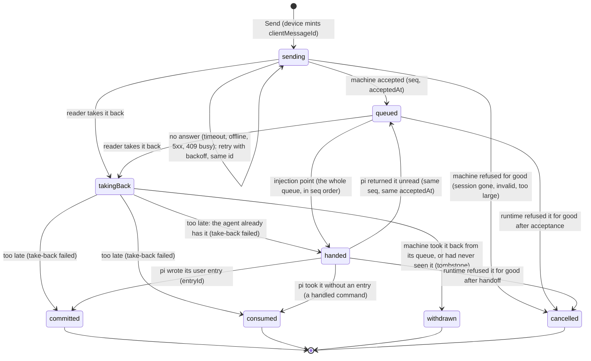

# Message states: a message is never lost and never fails for good

Status: implemented 2026-10-13 (device and daemon), with the operation log the
owner asked for that day (see Order). Approved by the owner (2026-10-04), with the details below (time,
the queue list, a failed take-back, and the state-merging rule). Revises D1 in
`state-diagram.md`.

## The owner's rules (2026-10-04)

- A send is retried, idempotently, until the machine answers. A message does
  not fail for good: it is either still on its way (in the queue, sending) or
  cancelled.
- Retry and Discard go. The one thing a reader does to a message on its way is
  take it back.
- A take-back of a message whose arrival is unknown is a request, not a fact.
  If the machine turns out to have taken the message, the message counts as
  taken and the take-back failed.
- A message's time is the time the machine actually took it, as the machine
  reports it.
- Every state a message can be in is named, with when it holds, what moves it,
  and what happens when the device and the machine disagree or a request is
  repeated. Which states the device knows and which the machine has confirmed
  are kept apart, and so is order.

## Two owners, one record

One record per `clientMessageId`, minted by the device when the reader presses
Send. It has exactly one state at a time, which the row, the pending block and
the queue list all draw.

- **The device owns** the record until the machine has answered about it once:
  `sending`, `takingBack`.
- **The machine owns** it from its first answer on: `queued`, `handed`,
  `committed`, `consumed`, `withdrawn`, `cancelled`.

The device never moves a machine-owned record by itself. It learns every
machine move from a frame or from a reconciliation read (below), and a later
device action (take back) is a request the machine answers.

## Device states

### `sending`

The device holds the record in its durable outbox (survives reloads and
restarts of the browser) and sends it until the machine answers.

- **Order.** One session's outbox on one device goes as ordered batches, numbered
  for this device (see "Order: one operation log per device"). Without the
  numbers, a retry of message 1 could arrive after message 2 and the machine
  would queue them reversed.
- **Retry schedule.** At once; then 1 s, doubling to 15 s; reset to "at once"
  whenever the link comes back (socket open, `online`, page load, session open).
  No age limit: a message written offline yesterday is delivered when this
  device next reaches the machine, unless taken back first. It shows as
  "Sending…" all that time, once the grace has passed (see "The sync overlay").
- **Which answers end it.**

  | Answer | Meaning | Next |
  |---|---|---|
  | accepted, or "already have it" with the ledger's state | the machine owns it | that machine state |
  | no answer: timeout, network error, 5xx, 409 busy, 429 | unknown | stay `sending`, retry |
  | 404 session gone, 400 invalid, 413 too large | can never succeed | `cancelled` with that reason |
  | this browser no longer has the message's attachments | can never be sent as written; the machine may already have it | stay `sending` while a take-back asks the machine (below) |
  | this browser cannot read the message's attachments now | unknown | stay `sending`, retry; the app row says why |

  A definite refusal is the only way a message on its way ends without the
  reader, and it is always a cancellation with a reason, never "failed, retry".
- **Attachments kept in this browser.** A message's attachments wait in the
  browser's IndexedDB, and its outbox record refers to them; a browser where
  IndexedDB refuses keeps them in the record itself and sends them from there.
  Before a message goes, its attachments are read back. When the store answers
  that they are gone (site data cleared, storage evicted), the message can
  never be sent as it was written, and it is never sent as words alone (owner,
  2026-10-19). An earlier batch may already have carried it, so this browser
  does not settle it alone: in its place in the outbox it becomes a take-back
  of its identity, which goes ahead of everything written after it and asks
  the machine (see "Take-back answers"). Taken back - the machine never had
  it, and wrote a tombstone, or held it queued - it fails: its row goes and
  its words come back to the composer, whose one notice reads "Not sent: this
  browser no longer has its 2 attachments, so send it again with the files."
  Too late - the agent has it - it stands delivered: nothing comes back and
  nothing is said. A take-back the machine refuses for good (the session is
  gone or takes no words) fails the message the same way, and the notice adds
  the machine's reason. A take-back nobody answers is sent again, like any
  batch, and the row stays `sending`. The rest of the outbox goes on. When
  the store cannot answer now (a closed connection, a failed transaction), the
  message waits and is retried like an unanswered batch; the messages behind it
  wait too, to keep their order, and the app row says that this browser cannot
  read the attachments of a message waiting for that machine.
- **Before the session exists** (sent while a new session starts): the same
  state, held until the session answers; nothing new.

### The sync overlay

Owner, 2026-10-23: sending feels like a local app. The page draws what the
reader expects the message to become, and the machine's answer confirms or
corrects it; the two disagree only while the link is slow or down.

A message the reader sent is in one of three **experience states**:

- **Said**: an ordinary message in the conversation, input to the agent. No
  mark.
- **Waiting**: after the reply that is running, "Queued · n" (or "Queued"
  before the queue list names its place), with Take back.
- **Back in the composer**: taken back, withdrawn by Stop or `/new`, or refused;
  its words and attachments return with a notice.

On top of it, the **sync overlay**:

- **Confirmed**: the machine answered (the batch's answer, `prompt.accepted`, or
  `operation.applied`). The experience state alone is drawn.
- **Unconfirmed, within the grace**: drawn exactly as the expected experience
  state, with no "Sending…".
- **Unconfirmed, past the grace**: "Sending…", announced once to a screen
  reader.

The **grace** is 1.5 s (`DELIVERY_GRACE_MS`), counted from when this device
wrote the message (the outbox record's `at`), so a reload does not restart it:
a record written a minute ago shows "Sending…" at once. The "Messages on their
way" strip above the composer, for a message with no row on screen, waits the
same grace.

The **expected experience** comes from the session's last status: Waiting while
it streams, stops or compacts; Said otherwise. Messages the session holds while
nothing runs (`pendingMessageCount` alone) start the next run together with
this one, so they predict Said. The machine's facts then correct it: a queue
list that holds the message while the session works makes it Waiting (it keeps
its place; only the mark appears), and an idle session, or the agent's
committed copy, makes it Said. "Queued · n" shows only while the session works
and its queue lists the message. A message the machine holds while nothing runs
(settling after a reply, or the session still opening) stays quiet as Said: it
starts the next run.

One classifier decides the mark (`deliveryMark` in `deliveryWords.ts`, from the
state, the write time, the time now and whether the session works); the page
draws again when the earliest grace runs out. Take back stays in the message's
own keys while the agent does not have it, whether a mark is drawn or not. A
message's time stays the time the agent got it (see "Time").

`!` commands and slash commands keep their own rows; this overlay is about
messages.

### `takingBack`

The reader pressed Take back on a message the machine has not yet answered
about. The device sends `withdraw(clientMessageId)` (idempotent, retried on the
same schedule) and keeps the row, marked "Taking back…". The words return to the
composer only when the machine confirms.

Whatever brings a message back to the composer (Take back, Stop, Clear queue, a
refusal, prompt history) brings its attachments with it: images, and files not yet
saved to the workspace (a saved file's reference is already in the text). They
come from this browser's own copy, else from the message's line in the
transcript. A message queued from another device, whose images this browser has
no copy of, comes back with a note under the composer's attachments saying how
many did not come back; the daemon lists each queued message's `imageCount` for
that. When nothing says whether it had any (an older daemon, or a message an
extension queued), the note says that instead.

## Machine states

These exist today (D1, B33) and keep their meaning: `queued` (with `seq` and
`acceptedAt`), `handed`, `committed` (with `entryId`), `consumed`, `withdrawn`.
Two changes:

- **`cancelled`** replaces `refused`: a terminal refusal by the runtime after
  acceptance. The words go back to the composer, and a notice names the session
  and the reason. Nothing offers Retry; sending the words again makes a new
  message.
- **Take-back of an id the machine never saw** writes a tombstone: the ledger
  records the id as `withdrawn`. A send of that id arriving later (a request
  that was slow on the wire) is answered `withdrawn` and not run. Today the
  answer is `recalled: false` and a late send would be accepted.

### Accepting before the session opens

Owner, 2026-10-23: a device's message to a session the daemon has not opened is
accepted before the session opens. Opening loads every extension, which took
seconds, and the device's answer waited for it.

- Refusals that need no open session answer as before: invalid words or
  attachments (400), too large (413), an archived session, and a session with
  no file (404). The daemon finds the file as a closed session's transcript read
  does, without opening it.
- A resend of an identity the machine already has is answered from the
  acceptance ledger, or from the identities committed in the session's file,
  read as a closed transcript read reads it. A file only the runtime can read
  (an older version, which opening migrates) takes the old path: the session
  opens first.
- The answer waits only for the inbox write. Then the acceptance is published
  as before, and the session opens, joining an open already running. Messages
  that arrive while it opens wait in acceptance order and start the next run
  together, as on an idle open session. Nothing publishes a status for the
  session until it is open, so nothing says it works and the device draws the
  message as said.
- **A session that does not open** does not strand the message. A refusal the
  runtime may lift (the transient ones of `promptHandoff.ts`) leaves it queued,
  handed when an open succeeds; any other cancels it with the reason
  (`prompt.refused`), and its words return to the sender's composer.
- Naming the session, emptying the extensions' composer text, and the
  tree-navigation guard need the runtime: they run when the session is open.
  A session that is not open has no navigation in progress.

### Take-back answers

`withdraw(id)` answers with the record's state after the attempt:

| Machine had | Answer | Reader sees |
|---|---|---|
| nothing | `withdrawn` (tombstone) | words back in the composer |
| `queued` | `withdrawn` | words back in the composer |
| `handed`, `committed`, `consumed` | that state | the message stays where it is; a notice: "Already with the agent; it could not be taken back." |
| `withdrawn` (a repeat) | `withdrawn` | nothing new |

## Time

A message's time is the moment the agent got it (`handedAt`), owner
2026-10-04: until then it sits in the queue, where it can still be taken back,
so it has not been sent to the agent yet.

- A message the agent does not have yet shows no clock, whatever it wears:
  nothing within the grace or as said, "Sending…", "Taking back…",
  "Queued · n".
- The daemon stamps `handedAt` when it hands the message to pi, writes it on
  pi's committed copy (the throat that stamps `clientMessageId` today), and
  every device shows it after every reload.
- A message pi returns unread (`handed -> queued`) loses its `handedAt`; the
  next handoff stamps a new one.
- This replaces B5's rule (the device's send time, clamped to acceptance).
- Message info shows all three: written on this device, accepted by the
  machine, handed to the agent.

## Who sent it

The same throat that stamps `clientMessageId` and `handedAt` on pi's committed
copy stamps who sent the message, so every device and every reload reads it:

- `sentVia`: the plugin whose composer control pressed Send (its `send()`), by
  plugin id. The device carries it on the operation (`via`), the inbox keeps it
  through a restart, and the message's details say "Sent with <plugin name>",
  or "Sent by a plugin (<id>)" where that plugin is not loaded. A message the
  reader sends with the Send button has none, even when a plugin wrote the
  draft.
- `sentBy`: the device (browser profile id) whose batch carried the message.
  The page compares it with its own id to tell plugins which device asked for
  a run (`onDidEndRun`'s `askedBy`). A message from the terminal or an
  extension has none, and reads as unknown, never as another device.

## The queue list

Everything that has not reached the agent is in the queue list, which is where
the reader controls it (owner: a reader who no longer wants to send a message
takes it back from the message queue):
this device's `sending` and `takingBack` records first in their written
order, then the machine's `queued` records by `seq`. Each has Take back. A
message leaves the list the moment the device learns it reached the agent
(`handed`, `committed`, `consumed`), was withdrawn, or was cancelled; it does
not wait for any other answer.

### Stop and the queue

Stop returns everything waiting when it is pressed to the composer of the
device that pressed it, as above. A stopped reply or tool call takes a moment
to end. A message accepted in that moment is not handed to the turn being
stopped, where the reply that reads it would never answer it. It stays
`queued`, listed with Take back like any waiting message, and starts a new
turn of its own once the stop has completed. Meanwhile the status line says so
("1 message starts a new turn after the stop"), from the status's `isStopping`.
Messages accepted together in that moment go together, in acceptance order, as
any idle batch does. A daemon restart while it waits keeps it in the inbox
file, and the startup drain sends it (owner, 2026-10-22).

An extension command sent in that moment runs at once, as it does while a
reply streams. Skills and prompt templates are text for the model and wait
like a message. A command sent after a message that is waiting for the stop
keeps its place behind it: it runs once that message has started its new
turn.

### `/new` and the queue

Owner, 2026-10-18: `/new` runs at once, as in pi's terminal, whether the agent
is working or idle. It does not wait in the queue. Only the bare command is
`/new`: `/new` with words after it, or with attachments, is a message to the
model, and the composer sends it as one, with a message's delivery marks and
take-back.

- pi first asks the session's extensions. If one cancels the switch, nothing
  is stopped and nothing leaves the queue; the session says "An extension
  cancelled /new." and the `/new` row reads failed with the same words.
- Once no extension cancelled, the session stops as it would on Stop: the
  reply in progress ends and reads as stopped by you, kept in the old session,
  and a compaction in progress ends too. While a tree navigation runs (with its
  branch summary), `/new` is refused like every command. Everything queued,
  on the machine and in pi's own queues, is withdrawn as on Stop, and its rows
  leave on every device. A `!` command still running ends with the old session,
  as in pi's terminal.
- What was queued goes back to the composer of the device that sent `/new`,
  joined as Stop joins it, and moves with that device's draft to the new
  session. A message that reaches the old session while the switch runs is
  handed back the same way, up to the moment the pages are told to move; one
  sent after that, before the page heard about the switch, waits in the old
  session and runs when that session is opened again. Nothing goes into prompt
  history.
- Every page showing the old session moves to the new one, as a new browser
  history entry, and takes the reader's draft and unsent attachments along. A
  tree dialog open on the old session closes. The row of the `/new` reads "New
  session started". A page that opens or reloads the old session after the
  switch stays on it, and so does a page whose session stream has forgotten the
  switch (after a daemon restart, for example).
- The old session stays as a finished session, listed even if it never had a
  message. A request for it during the switch waits for the switch and never
  reaches the new session; a message sent to it after the switch, from a
  device that has not moved yet, runs there.
- If the new session cannot be created after pi has closed the old one, the
  old session's runtime is closed (an old session that never had a message is
  written first, so it stays listed), says "Could not start a new session: …",
  and opens again from its unchanged file with the next message. The `/new`
  row reads failed with the same words, and what was queued stays in the
  sending device's composer.
- A `/new` the daemon dies while running is lost, and so is the new session,
  which had not been written yet.

## How racing updates are applied

A record's state can be reported by several sources that race: the answer to
the batch, socket frames, and the catch-up read after a reconnect.

The 2026-10-04 design ordered them by a per-record revision `rev` stamped by
the machine. That was not built; the operation log below replaced it. What is
built:

- Frames reach the page in the session stream's `seq` order, with gap repair,
  so a frame is never applied before one the machine published earlier.
- Each batch answer reports where the machine stands (`appliedThrough` for this
  device, and the stream head), and each `operation.applied` frame carries
  `appliedThrough` too. Whichever arrives first settles the record; the other
  finds nothing left to do, because a record leaves the outbox once the machine
  has applied it.
- Device-only states (`sending`, `takingBack`) give way to any machine report.

**A take-back that turns out too late:** the take-back goes in order after the
message, and the machine answers that the agent already has it. The message
stays where it is, and the note "Already with the agent; it could not be taken
back." shows under it once.

## Order: one operation log per device, acknowledged both ways

Owner, 2026-10-13: a later message was "Queued" while an earlier one from the
same phone read "Not received". The device kept its sends in order only as long
as each was answered; a send that timed out let the next one go, and nothing on
the machine could tell that one was missing. Order is now a protocol, not a
habit of the device: an operation log with numbers, the way the machine already
numbers the frames it sends (`seq` with gap replay). The owner chose the full
protocol on 2026-10-14: the machine's check is real, not a
formality, acknowledgements travel both ways, and operations go in ordered
batches.

### Devices

- **A device is one browser profile** with a fixed id (`pi-web:device-id`), so a
  reload, or closing the page and coming back, keeps sending what was left
  (owner, 2026-10-14: with a fixed device id, a reload or closing the page and
  coming back keeps sending). Every
  tab of the profile is the same device and writes the same outbox.
- **Every operation is its own stored record**, never one array rewritten:
  appending writes a new key and an answer deletes its own key, so two tabs that
  write at once never overwrite each other (owner, 2026-10-14: this serves both writing from
  several tabs and message consistency). The outbox of a session is its records in the order they were
  written (write time, then a per-tab counter). No locks: it holds on plain
  `http` too.
- **Two tabs may send the same records.** Same identity and number, so the
  machine runs it once and answers the repeat; the cost is a request.
- **Reading is the machine's.** A page shows what the machine sends it; another
  tab's operation appears there when the machine has it (owner: writing and reading each talk to
  the machine on their own).

### Operations

- **Every operation the machine runs is numbered**: a message, a take-back, a
  slash command the machine runs, a `!` shell command. A command the browser
  handles itself (sign-in, settings) takes no number.
- **Operations go in batches** (owner, 2026-10-14: batches are fine). One request
  carries every unsent operation of one session, in order; the next batch goes
  only once the machine has answered the last. Within a request the transport
  delivers everything, in order; across requests it promises nothing - a
  request can vanish, an answer can vanish, and the browser may send a POST
  twice - so a batch nobody answered is sent again whole, and the machine
  answers what it already ran by identity without running it again.
- **A number is taken when the operation is first sent**, from where the
  machine last said it stands, so the numbers the machine sees have no holes.
  Each batch also carries `ackedThrough`, the highest number this device has
  seen the machine confirm - a recorded value.
- **A take-back of a message still in this browser's outbox is local**
  (owner, 2026-10-14: take it back locally where possible): its words return at once, and its
  record turns, in its place, into a take-back, so the machine hears of it before
  anything written after the message. That happens only while the machine is not
  answering; on a live link a message leaves the outbox as soon as the machine
  answers. A batch that went unanswered may still have reached the machine, and
  another tab may be sending the message this instant, so the take-back still
  goes: the machine refuses the message if it never had it, recalls it if it
  waits, and says when the agent already has it - then "Already with the agent"
  shows under it, the words being in the composer already. A message the
  machine already answered is taken back by the machine, after everything
  written before the take-back, and its words return once the machine confirms.
- **An operation carries the scope it belongs to**: machine, session and cwd,
  and for a session still being created the launch it needs (project,
  workspace, startup token). The device sends every outbox, not only the open
  session's: a session left with unsent operations keeps sending in the
  background (owner, 2026-10-14: keep sending in the background). A new session is created on the
  machine when it opens; an operation written before that is answered waits for
  the creation, and makes it (idempotent by the startup token) if the open-time
  start went unanswered, and its records move to the session's id.
- **An unanswered creation is still creating.** A create the machine has not
  answered (a request deadline, a dropped link, a gateway error) is asked
  again under the same startup token, on a machine whose session daemon
  advertises `sessions.create-joins`; on any other, or while that is unknown,
  it fails as before, since a repeat there makes another session. A refusal
  the machine states, or a fact (signed out, forbidden, gone), fails the row
  with the machine's reason. The machine keys a creation by directory and
  startup token: a repeat joins the creation still running (and names its
  session again, so a reloaded page finds its startup dialog; the page also
  asks once more when its realtime socket opens), and for a day after it made
  the session answers that session. A refused creation leaves nothing behind
  and is forgotten, so a repeat after the cause is fixed creates the session.
  A daemon restart drops an unwritten session with its creation, so a repeat
  after it makes the one session there is. While a new session is being
  created this browser keeps a small record of it (machine, directory, startup
  token, when it started) in local storage, cleared when the start settles
  (made, refused, discarded) and after a day. After a reload a new session's
  row comes back from its link only while this browser still holds that
  record, its draft or its outbox; an old link with none of them says this
  page is not starting it, and is not looked up. The record is found by
  machine and startup token, so a link that names another place (or none)
  still rebuilds the start in its own directory, and the page moves there.
  When the realtime socket opens, a held start the page has not rebuilt is
  asked for with a join-only create (`joinOnly: true`), only on a machine
  whose session daemon advertises `sessions.create-join-only` (a daemon that
  advertised `sessions.create-joins` before join-only existed creates
  instead). A join never makes a session, and a later reconnect asks it as a
  join again; at most two joins are in flight at once. The machine answers
  the creation still running or the session it made, or `creation-unknown`
  (a restart dropped it); that, or a refusal, forgets the start quietly. Its
  record goes too, unless it is under a minute old: the tabs of a browser
  share the records, and another tab's create may still be on its way. A tap
  on the start's row, its link or a queued message makes the join a create.
  A start being created is listed, with its state, in its project's list and
  in the machine-wide lists (the Navigate page and the quick switcher), whose
  row menu and bulk Archive discard it; opening it from there moves the page
  to its project and workspace before it is shown, and the page swaps to the
  session once it is made.

### The machine

- **Per session and device it keeps the highest number applied**
  (`sequence-cursors.json` beside the ledger, with the time each was last
  used; entries unused for 30 days are dropped). The cursor is the higher of
  the file and the batch's `ackedThrough`, so a lost file costs nothing.
- **A batch is applied in order and stops at the first operation it cannot
  apply.** Verdicts are decided before an operation runs and recorded only once
  it is accepted (a refused operation takes no number):

  | number against the cursor | identity | verdict | the batch |
  |---|---|---|---|
  | next | any | `next` | run it; the cursor moves to it; go on |
  | at or below | known to the ledger | `repeat` | its recorded answer; nothing runs twice; go on |
  | at or below | lost to a restart | `rerun` | run it again; go on |
  | at or below | unknown | `stale` | stop |
  | past the next | any | `gap` | stop |
  | refused for good (400, 404, 413) | | | stop |

  The answer lists each operation's result - applied (and what it came to),
  refused (and why), or not attempted - and where the device stands. It is the
  device's instruction: what was applied leaves the outbox, a refused operation
  is cancelled with its words back, and the rest are numbered again from
  `appliedThrough` and go in the next batch at once. The machine never asks for
  a resend on its own: it cannot know of a request that never reached it.
- **Every answer says where the machine stands**: `appliedThrough` for this
  device, and the session stream's head (epoch and frame number).
- **Acknowledgement travels both ways.** As it accepts each operation the
  machine publishes `operation.applied` (device, number, identity, outcome) on
  the session's stream, so a device whose HTTP answer is lost learns what landed
  without waiting to resend. In the other direction, an answer that reports a
  stream head beyond the frames this page has applied makes the page ask for
  what it missed.
- **A command is acknowledged when it is accepted**, not when it finishes; its
  result is read separately, by identity, so a slow command is never mistaken
  for an unanswered one, and a repeated command returns the result it returned
  the first time and runs once. A result that needs the page - a session to
  switch to, a picker, words for the composer - and that arrives while the
  reader is in another session waits until the reader returns to the session
  (owner, 2026-10-14: send in the background, handle the result when the
  reader is back). Any other result shows
  under the command's row.
- **Machine order is acceptance order** (`seq`), across all devices; within one
  device it is that device's outbox order.
- **The transcript tail**: committed rows at their entries, each reply after
  the messages it answers; then the pending block, after any reply still
  running, in the order the agent takes them (owner, 2026-10-23): what the
  queue lists, in its order, then this device's other rows in the order they
  were written. One device's messages keep their written order everywhere,
  confirmed or not: a message of this device the queue no longer lists, written
  before one it lists, was taken by the agent and heads the block, or is being
  taken back and keeps its place just before that one (`userRowPlacement.ts`).
  Take back, Stop and `/new` remove a row without moving the others.

## Staying in step

Owner, 2026-10-14: there are two states besides normal, one per direction, each
named by a fact rather than guessed.

- **Trying to sync with *m*** - the page does not know whether what it sent
  reached *m*. The oldest operation for *m* still unacknowledged was first sent
  more than *n* ago (10 s, counting only time the page is in view; a resend does
  not restart it), or a probe to *m* went unanswered for *n*, or a read went
  unanswered for *n* while nothing at all came from *m* since it was sent (a
  slow read on a live link is not an outage). When the page cannot reach the
  machine that serves it at all, the row says "Trying to reach *p*…".
- **Syncing with *m*** - the page knows it is behind *m* and is fetching what it
  missed: a frame number skipped, a probe or an answer reported a head beyond
  what was applied, or *m* restarted (another epoch) and the view is read
  again. It shows once the fetch has taken more than 1 s (owner: catching up for
  more than one second).
- **Normal** - everything else, including a list drawn from what this browser
  remembered: not knowing is not being behind, and the first read after the page
  opens is a probe, bounded by *n* like any other.
- **Every machine counts**, the one on screen and any the page sends to in the
  background, and the row names each one it is about (owner: always show the machine's
  name).
  Precedence: a notice the reader must act on, then Trying, then Syncing.
- **An answer is never an outage.** A machine that answered with an error has
  stated a fact, which shows as "*m*: *reason*".

**How the two states show** (owner, 2026-10-19: the loading bar is enough).
"Trying to reach *p*…", "Trying to sync with *m*…" and "Syncing with *m*…" draw
no words on the app row. The row stays empty and the top progress bar sweeps:
the same 2 px line that crosses the top while a session opens, drawn once when
both are true, above any dialog. The sentence, with any evidence the page
composed after it, goes to a visually hidden status, so a screen reader still
hears it. A notice the reader must act on and an answer "*m*: *reason*" stay
text in the row. Machine lists (Settings, Go to) keep their per-machine words.

**The probe.** When nothing has come from *m* on its stream for *x* (the quiet
window, a setting per device, 15 s by default, distinct from *n*), the page asks
*m* for everything after the last frame it applied. The answer is empty (in
step), the missed frames (applied in order), or "read again" (Syncing). The
machine sends a quiet stream a heartbeat carrying its head every 0.6 *x*, so a
healthy idle link never needs a probe. Only frames on the stream restart *x*:
an HTTP answer does not, because a stream can die while requests still work.
Events probe at once too (owner: the stream's checks may be triggered by
events): the page coming
into view, the browser going online, the stream reconnecting, a session or
machine opening, and an answer reporting a head beyond what was applied. Probes
for one machine coalesce into one in flight.

The machine answers "already have it" from two sources, so idempotency outlives
the ledger's age limit:

- the acceptance ledger, whose retention goes from 24 hours to 30 days;
- the session file: every committed user entry carries its `clientMessageId`
  (stamped at `message_start`), and the daemon indexes them when it opens the
  session.

## What goes away

- The reader states `notSent`, `unverifiable` and `refused`, and their words
  ("Not received · Retry", "Not accepted · Retry", "Receiving…").
- Retry and Discard.
- The 10-minute automatic-resend window (B4); every `sending` record is resent.
- `sentAt` and `acceptedAt` as the shown time (both stay in message info).

## Words

| State | Row | Notice |
|---|---|---|
| `sending`, within the grace | as expected: nothing, or Queued while the session works | none |
| `sending`, past the grace | Sending… | none |
| `takingBack` | Taking back… | none |
| `queued`, while the session works | Queued · n | none |
| `queued` while nothing runs, `handed` | nothing: the message is said | none |
| `committed` | (the message, with its time) | none |
| `withdrawn` | (no row; words in the composer) | none |
| `cancelled` | a note where the row was: "Not sent: <reason>. The words are back in the composer." | none on the app row |
| take-back too late | the message stays, with a note under it: "Already with the agent; it could not be taken back." | none on the app row |

A note about one message sits in the transcript under that message (owner,
2026-10-14: in the row of the message it concerns), not on the app row, which says only whether the
page is in step. It leaves after a few seconds in view or with the reader's next
send. A note for a session the reader is not looking at waits until the session
is opened.

## Upgrade

None (owner, 2026-10-13: no compatibility with older versions). Outbox records an older build wrote
have no number and are not read; a page and a machine of this version are
updated together.

## Order of work

1. Daemon: tombstone on take-back of an unknown id; take-back answers with the
   state; ledger retention 30 days; committed-id index from the session file
   (daemon restart).
2. Device: the outbox state machine (`sending`, `takingBack`) with ordered,
   unbounded retry; reconciliation on reconnect; Retry and Discard removed.
3. Time from `handedAt`; B5's clamp removed.
4. Words, notices, and `state-diagram.md` D1 replaced by this page.
