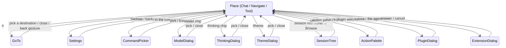
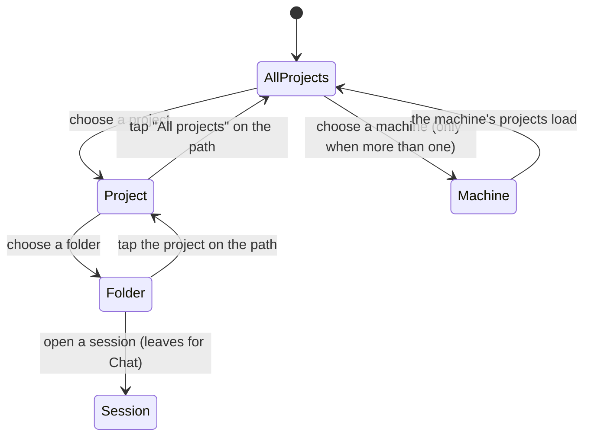

# The navigation state machine

Every surface the reader can be on, every control that moves between them, and
the rule each transition obeys. Written because four navigation surfaces grew
independently and the owner could reach a page with no way back: "jumping around between all the machine
and project pages, I don't know how to get back".

The machine has two layers that must not be confused:

- **Place** — where the reader is: a main view (Chat, Navigate, or a tool) with
  a scope (machine › project › folder › session). Places are addressable: the
  URL restores them.
- **Layer** — what is over the place: one modal at a time (a dialog, a sheet, a
  picker). A layer never changes the place unless the reader picks something in
  it, and closing a layer always returns to the place underneath.

The closure rule this document enforces: **from every state, the reader can
reach every other state without using the browser's back button, and every
layer has a dismissal that returns to the place it opened over.**

## Places

```mermaid
stateDiagram-v2
    [*] --> Boot
    Boot --> Navigate: no session restored
    Boot --> Chat: session restored from the URL

    Navigate --> Chat: open a session
    Navigate --> Navigate: choose machine / project / folder (path narrows)
    Navigate --> Navigate: tap a level on the path (path widens)
    Navigate --> Chat: + New session

    Chat --> Navigate: grid key ⊞ (phone, over the session) / panel (desktop)
    Chat --> Tool: Go to ≡ picks a tool
    Tool --> Chat: Go to ≡ closes the page (phone, medium) / the chat beside it (wide)
    Tool --> GoTo: Back ‹ returns to the Go to list
    Tool --> Tool: Go to ≡ picks another tool
    Tool --> Navigate: grid key ⊞ (wide; where Back covers it, the Go to menu's grid key)
    Navigate --> Tool: open a session, the tool it was on returns
```

Rules that make the place layer closed:

1. Navigate is reachable from every place through one control: the grid key in
   the window's top-left corner on every layout (owner, 2026-10-16), which on
   desktop opens and folds the navigation panel. Go to holds the top-right
   corner: it opens the Go to list, and closes the list or the page it shows.
   Over a page opened from Go to, Back holds the top-left of the place pages
   show in and returns to the list; where pages replace the chat it covers the
   grid key, and the Go to menu carries the grid key instead (owner,
   2026-10-16). Each key stands in whichever bar is at its corner
   (`cornerKeys.ts`); a page holding the whole canvas carries them all.
2. Navigate never dead-ends: narrowing and widening are the same control (the
   path), so the reader can always get back to "All projects".
3. Chat is reachable from Navigate by opening a session, and from a tool by the
   way back; on the wide layout it stays beside the page column. Go to lists the
   pages only (owner, 2026-10-14): the grid key reaches Navigate and the way back
   reaches Chat, so a tool is never the only way back to anything.
4. A place change writes the URL, so a reload lands on the same place.

## Layers

Rules that make the layer stack closed:

1. At most one layer is open. Opening a second closes the first; the shell's
   modal-layer registry owns that and is what the back gesture reads.
2. Every layer has three dismissals: its own close control, the platform back
   gesture, and Escape on a keyboard.
3. A layer that changes the place (Go to, Navigate's session rows, the tree)
   closes itself as part of the change, so the reader is never left with a
   layer over a place it does not belong to.
4. A layer never opens another place behind itself.

## Scope, which is not a place

Machine, project and folder are scope, not navigation: they narrow what a place
shows. The single mistake this whole rework corrects is treating them as pages.
Scope changes only ever happen inside Navigate, and they never leave it.

## Review: where the machine is not yet closed

| Gap | Where | Status |
| --- | --- | --- |
| Two surfaces besides `AppNavigatePage` still answer "where am I": the context sheet and the quick switcher (the navigation panel's accordion is gone) | `PiWebApp.contextSheetOpen`, `quickSwitcherOpen` | They remain beside `AppNavigatePage`; until they are retired the place layer has more than one entry where the machine says one |
| A session opened from a remote machine's pins changes machine and place at once | `navigateModel` pinned rows | Allowed by design, but the machine level must show the move, otherwise the path lies about where the session came from |
| The tool places are addressable but Go to is the only way between them | `AppGoToSheet` | Acceptable: the Go to key holds the window's top-right corner in every layout and closes any page, and Back returns from a page to the list, so no tool is a dead end |
| Boot with an unreachable machine | route restore | Must land on Navigate with the machine level showing the failure, never on an empty Chat |

## What a change to navigation must prove

1. Name the state it adds or removes in this document.
2. Show the transition into it and the transition out of it, both reachable
   with one control from the place the reader was on.
3. Keep at most one layer open, and keep the back gesture bound to it.
4. Check in a real browser that the reader can walk in and back out again,
   and fail the check loudly if either direction disappears.
