# PI WEB state diagram: one owner per state, every bug on the map

Owner, 2026-09-30: "Use a state-transition diagram. When development hits a new state, judge whether it is reasonable and merge it in, so there is always a global view. Every problem should show on the diagram."

This is the map. Code follows it; it does not follow code.

The inventories (file:line for every claim), the reviews of the first draft and the UI/UX methodology research behind this map were working files and are not kept in the repository; the file:line citations in the bug index are as of 2026-09-30.

## Rules

1. **One owner per state.** Each state has exactly one writer and a fixed set of values. Every other place derives from it; nothing keeps a second copy that can disagree. A cache or a local store is a persistence of the owner's state, not a second state.
2. **Words are output; identity is an id.** A label, a message or an error sentence is rendered from a state and never read back to decide one. Identity crosses a boundary as an id, never as matching text. Typed discriminants (`type`, `kind`, `phase`, `status` fields, exact `customType` constants) are fine. Known debt, each tied to an item here:
   - the commit claim by text (`committedPromptIdentity.ts:39-45`), removed by the `prompt.committed` frame (D1);
   - the pre-ask claim's text fallback, removed with PI WEB's own `ask_user` (2026-10-11);
   - the 20 text-decided sites of B16.

   One exception is named and permanent: a scraped terminal screen (the parsed-card fallback). A parse that cannot decide is `unknown` and falls back to the raw frame.
3. **Each transition happens once, and only forward.** Every state has a rank.
   - A fact for a later state applies from any earlier state (skip forward).
   - A fact for an earlier state is ignored, unless it is a named return drawn here.
   - A return keeps the thing's identity and its original times.
4. **Plugins append; they do not own.** A plugin adds information to a fixed core state through a declared contribution point. It never adds a core state and never replaces one. A disabled plugin's appendages disappear, and its open cards are cancelled.
5. **Unknown is a state.** The absence of an answer is `unknown`, never `empty`, `idle` or `current`. A failed read is `unknown` for the source that failed and is read again by itself (B48).
6. **New state, new arrow, here first.** A change that needs a state, a transition or a wire frame not drawn here adds it to this document, with its reason, in the same commit as the code.
7. **PI WEB owns the chrome.** Nothing is injected between the header and the transcript, or between the transcript and the composer. The only exceptions are the status line and the back-to-bottom key (owner, 2026-09-30: "pi web should not support injecting any bar or element here").

## D1. A message

Replaced on 2026-10-13 by [message-states.md](message-states.md), which is what is built: a
message is on its way until the machine answers, sent in order from this device's numbered
operation log, and never fails. Retry, Discard, `notSent`, `unverifiable` and the 10-minute
resend window are gone. The earlier D1 is in git history.

## D2. A docked card (extension dialogs, declared screens, plugin cards)

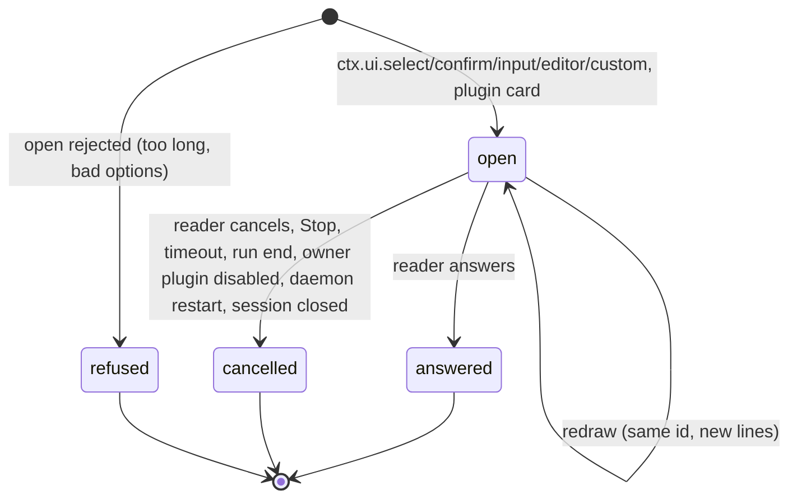

- **Owner.** The daemon's card stores own a card. Cards are session-scoped and FIFO.
- **Cancel causes are typed:** `reader`, `stop`, `timeout`, `run-end`, `owner-disabled`, `daemon-restart`, `session-closed`. The waiter always resolves, so an extension's `await` never hangs.
- **Run end and Stop settle only what the run opened (B54).** A dialog opened by a tool or an event handler of a run is the run's: its end or a Stop settles it, so the agent loop is never parked behind it. A dialog an extension command opens is the command's, even when the command was typed while a run was going: it outlives that run and closes only by the reader, its timeout or signal, or the session going away. The daemon tells them apart by the async context the dialog opens in (`CommandHandlerScope`), not by `isStreaming`; found 2026-10-02, when a command's screen was settled less than a second after it opened because an unrelated run ended. A run the command itself starts owns its own dialogs once the command's handler has returned.
- **Class.** Extension dialogs, declared screens and plugin cards are one class. PI WEB's own `ask_user` card was one too until 2026-10-11, when the tool was deleted (owner: PI WEB gives agents no tools of its own; a question tool is a pi extension's, and its questions arrive as extension dialogs).
  - A plugin opens a card through its server half, into the daemon store, with a declared contribution point (`dockedCards`). An answer routes back through the same store.
  - Disabling the plugin cancels its open cards (`owner-disabled`).
- **Rendering.**
  - Every open card renders, FIFO (no more "N more queued").
  - A card renders once, natively. A screen declared with `web: { kind: "card" }` is the interactive card (interactive-card.md); an undeclared terminal screen is a parsed native option card; the raw frame is the last resort. One question never passes through two cards.
  - A card has exactly one capped inner region, within the waiting slot's 60vh budget. It chains the wheel and touch to the transcript at its end and when it does not overflow; `overscroll-behavior: contain` is for overlays only. The action row never scrolls away. Built 2026-10-03 (B11): the dialog detail region declared `contain`, so a wheel over a long goal draft at its end moved nothing; `cardScrollChains.test.ts` keeps vertical containment out of every component drawn in the transcript (horizontal containment on code blocks stays, so a sideways swipe never goes Back).
  - The card re-renders whenever any rendered field changes, including `lines` and `screen`.
  - **Slice a (2026-10-02, owner screenshots).** The reader met an "Extension screen" with "1 more extension dialog queued" under it, and found the native card (an update prompt) only after Close. Done here:
    - Every open dialog renders, FIFO, each answerable on its own (the daemon keys answers, keys and cancels by `dialogId`). The "N more queued" line is gone.
    - An undeclared screen that parses as a menu is a native choice card: its own first line as the heading, the options as radio choices starting on the component's own cursor, Confirm and Cancel. Confirm walks the component's cursor to the chosen option and presses Enter. No hint line, no key row, no monospace frame. Owner ruling (2026-10-02): an extension chooses how its screen is drawn by declaring it (a declared screen is drawn as its declaration says; since 2026-10-12 that is the interactive card); an undeclared menu defaults to radio choices with Confirm. The first build drew option buttons that selected on tap; the owner chose the radio default from the two prototypes.
    - A screen that does not parse keeps its lines and the key row: the last resort. Its close control reads Cancel, as on every other card.
  - **No arrow keys; a field for text (2026-10-11).** The owner asked for no up, down, left or right keys in PI WEB. The key row (▲ ▼ ⏎ Esc) is gone. A screen that does not parse keeps its lines, and a tap on a line still walks the component's cursor there and selects it. Text goes in through a real field, typed into the component as the reader types (what is added as its characters, what is deleted as Backspace, an input method's composition when it ends; Backspace in an empty field still reaches the component), so a list that searches as you type follows the field; Send presses Enter (2026-10-11, after the owner found pi-prompt-history's picker hard to use). A Chinese answer typed by the owner had reached a screen as "3": a key handler hears no input method, a field does. On a keyboard, keys still reach the screen while it has focus, except the ones an input method is composing.
  - **A declared choice picks how its typed answer is offered (2026-10-11).** `other: "field"` on a choice field of an interactive card draws the typed answer as a box under the options, ready to type into; `other: "choice"` offers a Custom choice that opens the box. On a single-answer question, typing replaces the chosen option and choosing an option empties the box, as Custom already did. Owner: whether the custom input takes a tap first or is a box straight away is the extension's to define. A browser that predates the field ignores it and draws the Custom choice.
  - **Keys arrive as a terminal sends them (2026-10-11).** The browser names a key (`up`, `enter`, a letter) and the daemon hands the component the bytes pi's terminal would (`\x1b[A`, `\r`, the letter); a name with no terminal form is dropped. The component's `keybindings` are pi's own (pi-tui's). Before, the component got the bare names and a catch-all object whose every `matches` answered yes, so a real pi-tui list (pi-prompt-history's picker) read every key as its first binding and Enter as text.
  - **A drawn screen reads as a web card (2026-10-11).** The owner asked whether a screen with only a pi TUI side could look better and more web-native, and then asked for it to be done. A screen the extension draws for pi's terminal, with nothing declared for PI WEB, is still drawn by the extension; the card no longer looks like a terminal:
    - *Roles, not colors.* The component draws with a theme that marks each pi role (`accent`, `dim`, `selectedBg`…) and emphasis (bold, inverse…); pi's own components inside it (`SelectList`, `DynamicBorder`) read the same theme for that one render. The daemon reads the drawing back into runs, `styledLines` (`ScreenLine` = `spans` + `frame`), one for one with the plain `lines`, which stay for older browsers and for the walk below. The card gives each role the app's own color, in the app's font.
    - *No terminal chrome.* Lines of box drawing (`frame`) and the component's key-hint row are left out; the heading is the extension's name (its package's PI WEB title, its package name, its file), not "Extension screen", and the "keys go to the extension · Esc closes" line is gone.
    - *Taps land where they are tapped.* `selectedLine` is the line under the component's cursor, read from how it is drawn: a run on the selected background, else a leading cursor glyph in a role that stands out or inverted, else a drawn cursor. A tap sends `{ line, text }` on `POST /sessions/:id/dialog/key` (with `key` it is still one keypress). The daemon walks the cursor one key at a time, judging each step on the redraw: an item drawn on two lines, a list that scrolls, a list that wraps, and a list's last item all land on the tapped item; a tap on no item selects nothing and walks the cursor back. A daemon without `styledLines` leaves the card on its old line count.
    - *Cancel ends the screen as Esc would.* The card's Cancel first gives the component the Esc pi's terminal sends, so one that ends itself on Esc (`done(null)`, as edlsh's pi-ask-user does) ends as it would in pi; the daemon then closes what is still open, and the call answers `undefined`. Closing from outside first answered `undefined`, which an extension written for pi's RPC mode reads as "no custom UI" and asks again through its dialogs: one question, twice. A component that throws on the Esc is logged and closed anyway.
    - *Drawn at the card's width (2026-10-11).* The owner, on a line that wrapped mid-word, asked for the screen to be drawn at the card's real width. The daemon draws the component at the columns a card measured, as pi's terminal draws at the terminal's width, so the extension cuts its own lines. A card asks with `{ width }` on `POST /sessions/:id/dialog/key` (a body names exactly one of `key`, `line`, `width`, else 400) when it opens, when its own width changes, and after the reader uses it; a redraw alone never asks, so two pages at different widths do not take turns: the screen follows the page last opened, resized or used. `screenWidth` on the dialog says the columns it is drawn at (default 56, bounds 20-160). A page that predates it never asks, so its screen stays at 56 columns; a daemon that predates it refuses the request, and the screen stays at 56 as before.
    - *What it is not.* The extension's widgets are not recognized and redrawn as web controls; the runs dress the extension's own drawing. A menu that parses as one (2026-10-02) is still the radio card with Confirm, and a declared screen is still its plugin's card.
- **Placement.** Open cards are the tail of the transcript (D1 order). In D4 `following` they stay in view. In `reading`, an open card below the fold lights the back-to-bottom key with "Waiting for you", whatever the distance. The reader is still never moved.
- **A notice for the agent waits with the reader's messages.** PI WEB's own notices meant for the agent (subsession completion) never go into pi's follow-up lane, which waits until the agent has no work left (B26, 2026-10-02).
  - *Lane.* A notice is delivered with `deliverAs: "steer"` (`AGENT_NOTICE_DELIVERY`). While a run goes it waits in pi's steering queue and is read at the next injection point, after the tool batch in flight, with the reader's own messages in the same queue. On an idle session it starts a run at once.
  - *Take-back keeps it.* Recall, the idle take-back, Stop and Clear empty pi's lanes to take back the reader's messages. A notice is not the reader's message, so it is put back in pi's steering queue. Only the daemon's own custom types count; another extension's custom message is left to pi.
  - *Stop, close and shutdown write it down.* After a Stop, when the session's runtime closes, and when the daemon shuts down, a notice still queued is written into the transcript without starting a run (`triggerTurn: false`); the agent reads it with its next turn. Only the notices leave the queue: a reader's message steered while the Stop settled stays for the take-back (review of 4a1bdfd7). At close the page gets no live frame for it, because the session's events are already unsubscribed; it is on the transcript the next time the session is read.
  - *Known limit.* A daemon that dies while a notice is queued loses it, because pi's queues live in the runtime.
  - *Withdrawn 2026-10-11, with PI WEB's own `ask_user`:* an answered card as a queued D1 message (`queuedAnswers`, its answers record marked Queued among the pending rows, no take-back). An extension dialog's answer resolves the extension's own waiter and delivers nothing to the model.
- **A refusal is a state the reader sees.** A refused open files a session notification. It is owned by the notification inbox, scoped to the session, and dismissible. It is never only an error inside the extension.
- **A closed card leaves nothing; the tool row tells what became of it (owner, 2026-10-12).** The owner asked why a "Cancelled" card sat at the bottom of the chat under every later message, and, told it was PI WEB's own record, called it gilding the lily. pi's terminal keeps no record of a closed dialog: when a tool asked, the tool's own row says what happened (pi-tui draws the tool's `renderResult`, "Cancelled" for a dismissed question), in place, and it is in the session file. PI WEB kept a browser-only card of every cancelled or timed-out dialog, drawn after all rows in close order, so later messages ran above it, and a reload dropped it. Now a dialog that closes for any reason leaves no card. Closing still settles it: its id joins `settledDialogIds` so a status snapshot built before the close cannot re-open it, its drafts are cleared, and the status map stops listing it. What became of a dialog a tool opened is the tool row's (next point); one a command opened leaves nothing, as in pi.
- **An extension's drawn result shows in its row, as in pi's terminal (owner, 2026-10-12).** A tool card whose extension draws its result (`renderResult`, slice 2 of R25) shows those lines under the call, where pi's terminal shows them, instead of inside the folded Details; Details keeps the tool's raw output. When the drawing is present it is the row's result, so the raw error block is not drawn above it (the drawing carries the error in the extension's words, and the raw text stays in Details, open by default when nothing was drawn). A tool with no drawing keeps the card as it was.
- **A closed card is inert.** A card kept on screen while a gesture settles has no live handlers. A tap on a card answered elsewhere shows "Answered elsewhere". Built 2026-10-03 (B22, `waitingSlotHold`): while a press holds or settles, the cards already drawn keep their places; a card still open is drawn live, a card that closed is drawn inert with no answer, cancel or key handler bound, and a card that opened during the press joins at the end. A closed card is held beside a card still open, and every open form is held, not only the first (found in review). A held card's layout is the live card's. The "Answered elsewhere" words wait on the owner (the no-UI ruling).

## D3. What a session is doing

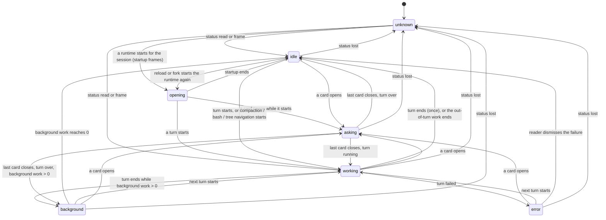

- **Owner.** One pure classifier (`sessionActivityCategory`) over typed fields: the status booleans, the open cards, the background-work count and the activity `phase`. The chat dock, the session list, the quick switcher and the status line all use it; none has its own ladder.
- **Precedence:** `asking` > `error` > `working` > `opening` > `background` > `idle`. A question waiting for the reader outranks the failure before it; the failure stays in the transcript. (The classifier had `error` first, a leftover of the four-state badge that predates this diagram; it follows this order since the B14 review.)
- **Built (B14, 2026-10-02).** Three derivations had grown beside the classifier, and they disagreed:
  - the chat dock's own ladder (`activityState`) read the activity's *label* when no status had arrived, so a session whose last word was "stopped" showed working dots until its status came; it took "background" from a plugin's note being present rather than from the count, and ignored an active phase the classifier counts;
  - the quick switcher drew its badge from the classifier but its WORKING and waiting groups from `isSessionActive` and `isWaitingForUser`, so a session being opened sat outside WORKING with working dots, and a failed session still streaming sat in WORKING with a red badge;
  - the Go to page's rows knew only waiting, working and idle, from the same two sets, so a failed session and one with background work read idle there while the switcher said error and background.

  Now every surface asks `sessionActivityCategory`. The dock's category is the classifier's, and its words are output only: the step narration (D3), else the activity's words, else the status's own work word; asking says "Waiting for your answer" unless there is work a reader could stop. The switcher's groups and the Go to page's sections are ids in a category, computed once from the same map. The Go to page marks all five categories with the switcher's colours, and a session whose state is unknown carries no mark: absence is not negation.
- **A different question.** `isSessionActive` stays, for a different question: is there work a reader could stop or must wait for (Stop, reload gating, a turn's falling edge, and the workspace roll-up, whose working flag is drawn on the workspace tile and means work a reader could stop below here). A session being opened has nothing to stop either, so it does not light its workspace.
- **Opening is not working (owner, 2026-10-12).** The owner tapped a session and its row turned to the working dots while the chat said "Opening session: Loading session extensions": starting a runtime for a session was classified as working. It is its own category, `opening`, from the activity's `startup` flag (the startup window's frames, and the daemon's reload and fork, which start the runtime again). The row and the dock wear the tap's own opening spinner until the startup ends (the owner's choice: keep the spinner the tap showed); it is not in the switcher's WORKING group and ranks with idle in the session order. A refused duplicate send and a recall no longer publish an active activity: they are no work, and the status already says what the queue holds.
- **Domain** (B14 review). The map covers every session a surface lists: the board's rows, pinned sessions whose project is closed, and the stepped-into project's own sessions. While another machine is browsed, neither the switcher nor the Go to page gets this machine's states: the rows wear no mark.
- **Boot read** (B14). The status catalog a page reads at boot carries each session's latest activity, and the page takes it for a session it knows none for or holds an earlier one for (the daemon stamps both), as a live status does, so a reconnect learns a failure the page missed while its socket was down (found in review); the selected session learns from its own status read, which also sets the dock. Before, a page loaded after a session failed never learned it: the Go to page and the switcher said "Session is done" for it, while a page open at the time said "Session hit an error".
- **Background work** is a count on the status, contributed by plugins (a `backgroundWork` contribution per plugin, summed by the daemon). The *category* is core. The *words* beside it ("2 background runs") are the contributing plugin's appendage. A disabled plugin contributes neither count nor words.
  - **Built (B20 slice 1, 2026-10-09):** the count is subsessions + background shell tasks + the sum of every active plugin's `backgroundWork(session)` answer (`{ running }`, a non-negative integer, bounded by the lifecycle timeout). Subagent runs are counted by the Subagents plugin (now the separate pi-web-subagents package), no longer by core. A plugin that fails or answers late fails the whole pass, and the session keeps its last count rather than dropping that plugin's share to zero (absence is not negation). A plugin turned on or off makes the daemon recount every open session at once (`recountBackgroundRuns` after a reconcile), since no file changes when a share starts or stops counting; measured on a dev stack: Subagents off, a seeded run 1 → 0 in about 0.5 s; on again, 0 → 1 in about 0.5 s (before the recount it stayed 0 for 15 s). Since B20b core counts only its own working subsessions; shell tasks are the Background runs plugin's share (now the separate pi-web-background-runs package). The words are not plugin-contributed yet. Slice 2 deleted core's own run reader (`subagentRuns.ts`), the `/subagent-runs/:runId/{messages,output}` routes and `SessionSubagentRunInfo`; `GET /sessions/:id/subsessions` answers `{ subsessions }` only, and the runs are the Subagents plugin's `runs.list`.
- **Sub-flags** (`compacting`, `bash`) qualify `working`. They are not categories.
- **One `idle` per turn,** published at turn end only. `message_end` inside a turn is not idle.
- **A cut turn settles visibly (B30); every producer.** The reader's Stop is owned by the daemon's `pi-web.turn.stopped` entry. That entry settles as exactly one row, "You stopped this turn", at one of two places:
  1. **On the reply it cut:** a reply pi ended as aborted (or errored with an abort) after the entry. That reply carries the mark (`stoppedBy: "you"`), and its streamed part stays above the row.
  2. **On its own,** when no cut reply follows it before the next user message or the end of the branch. The case: Stop during pi's retry backoff. pi only emits `auto_retry_end {success: false, finalError: "Retry cancelled"}`. History renders the lone entry as the settled row, after the failed attempt and its "Retry cancelled" row, which D11 shows because no retry replaced the attempt. Live, the daemon publishes the same row when the stopped work ends with the mark unconsumed: at `agent_end`, or at `auto_retry_end`, because pi schedules a retry after the failed run's `agent_end`.

  **The settlement is recorded, not re-derived (owed review A F2-1 and C 4, 2026-10-09).** History used to find where a Stop settled by walking the branch again, and the walk disagreed with what the reader had seen live:
  - **A Stop settled on its own stays on its own.** With no user message after it (a goal continuation, an extension's turn), the walk attached a Stop that had settled alone live to a later turn's cut reply, which then read "You stopped this turn" while the lone row vanished. When the daemon settles a Stop on its own it now appends `pi-web.turn.stop-settled` (`{outcome: "alone", at}`), and the walk ends the Stop there. A file written before this keeps the old walk.
  - **A Stop during the compaction after a finished reply settles when the compaction ends** (`compaction_end`), on its own. It never settled live before (pi's `agent_end` had already passed), so the row appeared only with the next message, while a reload drew it right after the finished reply. Live and a reload now agree. Whether that row should read "You stopped this turn" or name the compaction is the owner's call (question 18).

  Producers enumerated (found in review):
  - an `aborted` reply with no row (fixed);
  - a Stop during a direct handoff, which aborts the run the handoff starts but did not record the Stop. The daemon now records it once the handoff's message commits;
  - Stop during retry backoff (case 2 above).

  Everything else that ends a turn without the reader's Stop reads "Interrupted before it finished". This covers `/compact` mid-turn, closing or archiving a session, and a parent-aborted child. It is true in each case. Old history written before the mark reads "Interrupted" by the owner's ruling.
- **Context usage** carries the model and window it was measured against. After a model change it is `unknown` until measured again. It is never capped to hide a wrong number (B24).

### The status line narrates; it never parrots an event word

Owner, 2026-09-30 12:06, after "message queued · 10m 51s" stood while the agent worked and two queued messages waited with no reason given: "Why does this incomprehensible state exist? What the user sees should be a state they understand: what pi web or pi is working on."

The status line answers three questions, every time, from live typed facts:

1. **What is being done right now:** the current **step**, with its object.
   - `thinking`
   - `writing the reply`
   - `preparing a tool call` (tool name and target, once the stream names them)
   - `running a tool` (name, target, elapsed)
   - `compacting`
   - `retrying` (attempt n of m, and why)
   - `waiting for you` (the open card)
   - `idle`
   - plugin appendages beside them
2. **For how long:** the step's elapsed time, and the turn's.
3. **What happens next** to anything the reader waits on. For example, "2 messages will be read when this step finishes" or "waiting for your answer".

The step is a state owned by the daemon, derived from pi's event pairs: `message_update` thinking, text and tool-call deltas; `tool_execution_start`/`end`; retry, compaction and card events. A step ends when its pair closes. It is never kept alive by a heartbeat, and an event word is never shown after its step ended.

**Built (B25 and B15, 2026-10-02).** The step is one typed field, `SessionActivity.step`, with `stepSince`, from one pure reducer (`nextSessionStep`, `sessionStep.ts`). The label and detail are derived from it for older readers and are output only.

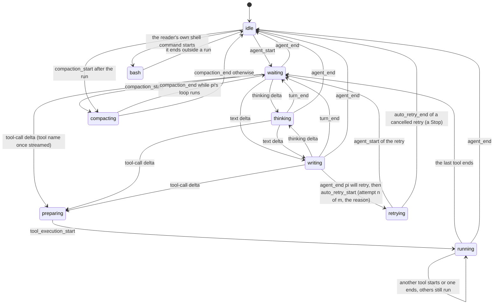

- **States.** `idle`; `waiting` (a request is on its way to the model and nothing has streamed yet); `thinking`; `writing`; `preparing` (a tool call is streaming, with the tool once named); `running` (the tools executing now, each with its name and target, in parallel); `retrying` (attempt, maximum, reason, and when it resumes); `compacting`; `bash` (the reader's own shell command).
- **One idle per turn (B15).** Only `agent_end` (and the end of compaction or of the reader's shell command outside a run) reaches `idle`. `message_end`, `turn_end` and a tool's end no longer publish an idle phase mid-run, and a failed tool is part of the run, not an `error` phase: the turn's own failure is.
- **Other events leave the step alone.** The fallback that re-published "working" for every unrecognised event is gone.
- **Review of ad83d24b.** pi emits `agent_end` before it schedules a retry, with `willRetry`; that `agent_end` keeps the step, so a retried run never shows idle in between, and `auto_retry_end` ends only a `retrying` step (its success arrives mid-reply and changes nothing). "While a run goes" means pi's agent loop is running: a compaction pi starts after the loop ended ends idle. pi emits nothing for the reader's `!` command, so the daemon feeds the reducer that command's start and end itself. The heartbeat's net resets any non-idle step once nothing runs, whatever word was published last. A step on a session that is not working is never narrated.
- **What the step is not.** The phase can still read idle mid-run when the reader changes the model or the thinking level: that is the word of that action, and the step beside it is unchanged. "Waiting for you" is the open card's own state; the card says it, and the dock stays out of its way. The step's time is measured against the daemon's clock, as the turn's is.
- **The dock says the step, its time, and what comes next.** "Thinking · 4 s", "Running bash: sleep 25 · 12 s", "Retrying, attempt 2 of 3: overloaded". When something waits for the agent, the dock says when it is read, from the step: during `thinking`, `writing` and `preparing`, "read when this reply ends"; during `running`, "read when these tools finish"; otherwise "read next". Answers count with messages ("your answer is read when these tools finish"). The words live in one table per step kind.

## D4. The transcript viewport

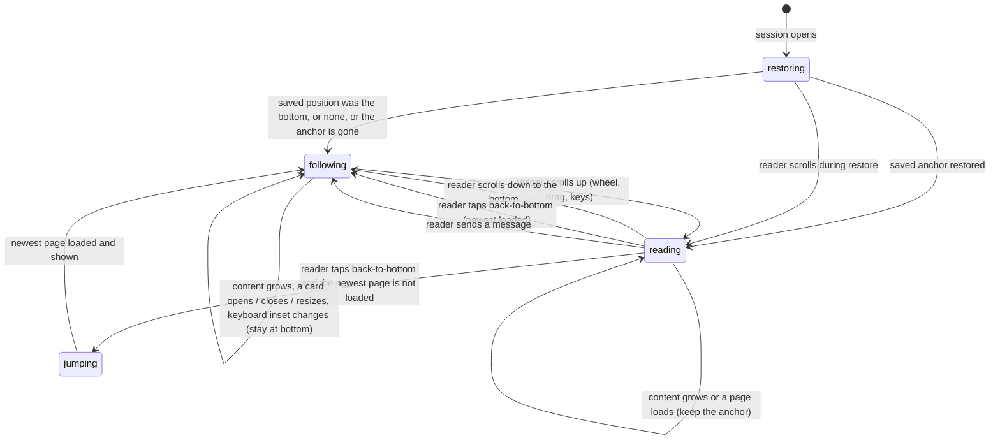

- **Owner.** One state (`restoring` / `following` / `reading` / `jumping`) replaces `pinnedToBottom` + `viewportState`.
- **Only reader intent moves it.** Intent means a wheel, a drag that moves, keys, the back-to-bottom key, or sending a message. A touch that does not move is not intent. A render-time measurement, a programmatic scroll (always tagged as ours), content growth, an image load or a page arrival never moves it.
- **The bottom** is the newest end with the newest page loaded. The bottom of an older window is not the bottom. A reader's downward scroll that lands within 48 px of the bottom counts as reaching it. An upward scroll that ends at the bottom is not the reader leaving it: a view that grew (the dock or the composer got shorter) lowers `scrollTop` to keep the bottom, and that scroll read as upward, so a docked card's session dropped out of `following` with nobody touching it (B12, built 2026-10-03).
- **In `following`,** one writer keeps the bottom through any size change, using a `ResizeObserver` over the content, as `use-stick-to-bottom` does. Only the reader's input ends it (2026-10-30): a press (a touch, a scrollbar or selection drag), a scroll key, an upward wheel or a drag. A burst of rows (follow-ups answered together) ended it with nobody touching anything, and left the reader about a screen above the newest rows with the rest piling up below (6 of 9 runs at 4x CPU on 2.202610.24): a second batch measured before the follow's own scroll had landed, or after a row swapped within a frame had clamped the transcript up before its scroll event ran (`followsAfterRowsChange`), the leftover "up" of a browser clamp re-read by the evaluation after a render (`readerScrollDirection`), and such a swap read as a 41 px upward scroll (`followsAfterScroll`, `byReader`). A following reader moved with no input keeps the follow, and the view scrolls back to the bottom. A move whose input the page does not see, such as find in page, no longer ends a follow.
- **In `reading`,** nothing moves the reader: no snap on a newer page. Anchor compensation never writes during a gesture in progress, except the prepend settle, which writes only what layout moved and never the reader's own scroll (see the 2026-10-27 bullet below), and the hold for rows that left the window above the reader (see the 2026-10-29 bullet below). Built 2026-10-03 (B13, `viewportDecision.AFTER_PAGE`): only the jump to the newest moves the reader after a page; a page they scrolled into, older or newer, keeps them reading (measured before the fix: the seed session's newer page took a reader at the end of an older window 1,658 px down to the bottom). The follow flag ChatView keeps beside the decision obeys the same rule (`followsAfterScroll`): reaching the end of an older window does not pin the reader, so the page landing under them cannot carry them down (review: a reader who waited at that end was still carried to the bottom). A newer page that lands after the reader pressed the jump lands them at the newest. Scrolling down to the bottom of the newest returns `reading` to `following`.
- **A restore settles.** A restored spot leaves `restoring` for `reading`, and a restore that landed at the bottom of the newest for `following` (`restoreSettled`; the state follows the follow flag, which an older window's end never sets, for a restored and a skipped spot alike). A viewport left in `restoring` asks for no page, so a session reopened where the reader left it loaded nothing however far they scrolled (found in review).
  - **A restore reads older pages through the decision** and stays `restoring` across them; a spot page that waits out a failed read's hold or is on its way is unknown, not gone, so the restore waits and goes on when the hold ends. Only an older end that is not there lands at the newest. Before, every page after the first went around the decision, so its failure was never held, and one failed read threw the remembered place away within a frame (found in review).
  - **The reader takes over.** A wheel or a touch drag during a restore, or while a jump's page is on its way, ends the restore and makes the page on its way the reader's (`readerTookOver`): it lands without moving them (`restoring --> reading: reader scrolls during restore`). Keys are not yet told apart from the restore's own scrolls, so they do not take over; a wheel spent inside a nested card scroller does take over, though the transcript did not move (both still open). A spot found while its page is still on its way ends the restore, and the page lands as the reader's.
  - **The remembered spot belongs to the restore.** Whatever ends the restore (a jump, the reader's scroll, the spot found or given up) forgets it, and a missing spot is re-armed only while the decision is restoring; a jump during a restore left the spot armed, and a later page moved the reader to it (found in review).
- **A page read ends, success or failure, and a failure is paced.** A read that fails clears its in-flight mark like one that lands: a newer read that failed stayed "in flight", and since any read in flight holds both ends, neither end loaded again until the transcript changed some other way (leg A). A failure holds both ends on the read ladder (`pageRetry`: 1 s, doubling to the 15 s quiet window, reset by a page that lands), and when the hold ends the viewport asks again from where the reader is. The hold is a state its own timer releases, not a time compared with the wall clock, which can step back. Only the jump asks through the hold; a scroll waits it out (1 s after a first failure, longer only while failures go on), because the update that follows a failure cannot tell the reader's scroll from its own re-evaluation: that re-evaluation asked again at once, so a failing older read repeated about 47 times a second against the daemon while the reader rested at the top (leg B). A jump whose read failed leaves the reader `reading` and unpinned (only a jump's failure unpins), and the hold owes its newest page: the hold's end asks for the newest again wherever the reader is, unless the reader moved during the hold: a wheel or a touch drag drops the debt as a gesture, and a key by the movement it makes. Every write of ours that holds the reader's place resyncs the last position, so it does not read as the reader's (review: an image or anchor compensation did); only the browser's own clamp, when the dock or the keyboard resizes the view, still drops the debt, which errs toward not moving the reader (review: it left them `following` a window that loads nothing newer; review: re-applying the scroll rules asked nothing for a reader far from the end). A page read's arrival is its own end, the host's loading mark going off with new messages; any messages change while a page was awaited counted as that page's arrival (found in review). A session switch settles nothing, since the read belonged to the session left, and the window reaching its newest end counts as an arrival only when no read is out and none ended in the same update, so one update is one arrival (found in review; r158 review).
- **A page the reader asked for never replaces their window, and each boundary waits only on its own page (2026-10-29).** Three arrivals moved the reader with nothing asked of them. An earlier page whose window had moved under it (a refresh had replaced it) merged disjointly, and the store answered a hole with the newcomer alone, so the transcript collapsed to one page away from where the reader was reading; a merge now says what it is for (`HistoryMergeIntent`), and a `neighbour` page that no longer touches the window leaves it standing while a `newest` read still takes over (`chatHistoryCache`). The two ends also read each other's reads: the earlier caption said "Loading earlier messages…" for any window with rows above it, and the newer one said "Loading N newer messages…" for every parked count, so a window that was loading neither end read as loading both (the report's screenshot: "Loading earlier messages…" over "1–400 of 460" and "Loading 60 newer messages…" under it). One read at a time is now a named state, `pageReadEnd`, not a boolean the end has to be inferred from, so a newer read in flight no longer makes the top claim an earlier page, and a boundary with nothing on its way says the count or that the rows load on scroll. A forward read is the earlier one's mirror (follow-up the same day): scrolling down reads the page that ends one page past the window's end (`before: end + page`, which the daemon opens on its turn's user message at most 100 rows earlier, so it overlaps the window) and extends the span, letting go of the oldest rows it trims, instead of replacing the window with the live tail; only the jump to the newest asks for the tail. Before that, every forward prefetch was a re-window, so a reader who turned around inside history paid a full one each way: on the reported session one wheel up from `566..792` chained three earlier reads and left them at `0..400` of 794, and one wheel down took the tail page, trimmed the top and was read as the end of the transcript arriving; the two ends then kept trading places.
  - **Reopening takes the newest page, the count below is messages, and a shrinking total is not noted (review of the forward read, 2026-10-29).** Kept for every read that was not the reader's, the window also survived the read that opens a session: a reader who left at the end of an older span reopened `following` under "300 newer messages below", where scrolling down asks for nothing, and eight wheels loaded nothing. The opening read takes the newest page again, as 2.202610.22 did; only resyncs of an open session keep the window (`resyncLanding`), and, since 2026-10-30, an opening read for a reader who left at a spot (next bullet). Selecting the open session again, as a retry after a failed status read does, is a resync. Until 2026-10-30, a reader who left mid-history in a window that does not reach the tail came back to the newest messages rather than their spot, because the restore landed on the cached window before the opening read replaced it (next bullet). The count below counted every live frame, deltas included, on top of a total that already held them after a resync, so one streamed reply read as several hundred newer messages; it now counts the frames that commit a message (`message.end`, what the daemon's total counts), a resync that notes the total starts it again, and a page read that brings a larger total takes the messages that total already holds out of it (`pendingAfter`). A merge keeps the larger of two totals, so a total that went down without going below the window's end left newer messages that did not exist and the forward end reading the same page again and again; a tail read or a forward page that shows the window already reaches the daemon's tail writes the daemon's total onto it (`notedTotalView`). A total that fell below the window's end (retry attempts hidden, another client moving the branch) means rows the window holds are gone: noted, that span was one the cache refuses and nothing read forward again; merged, the window's higher total won and the forward end read the same clamped page without moving. A resync then replaces the window with the newest page (`replaceWithTail`), and a page read that sees such a total is not merged but asks for that resync (`shrankUnder`); a noted total also lets the longer persisted span go of rows past it. A tail that lands shows the notices held while it was trimmed. A second read of a page whose window moved, and the merge, happen only while the reader still has that session open on the machine it was read from.
  - **A reader comes back to their spot (owner, 2026-10-30).** The read that opens a session lands by where its reader left it, as the page saved it then (`openingRead`). Left at the newest messages, or with nothing saved, it takes the newest page, as above. Left at a spot in a window that ends before the newest message, it keeps that window and notes the total, as a resync does for a reader in history (`resyncLanding`), so the restore finds the spot in the window the reader left, by switching sessions or by reloading, and the messages since are counted below. Left at a spot in a window that reached the newest message, it merges the tail as before: that window lacks the rows that arrived live while the reader watched, which only the view holds, so keeping it lost a spot among them, and the restore paged back to the session's first message looking for it (review of r167). The restore stays owed until the opening read has landed, even when it found the spot at once, and restores it again then: the read can take the window the spot was found in (the span cap trimming a longer cached window, or the newest page over a window it does not touch), and the restore then finds the spot again or pages back to it. An archived session's opening page lands the same way (`landArchivedPage`); merged as the newest, it replaced the window too. A spot outside the cached window is fetched page by page as before, and with no cached window the newest page lands and the restore pages back to the spot. A reader near the bottom of a window that ends before the newest message was saved at the bottom, so they reopened at the newest messages; the bottom is now saved only where the window reaches the newest message, and anywhere else the row they are reading is (`savePosition`). Following means reading the newest messages, so a follow whose window does not reach them asks for the newest page at its next evaluation (`followsShortOfTheNewest`): `following` ignores every other scroll, and the reader left following such a window scrolled down with nothing loading, the symptom of a newest page landing short (review 754821b2), of an older span's end reopened at the bottom (PR #69 review) and of a remembered spot gone from the session, which the restore looks for up to the first message and then leaves at the bottom of that window. Not changed: a reader who left at the newest messages and scrolls up while a slow opening read is on its way can still be moved to the newest page when it lands; and after a reload a window in history that an opening keeps is the persisted one, which the 400-row span cap trims only when the next page lands (the opening read used to trim it). The follow waits while the session is still opening (`opening`: its first reads are out, or its transcript read failed and the selection is read again a second later): the transcript read lands the newest page itself, with the reply being written and the sends still waiting, and a second newest read racing it, for a session left at the bottom over an older cached window (a bottom saved by an earlier build, or no saved place), replaced that with a bare page. Saved places are pruned only by a loaded listing of the folder they were saved for (`pruneSavedPlaces`, the place's `cwd`): pruned against whichever folder was listed, every other session on the machine lost its place, so a reader who came back from another project landed at the newest messages, as after every reload for sessions outside the folder shown first.
- **Earlier messages load three screens ahead, one page ahead.** An upward scroll within three screens of the top asks for the earlier page, and an earlier page that lands while the reader is still within that distance asks for the next one at once, without waiting for another scroll; a reader who moved away, or a session with nothing earlier, asks for nothing (`viewportDecision.staysOnePageAhead`, r158). At a screen and a half, scrolling up a long session on a weak link (1.6 Mbps, 150 ms) still left the reader waiting at the top about 1.3 s on each ordinary page. The newer end keeps its screen and a half.
- **A render never gives a reader on their way up the newest page, and a prepend's settle follows the reader (2026-10-27).** In an older window the jump to the newest replaces the window with the newest page, so it moves the reader (until 2026-10-29 every newer read did, a scroll forward included). It answered nearness, any evaluation within a screen and a half of the window's end: an earlier page whose trim cut the end to just below a reader scrolling up was followed by a render that read that as nearness and threw them to the newest messages. A render now inherits the reader's last movement (`viewportDecision.headingUp`), so it asks for the newest page only for a reader who last moved down or not at all. The settle that holds the rows in place for 30 frames after an earlier page (the new rows' text renders after its first write) wrote its anchor back every frame, undoing the reader's wheel or swipe, kept the reader's scrolls from asking for pages meanwhile, and, once the window was replaced under it, put the reader at the top of the newest page, where no further scroll could ask for anything; a desktop reader stayed at "Loading earlier messages" for good. Now the settle carries the reader's scroll since its last write into its anchor (its own and `holdThePlace`'s moves are not the reader's) and writes only what layout moved (`chatScrollAnchoring.anchorAfterReaderScroll`); after a frame the reader moved in it re-anchors on the row now at the top, so an image loading between the reader and the old row cannot move them; a wheel, a touch move, a push past an end, or the transcript moving right after a scroll key releases its holds on page requests and saving; and it ends once the window it was captured for is replaced. A resync no longer takes a reader's place (2026-10-29): `SessionController.refreshSelectedSession`, on a gap repair, a dialog resync or a manual refresh, says what the tail is, not where the reader should be, so a window that ends below the total keeps its rows and takes only the daemon's new total (`ChatTranscriptStore.noteTotal`), while a reader at the tail still takes the newest page. Still open: a scroll key pressed against an end does not push past it. Ending it at the reader's first wheel instead was measured on a text-heavy session: the new page's text pushed the rows under the reader about 15,000 px. A wheel or swipe pressed against an end with a page past it asks for that page as the scroll it would have been (`viewportDecision.pushPastEnd`): such a push moves nothing, so no scroll event asked, and a reader left at the very end of an older window by a trim, or restored to the top of one, read "Loading" with nothing asked.
- **An earlier page is at most two pages long, and rows leaving the window above the reader are held even under a finger (2026-10-29).** The daemon started a page at the user message that opens its turn, however far back that was (`messagePaging.expandStartToSafeBoundary`). Inside an agent turn of a few hundred tool calls an earlier page reaching into the turn was the rest of the turn: one of 460 rows pushed the reader's own rows off the 400-row span, the settle found no marker and fell back to the bottom distance, and the reader was thrown (754 -> 294 and 294 -> 26 on a real session, on 2.202610.21). A page read with `before` now reaches back at most one more page for its turn's start; past that it starts at the nearest message within that reach that is not a tool result (`messagePaging.startWithinReach`). It opens on a tool result only when a longer run of results straddles its start, and a result whose call sits before an interleaved row (a stopped tool, a refused dialog, an extension's own entry) can still arrive without its call. The newest page, read without `before`, still reaches the whole way: the newer read asks for it, and a smaller one would leave a gap under a window ending inside the final turn, which replaces the window. Separately, a window whose top is trimmed (a page that landed at the far end) moved the rows under a dragging finger by the trimmed height, because the reading hold stood aside for a gesture: 6,035 px measured at 393x850 when the newest page touched the window. A trim is the window's doing, not the reader's, so it is held through the gesture, as a prepend is (`readingAnchor.shouldHoldReadingPosition`, `rowsLeftAbove`).
  - **An open group's members carry their own scroll markers.** With pages bounded, a window can start inside an older turn of a few hundred tool steps, and a group the reader opens there takes the next earlier page's rows at its top, above the reader. The group's one marker sits above its `<details>`, so the settle anchored on it saw nothing move: the reader dropped by the joined rows (4,725 px measured on a 280-row tool turn). Each member of an open group now renders a marker, so the settle anchors on the row just above the reader. The same held before for a final turn longer than 400 rows, whose window starts inside the open live group.
  - **Still open:** the span is capped in rows while the reader's distance is in screens, so a page still trims the reader's rows when more than 400 rows minus the page's own sit above them, which a window of mostly folded tool groups can reach. An image that loads above a dragging reader is not held; a trim into the group being read while no message row is in view disconnects the anchor; and rows above the reader that change while the window's start stays (a retried attempt hidden by a resync) get no hold.
- **The back-to-newest key asks for the newest page wherever the reader is.** Its read went through the forward end's prefetch distance (1.5 screens), so pressed mid-window in an older window it asked nothing and moved nothing, and the viewport waited on a page nobody had asked for (seen 2026-10-03 on a dev stack: 0 reads, `fromBottom` unchanged at 56,856 px). A newest page that lands short of the newest asks again (the walk is the decision's, not a flag's), and the last one lands the reader at the newest. A jump pressed while an older page is on its way goes on to the newest when that page lands (review: it was lost).
- **No inline region traps the wheel or a swipe** (see D2).

- **A row is keyed by what it is, not where it sits (designed 2026-10-09; B2 review items 6-7).** Today a row's scroll anchor, render key, copy highlight and info-panel key are its position: `m:<index>` for a message, `g:<startIndex>` for an event group. A plain append keeps them. But a message that leaves the pending block for its committed place, a retried attempt hidden mid-list, or a withdrawn row shifts every later position by one, so every later row changes key: Lit rebuilds those rows, the saved anchor names a different row, and the reading anchor holds the wrong row in place.

  The key is the row's identity, the same live and after a reload, from the first of:
  1. `u:<clientMessageId>`: a user message sent with an id. The daemon stamps the id on the entry at `message_start`, so the optimistic bubble, the echo and the committed copy share it.
  2. `t:<toolCallId>`: a tool row.
  3. `r:<responseId>`: an assistant reply that carries the provider's response id.
  4. `e:<entryId>`: any other row read from history. The daemon already sends each history message's entry id (`withEntryId`); the page keeps it on the line instead of dropping it.
  5. `p:<index>`: only a live row with none of these yet, such as a streaming reply before its response id arrives or a live custom message. A provider that sends the id only at the end changes the row's key once, at `message_end`.

  - **Collisions.** Two rows share an identity only when they come from one message (the lines a reply is split into carry its `responseId` and entry id). The second and later get `#<n>`, counted in transcript order, so keys stay unique. A page never splits a message, so a page of older history loaded above does not renumber them; a provider that reused one response id across replies would (a test model used on the dev stack does).
  - **A queued message with no id of its own** (sent by a client that mints none) keeps the register's synthesized id `queued:<kind>:<position>`, so its key moves when the queue ahead of it drains, as it did before.
  - **A group** is keyed by its first member's key, prefixed `g:`: events join a group at its end. The scroll marker before it is named by its last member, also `g:`, because a prepended page joins older events at its start. An event inside a group is `ev:` plus its line's key, since the same line can also draw a readable row, which owns the plain key.
  - **An extension's custom rows (2026-10-09, pi-insertion-points.md slice 1).** A custom message is drawn by a plugin's renderer for its type, else by the extension's own pi renderer as lines the daemon draws (`drawn`), else as its type and content (pi's default). A custom entry is a row (`source: "entry"`) only when an extension registered an entry renderer for its type: live on `entry_appended`, published as a `message.end` carrying its entry id, so its key is `e:<entryId>` live and after a reload; and from history. A session read without its runtime has no renderers, so its custom messages fall back to the default and its custom entries are not rows; the head the heartbeat compares is computed with the same renderers as the page.
  - **An extension tool's drawing (2026-10-09, slice 2).** A tool call carries `drawnCall` and its result `drawnResult` when the session's runtime is open and an extension draws that tool (`registerToolRenderer`, or the tool's own `renderCall`/`renderResult`): on the history page (the assistant message's tool-call part and the tool result message) and on the live `tool.start`, `tool.update` (partial) and `tool.end` frames. The card shows them as its input and result; neither changes the row's key or status.
  - **How long a shell command ran (2026-10-10, owner Q26, pi 1.1.0).** pi records `durationMs` on a tool's final result: the session file's tool result message and `tool_execution_end`. The daemon passes it on the live `tool.end` frame (`durationMs`), and history pages carry it on the tool result message as stored. A `bash` or `powershell` card whose result has one ends with `Took <d>` in pi's own format (`3.2s`, `4m 5s`, `1h 2m 5s`), live and after a reload. A result without one (run before 1.1.0, a call that never finished) shows none, and a result an extension draws itself shows what the extension draws. pi's live `Elapsed` while the command runs is not drawn. The render context the daemon hands extension tool renderers carries pi 1.1.0's two new fields: `durationMs` (the final result's, else undefined) and `outputPad` (the session's setting, else pi's default 1).
  - **How an extension's markdown transformer draws a text (2026-10-09, slice 3).** A finished user message, assistant text or thinking carries `displayText` (on the message when its content is a string, else on the part) when the session's transformers change it, on the history page and on the live `message.end`. The page draws it; the text itself, which copy, quote, the row's identity and every other reader use, is unchanged.
  - **Esc to extensions (2026-10-10, slice 8).** The standing extension UI carries `terminalInput: true` while the session's extensions listen (pi's `onTerminalInput`). Esc pressed in the chat view that no surface used goes to `POST /sessions/:id/terminal-input { key: "escape" }` (federated for a remote machine), answered `{ consumed }`; a failed request is an error notice. No other key is passed.
  - **A supervisor card stands where its reply stands (2026-10-10).** The Subagents plugin (pi-web-subagents) draws a request that expects a reply in one of four states, from the transcript as loaded: `delivered` (a later `subagent_supervisor_reply` entry with its request id, pi-subagents' record of a reply reaching the child), else `asked` (a later reader message written the way the card writes a reply, or one sent from this card in this page), else `open` (the reply form); a request that expects none is `not-expected`. Plugins read later custom rows through `followingRows` on the message renderer view model.
  - **Tools expanded (2026-10-10, slice 7).** The standing extension UI carries `toolsExpanded: true` while the session's extensions hold pi's `setToolsExpanded(true)`; the chat view opens every tool card's output while it is present and folds them back when it goes. Drawings made while it holds get `expanded: true`; rows already read keep theirs until read again.
  - **An extension's autocomplete providers (2026-10-10, slice 6).** The standing extension UI carries `completion: { triggerCharacters }` while the session's extensions stack a provider. `POST /sessions/:id/extension-completions { text, cursor }` (federated for a remote machine, as is its apply route) answers `{ prefix, items }` (no items: none, failed, late after 2 s, or no running runtime; asking never starts one) and `POST /sessions/:id/extension-completions/apply { text, cursor, prefix, item }` answers `{ text, cursor }`. The composer shows the providers' items when there are any, else its own; a pick applies only to the text it was suggested for.
  - **An extension's header and footer (2026-10-09, slice 5).** `ExtensionWidgetPlacement` gains `header` and `footer`: the status's standing widgets carry the session's one header first and its one footer last, each under the extension that set it last. A page that predates them reads an unknown placement as `aboveEditor` and still shows the lines on the extension's page.
  - **An extension's shortcuts (2026-10-09, slice 4).** The session status carries `extensionShortcuts` (pi's resolution, read once per extension runner) when its runtime is open; the page offers them as actions of that session only, and `POST /sessions/:id/extension-shortcuts/run { key }` (federated for a remote machine) starts a handler without waiting for it (it may open a dialog), answering `{ started: true }` or 404 `unknown-shortcut`. A handler failure arrives as an error notice on the session socket.
  - **Per-row state follows the key**: the copy highlight, the open metadata, and a group's disclosure (the live group by its first member, a finished group by its last). The code is `rowIdentity.ts`.
  - **Saving a position** prefers a visible row whose key is not `p:`, because a `p:` key does not survive a reload.
  - **Migration.** A saved `m:<index>` or `g:<index>` anchor no longer matches anything. The restore finds the anchor gone and lands at the bottom once (`restoring --> following`), as for any missing anchor. A group opened under its old position key shows closed once.

## D5. Page sync and the socket

What the page holds of the selected session's transcript is one value with one owner, `transcriptSync` in `SessionController` (sync-convergence.md, phase B). It is not drawn; the reader sees the session's line and, when a request went unanswered for the ack timeout, the top progress bar, whose hidden status says "Trying to sync with *m*…" (`message-states.md`, "Staying in step").

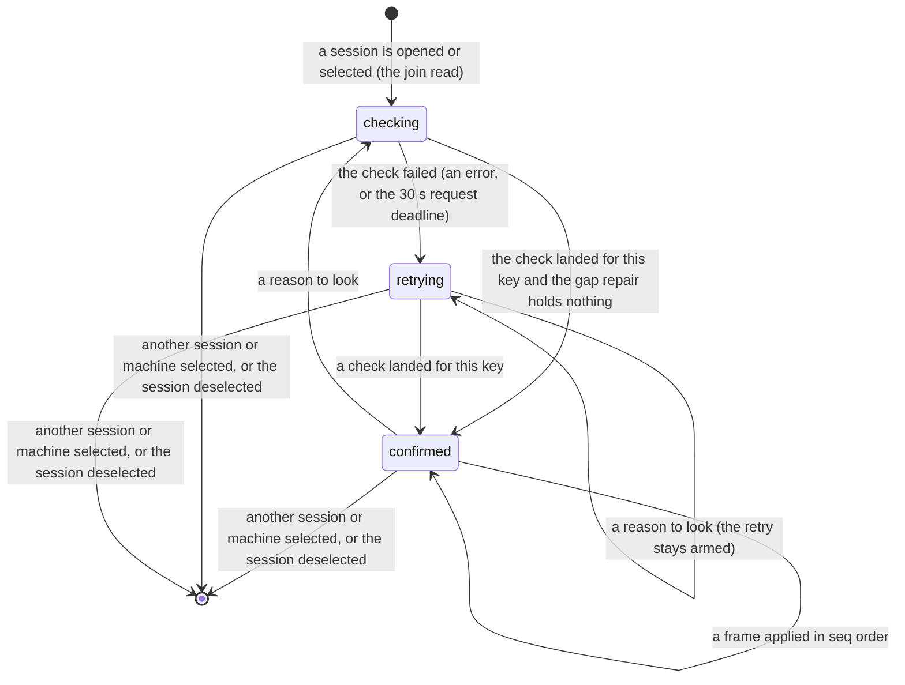

- **A reason to look** (each starts the catch-up from the frontier, or the full read when there is no frontier yet): the page becomes visible or is restored from the back-forward cache; the browser reports `online`; the socket loses an open connection or reopens; the selected session goes idle; the seq monitor, the gap repair or a heartbeat head shows a gap; a revisioned frame fails validation; and **nothing at all arrives on the session socket for the quiet window *T*** (below).
- **The quiet window *T*** (owner, 2026-09-30: "pull only when nothing at all has arrived for 15 s"; B7). *T* is a setting of this browser, default 15 s, on the Settings page. The page names *T* when it opens the session socket (`quiet=<seconds>`), and the daemon sends a quiet socket a heartbeat every 0.6 *T* (3–20 s), carrying the stream head. So a healthy idle socket is never silent for *T*, and a heartbeat whose head is ahead is already a gap. Silence for *T* means the socket or its link has stopped delivering: the page asks for the frames after its frontier, and asks again after every further *T* of silence. The ask is one small request that answers nothing when the page is in step. A link that does not answer it is the top row's to say, so a page whose network went away says so within *T* plus the ack timeout instead of looking live (viewport P1: 60 s offline looked live).
  - *T* is read when the socket opens; a change applies to the next connection, so the page and the daemon always agree on it.
  - *T* runs from 5 s to 30 s. The page looks every 5 s and drops a socket silent for 42 s, so a look must land between *T* and the drop; past about 37 s the drop would come first and its reconnect would ask before *T* did (found in review).
  - A daemon that predates the heartbeat ignores `quiet=` and keeps 20 s keepalives; with *T* below that, the page asks once per keepalive gap while idle. One request; phase D (skew) names the older build.
  - The retry caps of other reads (B48: backoff capped at the quiet window) keep the default 15 s; they are about a read that got no answer, not about silence.
- **Socket:** `connecting` → `open` → `closed`. While open it is checked every 5 s while the page is visible, and on coming back to the front: silent for *T* is a reason to look (above), and silent past the liveness budget (42 s: two 20 s keepalives and a margin, safe with an older daemon) is `dead`, and the socket is dropped and reopened, which is itself a reason to look.
- **`POST /sessions/heads` is not built** (phase A item 5). It was the pull after *T*. The catch-up from the frontier answers the same question in the same one request and also carries the frames that were missed, so a heads read would add a round trip and a route nothing else needs. The transcript head `{n, leaf}` is still not compared (sync-convergence.md, "Not yet").
- **A cached page is a seed.** The join read always runs; the cache only fills the screen until it lands. The delta replay from a persisted watermark is retired (phase B).
- **Every surface is live** (owner, 2026-09-30: "every screen should take event-based updates at all times"). This covers everything on screen: session rows and their state, latest activity, whether a session waits for the reader, and a list's order.
  - Each surface subscribes to the events that change it and applies them as they arrive.
  - The same quiet window *T* applies: nothing received for *T* makes the surface compare its head and pull only what changed.
  - A session list is ordered by latest activity, a daemon fact carried on the list head. It re-sorts when an activity event arrives, never only when the list is refetched (B28).
  - **The board takes its machine's announcements** (O-P9). A `session.name` or `session.created` the machine publishes changes that machine's board at once, on the main socket for the selected machine and on its activity socket for any other: a rename renames the row wherever the board lists it, and a new session in one of the board's workspaces joins it. Before, a session renamed or started on another device stayed stale on the board and in the quick switcher until the next whole read. A change that lands while a board read is on its way is applied again over that read's answer, so the older answer never erases it (I13). A fork or a copy is announced as a new session too. An announcement of a session the board already lists keeps the listed row, which is the newer one, and a rename the machine refused is taken back.
  - **Pins outlive projects** (B49 slice a). The board answer also locates each pinned session that no open project lists, so PINNED keeps a pinned session whose project was closed, and tapping it opens the session without opening the project. The page then names no project: a session outside every open project is placed `outside`, which empties the project and workspace selection, and its URL names the session alone, which a reload opens again. While a project has not answered the place is `unknown`, and nothing moves. A pin whose session is gone is not drawn, and is kept: the board's locate starts from the home directory and does not search a project's own configured session directory, so a live session of a closed project can read gone there (review of 4caabf4e, which unpinned on it and destroyed such pins). A deleted session is no longer pinned (owner, 2026-10-01: once deleted, it is simply gone): PINNED never draws it, and the machine unpins it when PI WEB deletes it. The web process owns the pins and unpins every id its daemon's answer to a delete or a cleanup names as deleted, the only proof of a deletion it sees. A session deleted with the pi CLI or by hand keeps an undrawn pin until a locate can prove it gone (B49 pin kinds: a pin that records its session's cwd). A pin whose locate did not answer keeps the board partial, keeps its pin, and is asked again.
  - **The board is one read** (P4 slice a). A machine's session board (every project's workspaces and every workspace's sessions) is one request, composed by that machine's web process from its own projects, its workspaces and its daemon's listings. Before, the page made 1 + P + W requests through two lanes of its six connections (14 for 6 projects on a dev stack, 27 or more for 13 on production). The answer keeps each source that did not answer as unknown, so a partial board is still a partial board (B48). A machine whose web process predates the route answers 404 or the app shell; the page then composes the board itself, as before, and remembers that for the page's life.
  - **Pins** (P5 slice a). Each machine's pins are read once, then again only when:
    - its realtime socket delivers `pins.changed`, which the web process that wrote a pin nudges its daemon to publish;
    - that socket reopens;
    - the tab resumes.

    A render never reads them. Before, every render more than 2 s after the last read re-read them, which was 7–8 reads a minute with the git panel open and nothing happening. A change that arrives while a read is on its way is read once more after it, and a write that changed nothing announces nothing. A remote machine's pins go through the gateway to that machine's own web process (P5 slice b; before, the gateway had no route for them, so they were never readable there), and its `pins.changed` comes back on that machine's socket.
- **A fact the socket keeps live is read once per socket open** (P6 slice a). A machine's unread set and its pins are kept live by that machine's socket, so the read that counts is the one sent after the socket opened: only a read that leaves after the subscription began can be sure no change fell between its answer and the first event.
  - A need that arises while the socket is still connecting waits for the open instead of reading. The open reads.
  - A socket that has not opened within 1.5 s does not hold the read hostage: the page reads anyway, and the open reads again, since the earlier read cannot prove the gap empty.
  - A machine with no socket at all is read at once. A machine that joins the roster gets its socket before its need is decided, so its socket's open is its one read (review: a remote machine was read on the roster and again at its socket's open).
  - A page's first `pageshow` is the load itself and reads nothing; only a page restored from the back-forward cache reads its unread set again.
  - Before, a boot read each twice, 3 ms apart: once on the first render or the machine roster, and once when the socket opened.
- **A project's workspace deletion runs are read when the selected project changes** (P6 slice a), on its machine, and an answer applies only to the machine and project it was read for. A request made while a read is on its way is read once more after it. Before, they were read on every workspace change and again at the end of a route restore (twice per boot); an answer was checked against the machine alone, so a slow read for one project landed on another; and a request made during a read was dropped. A failed read leaves the runs unknown, not empty, and is tried again on the shared backoff while the project stays selected.
- **Git status** (P5 slice c). The git panel reads its status every 8 s only while the panel is on screen and the tab is visible, and reads at once when it comes back on screen. "On screen" means laid out in the viewport: a sheet or dialog drawn over the panel does not stop the poll (one read too many, never one too few). Before, it read for as long as it was rendered, and the host keeps the active panel rendered while the phone shows the chat (7 reads a minute unseen). A change made while it is off screen still arrives through `workspace.changed`, and a change announced while a read is on its way is read once more after it. The poll itself stays until the workspace has a head and a watch of its own: the daemon watches only the working directories of the sessions it holds open, so a workspace with every session closed has no other freshness (B28).
- **Efficiency and latency** (owner, 2026-09-30: "guarantee maximal message efficiency and low latency"). The budgets are measured by the phase probes, and a regression fails them:
  - **Latency:** a frame reaches the screen within one animation frame of its arrival. A catch-up after *T* costs one head read plus the missing entries, never a page reload.
  - **Efficiency:** heartbeats and head reads carry heads only, tens of bytes. Status frames carry what changed, not the whole status. Nothing polls on a timer while events are flowing.
  - **Measured (B28, 2026-10-08, a dev stack, phone page, Navigate board):** each change is timed from the socket frame before it to the first frame drawn with it, checked after that frame's own callbacks (the status buffer flushes in one). A session's start, its running mark and move to the top, its return to idle, and a pin landing or leaving each reached the screen in 1 animation frame (3-15 ms; headless Chrome draws every ~9 ms). The pin is the exception in kind: `pins.changed` names no pins, so the page reads `session-pins` again (5-6 ms here, one round trip to the machine elsewhere). Only changed statuses go out: the heartbeat and pi's own events ask `if-changed`, and a tool call's streamed arguments publish none, as streamed text and thinking already did. Since 2026-10-10 they go as what changed (below). Before, one bash call whose arguments streamed in 176 deltas sent 218 status frames on each socket, 207 the same as the one before (about 390 KB per socket); now the same call sends 15 (25 KB), with the same 11 distinct statuses.
  - **Status deltas (2026-10-10, B28: "status frames carry what changed").** A page asks for them on both of its sockets (`status=delta` beside `quiet`); a daemon that predates them sends whole statuses, as it always did, and so does a daemon to a socket that did not ask. On a socket that asked, a session's status goes as `status.changed { sessionId, set, unset, seq[, epoch] }`: the top-level fields that changed since the status that socket was sent before, and the ones gone (a field without a value counts as gone, so nothing vanishes from the JSON unseen; `shared/statusChanges.ts`). Invariants:
    - A socket gets a session's whole status first, after a frame of it the socket missed (the debug drop), and once the daemon no longer remembers the session's last status (256 sessions per scope). It is never sent changes against a status it was not sent (`StatusDeltaScope`).
    - The replay ring and every HTTP read keep whole statuses; only live delivery changes.
    - The page lays each delta over the last status that connection received and hands a whole `status.update` on (`StatusFrameDecoder`, one per connection), so nothing past the socket sees a delta. A delta with nothing under it cannot happen by the first invariant; if it does, or one comes not shaped as a delta, the page closes the connection, which reopens from whole statuses (dropping it would build every later status on a stale one).
    - Measured on a dev stack (phone page; one model turn with one tool call on the probe model; the same script on the build before and after): the session socket's 15 statuses went from 38,642 B to 5,983 B and the two machine sockets' 30 from 78,124 B to 12,798 B, and everything on the session socket fell from 45,108 to 12,460 B. After the turn the page's status differs from the daemon's HTTP status in the same three fields on both builds (`pendingDialogsRevision`, `daemonInstanceId`, `extensionUi`): the deltas rebuild what the whole frames gave.
- **An aggregate list** (All projects) keeps one state per source. A source that has not answered shows as reconnecting; it never disappears into an empty list.

### An open reads the session once (P3 slice c)

Measured on a dev stack, a cold open of a session whose extension raises a startup dialog: 5 status reads, 5 stream syncs, 1 tail and 4 refreshes of the open session. A warm open (runtime already up) made 1 status and 1 tail. Two producers did it:

- **The dialog surface resynced while its first full read was on its way.**
  - The selection's status read opens the runtime, and that takes seconds.
  - The startup dialog the runtime raises reaches the socket before the read answers.
  - The surface was not fresh yet, so it asked for a full read, and the refresh's trailing request doubled it.
- **Dialog, ask and inbox frames lost their seq in validation.**
  - Their dedicated validators rebuild the event, so the gap repair never saw their seq.
  - The next status frame then looked like a gap, and the repair fetched the range again.

The rules now:

```mermaid
stateDiagram-v2
    [*] --> awaiting: selected (its full read is on its way)
    awaiting --> awaiting: a revisioned frame (remember its revision; apply nothing)
    awaiting --> fresh: the full read answers at or past every remembered revision
    awaiting --> resyncing: the full read answers below a remembered revision, or fails with one remembered
    fresh --> fresh: frame at revision + 1 (apply), or at or below it (ignore)
    fresh --> resyncing: a skipped revision, a resync flag, another daemon
    resyncing --> fresh: the repair read answers
```

- **A surface that is not fresh waits for the read on its way.** Its status read reflects every revision up to the one it reports. Only a frame past that revision proves the read stale. A failed read with a frame remembered resyncs, and a frame after a failed read resyncs at once, since no read is on its way. Any read that answers below a frame that waited for it, the repair read included, asks once more, so a lost frame is never dropped for good. A failed or stale status read, or one whose transcript read beside it failed, still settles the surface: it applies when it answered fresh, and otherwise leaves no read on its way.
- **Every frame of the session's seq space keeps its seq**, the revisioned ones included, so the gap repair sees every frame the socket delivered. A gap is a seq the socket never delivered, nothing else.
- **Only transcript frames are reflected by the transcript snapshot.** A dialog, ask or inbox frame at or below the snapshot's seq still applies, and its own revision scope drops it when it is old. The gap repair uses its seq for order and for the frontier, never to skip it.
- **The budget**: a cold open with a startup dialog makes 1 tail, 1 status and no stream sync when the stream has no real gap. A warm open does the same.

### Reading a closed session never opens it (P3 slice d)

A session's runtime is opened by an action (a send, a command, a Stop, a model change) or by a read of live runtime state (status, models, thinking levels, commands). A read of what the session holds never opens it: its transcript, a page of it, an image in it, and its background tasks answer from the session file when no runtime is open. An archived session is read from its archive file, and nothing the page reads to show it opens a runtime.

- **Before:** the background tasks read (on every selection, including archived sessions) and the transcript page read (an archived session's whole open, and every Load earlier) opened the runtime only to learn the file path or the entries. That cost about a second cold, loaded every extension, and showed "Opening session: Loading session extensions" on an archived session that can take no message.
- **Which file:** the archived record's archive file when the session is archived in that directory, else the session file resolved in its directory. Neither means the session is not there (`session-not-found`).
- **Which entries:** a current-version file is read as the SDK reads it (`branchFromFileEntries`). An older file takes the runtime path, which migrates it on disk (P2 slice c).
- **A runtime still closing** can write its last entries (steers it took back, the aborted reply) after it left the active set, so a closed read waits for that close to finish before it reads the file.
- **Proof**: an archived copy opened by link never appears in the daemon's runtime catalogue (`sessions/statuses`) and shows no startup notice; a closed live copy's status read opening its runtime is the control.

### Plugin pages read while watched

A plugin page that has no head of its own reads only while it is on screen and its session works. The Subagents and Background runs pages that first followed this rule now live in their own plugin repositories.

### Workspace pages stay fresh while someone looks (Files and Git)

The owner asked for Git and Files to refresh by themselves, every few seconds (2026-10-02). Measured first on a dev stack: a file written from outside showed in both within 2.8 s, through the workspace watcher, and both re-read when a turn or the last background run ends. The gaps were in Files. It had no read of its own, and the watcher is only a hint: it can drop events and it watches only the directories of sessions the daemon holds open. The open file in the viewer was never re-read at all.

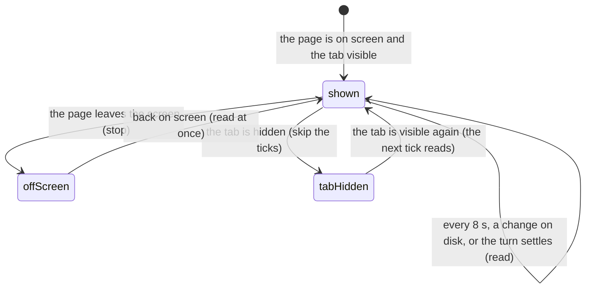

- **Owner.** Each page owns its own read, as Git already did (`GIT_POLL_INTERVAL_MS`, 8 s). Files reads its tree on the same terms: only while its page is on screen and the tab is visible, and at once on coming back on screen. A read keeps the expanded folders and the selection.
- **One read at a time.** A read asked for while one is on its way waits for it and reads once more, as Git's `statusReadAgain` does. Overlapping reads let a machine slower than the interval land nothing at all.
- **"Out of date" goes only for a read that says so.** The toolbar's mark goes when a read lands, for the workspace still shown, and began after the latest settled turn. A failed read, a read for a workspace the reader left, or one already on its way when the turn settled leaves it up; the next read takes it down.
- **A folder that fails to list** keeps what it showed, unless the read shows it gone from its parent, which drops it. An expanded folder the agent deleted used to fail every later read, so the whole tree froze.
- **The open file follows the tree.** Every Files read compares the open file with its entry in the listing it just got (`selectedFileVerdict`):
  - a different `modifiedAt` re-reads it, keeping the old content on screen until the new content arrives;
  - an entry gone from a folder listing the read holds re-reads it too, so the viewer says the file is gone;
  - a folder listing the read does not hold says nothing, and nothing is re-read;
  - a symlink is re-read on every read: its listing reports the link, not the file it points to;
  - an open file whose last read failed is re-read while the listing still shows it, so a failure that passed does not stay on screen; one gone from a held folder is not.
- **The reader keeps their place.** New bytes of the open file land in the editor already showing it, with the selection kept and the line at the top of the view still at the top; another file gets a new editor.
- **Cost.** One listing per held folder every 8 s while Files is on screen, as Git costs one status read. Neither reads while off screen or in a hidden tab. Known extra reads, accepted: an open symlink, an open file whose read keeps failing, and an open file absent from a listing cut at 1000 entries are each re-read once per read; an expanded folder inside a collapsed one is still listed.

### A surface never gives up (B48)

Owner, 2026-09-30, on "Couldn't read the projects on this machine." frozen on the phone board: "the page keeps trying to update itself, through event-based messages and, after n silent seconds, an active heartbeat that checks for messages from a newer version … so really there are only two states: trying to reconnect/sync, and syncing … the front end has to design well what it presents to the user".

Measured: the maintainers' production instance answered both projects reads at 15:21:46 and 15:21:47 with 200 in under 10 ms. The answer was lost on the phone's link, and the page stopped at `projectsLoad: "failed"` with nothing that would read again.

**The rule.** A read that got no answer is not an outcome. A surface is in one of three states, and none of them is final:

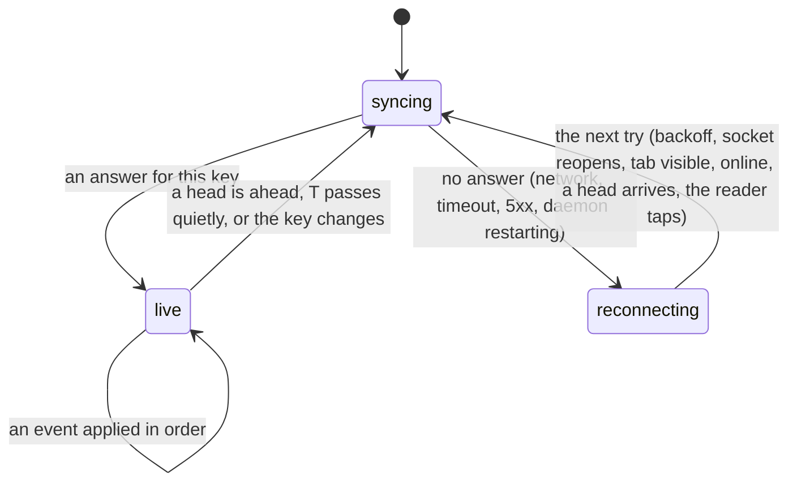

- **live**: the surface shows what it knows for its key and applies events as they come. Nothing extra is drawn.
- **syncing**: a read for this key is in flight. Data already known for the same key stays on screen.
- **reconnecting**: the last try got no answer. The surface keeps what it knows for the same key and tries again by itself. Tries back off 1, 2, 4, 8 s, capped at *T* (15 s), and any sign of life (the socket reopening, the tab becoming visible, the browser going online, a head on the keepalive) tries at once.
- **An answer is never "failed".** A server that answered with a refusal has stated a fact, and the fact is shown as itself: 401 opens sign-in, 404 says the project or session is gone. Only "no answer" is reconnecting.
- **Scope.** Retained data belongs to its key (machine + project + workspace + session). On a key change the old data is not shown, and the new key starts at syncing.

**Every producer of a dead end today** (each becomes the three states; none keeps a "failed" of its own):

| surface | today | where |
|---|---|---|
| projects on a machine | "Couldn't read the projects on this machine." / "Projects could not be loaded." | `projectController.ts:51`, `PiWebApp.ts:2701`, `:3158`, `ProjectList.ts:165` |
| workspaces | `workspacesLoad: "failed"`, derived from the global `error` string | `PiWebApp.ts:3206`, `WorkspaceList.ts:201` |
| machines | `machinesLoad: "failed"`, and a remote deep link whose roster retry ladder stops after five tries | `machineController.ts:33`, `PiWebApp.ts:1254`, `:1569` |
| a deep link to a remote machine | "*m* is still unavailable." after five tries, and the restore is dropped | `PiWebApp.ts:1685`, `:1707` |
| sessions | `sessionsLoad` | `appState.ts:27` |
| a session's transcript and status | the failure panel with `transcriptFailed` / `statusReadFailed` | `sessionController.ts:506`, `ChatView.ts:1831`, `PiWebApp.ts:4165` |
| opening a session (D8) | "Couldn't open · retry" | `navigationIntent.ts` `OPENING_WORDS.failed` |
| files | "Couldn't read this workspace's files: …" | `files/explorer.ts:89`, `filesPanelElement.ts:134` |
| the terminal page (owner screenshot, 2026-10-13: "The server did not answer within 30s." in red) | `describeTerminalError` in red for every failure: listing shells and command runs, the shell's socket, and start, close, rename, continue and cancel | `terminal/TerminalPanel.ts`; now `terminalRecovery.ts` through the host's `ui.readFailure` |
| git status and diff (missed in the first count; owner, 2026-10-13) | a red alert with the transport's words on every missed 8 s poll, and "Status unavailable." | `git/browser/git-panel.ts` status and diff reads; now `applyReadFailure` through the host's `ui.readFailure` |
| goals | "Goal records could not …" | `goals/pi-web-plugin.ts:79`, `goalsSectionElement.ts:90` |
| background runs | "This machine could not read the background runs." | `PiWebApp.ts:920`, `backgroundTaskRows.ts:90` |
| subagent runs | "This machine could not be asked for the runs." | `subagents/runsRead.ts:26` |
| interrupted runs | "…the read failed. Reconnect to read it again." | `PiWebApp.ts:259` |
| the status of a sent message | a red "Reconnecting to update message status…" notice with Retry, written into `state.error` and retired by comparing that text (owner screenshot, 2026-10-01: "shouldn't this be removed as well?") | `sendVerification.ts` `VERIFY_RECONNECTING`, `sessionController.ts` `askLedgerAbout` |
| quick switcher and the navigation board | an empty meaning of kind `failed`, "Loading sessions…", and "No sessions yet." after a lost projects read; a workspace whose read failed was dropped without a trace | `QuickSwitcher.ts:244`, `AppNavigatePage.ts:279`, `PiWebApp.loadQuickSwitcherData` |
| the global banner | "Lost connection…", "A request timed out…", "Connection problem…" | `errorBanner.ts:95-125` |

**The status of a sent message speaks through the row (P1 slice 6).** A row whose bytes left unconfirmed (past the 1.5 s grace it says "Sending…", docs/design/message-states.md) is asked about on a clock, by asking the daemon's ledger. When an ask gets no answer, that is an unanswered read like any other. It is scoped to the machine and the session, counted from the first ask that got none, and folded into the app's one row with the projects, machines and named-target misses. So it waits out the same grace and shows the same words: "Reconnecting…", "*m* is unavailable; reconnecting…", or a server's own reason. It never shows Retry, and it leaves when an ask gets through, when a later send to the same session is answered (the link to its machine is up), or when the reader leaves the session: leaving ends the episode, so coming back never shows a claim counted from before, which would skip the grace. Nothing about it is written into `state.error`, and nothing compares display text. The message's own row keeps saying "Sending…" meanwhile. A send nobody answered starts the claim itself, and no longer raises the transport error as a notice: that notice was a second producer of the same words, hidden until now under the first. Still decided by text, though already in the row's style and without Retry: the machine-down notices and the transport rewrites in `errorBanner.ts` (the session daemon, a dropped fetch, a remote machine). They become typed misses with B16.

**The terminal page** (owner, 2026-10-13: "we keep trying; never show the user an error they cannot fix"). The host says what a failure means (`ui.readFailure`); `terminalRecovery.ts` says, in one table over the request and that answer, what the panel does:

| request | no answer | a server error, in its words | a stated refusal |
|---|---|---|---|
| listing shells and command runs; the shell's socket | keep what is shown, "Reconnecting…", read again with the host's backoff | the same | its words |
| start | read the list to learn whether it started; never sent twice | its words | its words |
| close, rename | read the list; resend while it shows the shell open or the old name (both are idempotent) | close: read the list; rename: its words | close: read the list; rename: its words |
| continue | read the list | its words | its words |
| cancel a command run | read the list | read the list | read the list |

A dropped socket to a shell that still runs reconnects when the list answers; the screen is reset and the daemon replays it. The tab becoming visible, the browser going online and the socket opening read at once. "Reconnecting…" goes when the list answered and no close, rename or socket is still waiting. An answer for another folder than the one shown is dropped, and the auto-started shell is decided only by an answer.

**A transcript image** (owner, 2026-10-21: an image that could not load was fetched again each time its "did not load" row came into view, about 30 times a second during a daemon outage, and the transcript shrank and grew with every try). An image larger than 8 KB travels as a reference, not as bytes, and the browser fetches it when it comes into view (`deferredImages.ts`): a tool result's image under its call, and since r158 an image the reader sent under its session entry (owner, 2026-10-24: scrolling up a 1018-message session at 1.6 Mbps, two pages each carrying one 2.8 MB photo as base64 took 9.4 s and 9.9 s, 19.8 s of the 23.1 s spent waiting at the top). History pages and the transcript tail carry the reference. A live frame of a just-sent message still carries its image to each browser watching then, twice (the acceptance echo and the committed message), because its entry does not exist yet: the acceptance echo is published when the daemon takes the message (`piSessionService.ts:3564-3565`), and pi publishes `message_end` before it appends the entry (pi 1.4.0 `dist/core/agent-session.js:753`, then `:767`); every later read (a reload, a scroll, another device opening the session) gets the reference. The sender's own row keeps drawing its local copy. The image is read the way the transcript is: a session the daemon does not hold answers from its file, and no image read opens a runtime ("Reading a closed session never opens it"). Edit and send again, and the composer's history, fetch a referenced image's bytes when the reader acts, within the reader's 30 s read deadline. Edit and send again brings the words back at once and the images join when they arrive; a send meanwhile waits for them, and a second tap while they join does not bring the words back twice. A fetch that fails says the attachment did not come back. A deferred image keeps one box, the size of its placeholder, while it loads, waits or fails, and only the loaded picture replaces it (`deferredImageLoad.ts`). A failed fetch tries again after 2, 4, 8, 16 and 32 s. While the page knows the machine's live link is down it does not try. The link coming back tries every image that did not load once at once, an image that already gave up included, so a flapping link does not leave boxes to tap one by one. After the last try the box says "Did not load". A tap tries once more, and a tap on any box that says the image did not load tries at once, including while it waits for a link that a proxy without WebSocket upgrades never opens. This is the one read the owner chose to let end: an image is not a surface the page depends on.

Done so far: projects on a machine (P1 slice 1); workspaces, and placing a session opened from another project (P1 slice 2); the machines roster, and a deep link to a remote machine, which keeps retrying with the shared backoff while it is still the reader's intent (P1 slice 3); the row names why a read is unanswered (P1 slice 4); the session board across the machine (P1 slice 5); a missing session is a typed fact, `gone`, not an error text (P2 slice a).

**A missing session** (P2 slice a) is one typed answer end to end:

| where | before | after |
|---|---|---|
| daemon | `new Error("Session not found")`; a read route turned any error into 404, a mutation route matched the message text, and an unreadable session directory listed as empty | `SessionNotFoundError`, answered as 404 with `code: "session-not-found"`; any other failure keeps the route's own status (500 for the transcript and status reads, 503 for child-work reads, 400 for mutations); an unreadable directory is a failure |
| wire | `{error}` | `{error, code}`; the text is kept for older clients |
| client | `message.includes("session not found")` | `HttpError.code`; `classifyReadError` gives the fact `gone`, and a 404 without a code is a server error. The text match remains only for a coded-less 404 from an older daemon |

**A route the machine does not have** (B16, 2026-10-09) is one typed answer too. A page newer than the machine it asks (a remote on an older release, or a web process restarted before its daemon) calls routes the machine lacks:

| where | before | after |
|---|---|---|
| daemon | Fastify's default 404 envelope, `{message: "Route POST:/x not found", error, statusCode}` | the same envelope with `code: "route-missing"` (`routeMissingBody`) |
| web | the envelope for an unknown `/api` path; a release before `unknown-api-says-not-found` answers the app's HTML at 200 | the envelope with the code |
| client | the HTML was parsed as JSON and the panel showed the parse error; the envelope's "Route POST:... not found" was shown as it was | `request()` throws `HttpError` with `code: "route-missing"` and the words "This machine runs an older PI WEB that cannot do this yet. Update PI WEB there and restart its session daemon." for the code, for an envelope without it (an older machine, read by its shape), and for an HTML answer to an API call. The per-route checks (`readNewerDaemonRoute`, the fork routes) keep their own fallbacks. |

**A folder that cannot become a project** (B16, 2026-10-09) is refused with a kind, `ProjectFolderRefusal`, as the code of the add route's 400; the page words it from a `Record` over the kinds:

| kind | produced by | page words |
|---|---|---|
| `folder-missing` | reading the folder: ENOENT | That folder does not exist. Tick “Create the folder if it does not exist” to make it, or correct the path. |
| `not-a-folder` | reading it: ENOTDIR, or a file at the path; creating it: ENOTDIR or EEXIST | That path is a file, not a folder. |
| `folder-unreadable` | reading it: EACCES or EPERM | That folder cannot be read with this account's permissions. |
| `folder-not-created` | creating it (“Create the folder” ticked): any other file-system refusal, such as EACCES, EPERM, EROFS or ENOSPC | That folder could not be created there. Check the path and this account's permissions. |

Before `folder-not-created`, a failed mkdir answered without a code, and the page read the EACCES in its text as "cannot be read". An answer without a code (an older machine) is still read by its errno words: ENOTDIR or EEXIST first, then a failed `mkdir`, then ENOENT, EACCES or EPERM.

**A failure that claims the link is down** (B16, 2026-10-09) carries its kind, `TransportClaim`. A claim's notice is retired by the next answer (reply lifetime, 6 s expiry, held through the grace window), and the row words it by a `Record` over the kinds. A notice without a claim keeps its own words and the reader's lifetime. Before this, both the lifetime and the words were decided by matching the failure's text against seven phrasings, so a producer whose words drifted kept its line on screen after the link was back.

| claim | produced by | row words |
|---|---|---|
| `daemon-not-listening` | the web process's error body `transport` field, set from the errno (ECONNREFUSED or ENOENT) when it could not reach its session daemon: session proxy, plugin backend and operation proxies, workspace deletion, workspace catalog | Trying to sync with *m*… |
| `machine-unreachable` | the gateway's `transport` field on its 502/504 for a remote machine | Trying to sync with *m*… |
| `network` | `NetworkError`: fetch() itself rejected, by the call site (`fetchNamingLinkFailure`), not by the browser's words | Trying to reach *p*… |
| `deadline` | `RequestTimeoutError`, the page's own deadline | Trying to reach *p*… |
| `aborted` | an error whose platform type is `AbortError` | Previous request was interrupted. Retry if the message did not finish. |
| `server-error` | an `HttpError` 5xx whose body said nothing | Connection problem. Retrying in the background… |

Since 2026-10-19 no row word in this table is drawn, nor "Syncing with *m*…": the row stays empty, the top progress bar sweeps, and the sentence goes to a visually hidden status (`RowView` in `components/errorBanner.ts`; `message-states.md`, "Staying in step"). The owner asked first for the sync sentences, then for every connection notice ("Connection problem…" and the interrupted-request line included).

An `HttpError` without the field (a machine older than it) is read by the old phrasings, `legacyTransportClaim`, until every machine carries the field (rolling compatibility). A notice composed by the page about a machine ("Trying to sync with X… *evidence*") is reply-retired with no claim; it is a sync state, so it shows as the top bar and its words, evidence included, go to the hidden status. A reply-retired notice about one machine shows only on that machine's row (`noticeScope`, r66: with another machine selected, the row kept "Trying to sync with" an offline machine, because only that machine's answer retires it); it stays in the state and shows again on its own machine until that machine answers, unless a newer notice took its place first: the page holds one notice, so a later notice about any machine replaces it. A notice the reader retires and a claim about the page's own link show on every row. The unanswered row's minimum display time belongs to the machine it was shown for and does not carry over a switch. The claim travels with the notice's other fields (`noticePatch`: words, lifetime, machine, claim), so none can be set without the rest.

**The session board** (P1 slice 5) is read from many sources: the projects, each project's workspaces, and each workspace's sessions. It answers in three degrees, `BoardAnswer`:
- `none`: nothing answered yet;
- `partial`: rows from the sources that answered, while others did not;
- `complete`: every source answered.

A source that did not answer is kept as unknown and read again on the shared backoff, never dropped; a retry asks only those sources. The list claims only what it knows:

| board | rows match | the list says |
|---|---|---|
| any | some | nothing extra |
| `none` or `partial` | none | nothing: a source may still hold them |
| `complete` | none, with a query | "No sessions match “q”." |
| `complete` | none, narrowed by the path | "No sessions in this part of the path.", with a way to widen |
| `complete` | none | "No sessions yet." |

The board is not a cause for the app row: the row already speaks for the machine's projects and roster, and a single unanswered source retries silently (owner Q4).

Plugins read through the host, so the rule reaches them as one host facility: a read the host runs for a panel reports syncing and reconnecting, and retries on the same schedule. A plugin never writes its own retry loop.

**Replaced on 2026-10-14.** The app row now has two states besides normal, one per direction, defined by facts: "Trying to sync with *m*" (something sent to *m* is unacknowledged past *n*, or a probe or a read on a silent link is) and "Syncing with *m*" (the page knows it is behind *m* and the fetch has taken more than 1 s). Every machine counts and is named; a list drawn from memory is normal. The rule is `message-states.md`, "Staying in step"; the text below is the earlier design, kept for its history and its producers table.

**What the reader sees** (owner, 2026-09-30; the full contract is `object-model.md` §0 and §2.3):
- One app-level row, the existing yellow one, shows one claim at a time. A definite failure is not reconnecting, and holds the row until it is dismissed or retired.
- Reconnecting shows only for the machine the reader is using. Another machine, or one project or workspace, that does not answer retries silently.
- A server that answers with an error shows its reason, never "reconnecting". Why a read went unanswered is one typed value (`ReadMiss`, object model §2.3):

  | miss | the row says |
  |---|---|
  | `link-down`: no status, or a 502/503/504 that PI WEB's gateway did not claim | "Trying to reach *p*…" |
  | `machine-unanswering(m)`: a 502/503/504 whose body names a remote machine (the gateway), or the realtime socket reached the web process and nothing came through it | "Trying to sync with *m*…" |
  | `server-error(m, reason)`: any other status | "*m*: *reason*" |

  All three keep retrying and retire when an answer comes; only a fact (401, 403) stops the retries.

  **Two sentences, and none once it is heard** (owner, 2026-10-12: the same outage read "Trying to sync with the server…" and "Trying to sync with *m*…" by turns, and "Trying to sync" stayed up while messages were already arriving). *p* is the machine serving the page, *m* the machine the claim is about; a machine is always named and nothing says "the server". Every producer words them through `sync/rowWords.ts`: the transport claims above, the read misses here, and the page's own notices about a machine that reported itself down (which keep their evidence after the sentence). A miss is no claim once the page has heard, after it began, from what it is about (`stillUnheard`, keyed by the miss's kind): a `link-down` by any answer from the page's server (`ackWatch.heardAt`), a `machine-unanswering(m)` by a frame from *m* on the realtime socket (the socket's open alone is the web process answering). A read still waiting on its own backoff no longer holds the row while the socket delivers. A `server-error` is an answer in its own words and is not retired by other traffic.

  **The grace counts only time the page is in view** (owner, 2026-10-12: "Trying to sync" showed every time he switched back to the browser; the grace is 10 s by his word, it was 4 s). A phone freezes a page in the background and closes its links. A request in flight at the switch, a read that failed while away, or a socket that dropped while away carries a start from before the return, so the first decision after it found minutes "waited" and showed the row before any read the return sends could answer. The grace (`TRANSIENT_GRACE_MS`) now counts from the later of the miss's start and the moment the page last became visible (`graceLeftMs`). A hidden page earns no row, and a row showing when the page was hidden is not kept, so a return never inherits one. The transport claims' notices wait out the same grace by the same rule. On return a socket waiting out its reconnect backoff retries at once, as it does when the browser reports the network back. A miss still unanswered 10 s after the return is an outage and shows.

  ```mermaid
  stateDiagram-v2
    [*] --> InStep
    InStep --> Waiting: a request or the socket goes unanswered
    Waiting --> Waiting: the page is hidden, then shown (the grace starts again at the return)
    Waiting --> InStep: an answer within the grace
    Waiting --> TryingToReach: link-down past the grace
    Waiting --> TryingToSync: machine-unanswering past the grace
    TryingToReach --> InStep: any answer from the page's server
    TryingToSync --> InStep: a frame from the machine
    TryingToReach --> TryingToSync: the server answers, the machine does not
  ```
- Syncing is never visible, except in two places: "Loading this session…" while a session with nothing known opens (until its transcript, status and thinking levels each answered or failed), and, until 2026-10-14, "Syncing…" on the app row while the session list on screen was drawn wholly from memory (a remembered list now says nothing: message-states.md, "Staying in step"). The tap acknowledgement (row spinner, "Opening…", the progress line) stays. "Still opening…" and the Loading titles go.
- There is no Try now; the page retries by itself. Known data stays live and usable. Other actions fire now and show as pending, and are never replayed.
- A tapped session opens unless it was deleted (the reason, and a way back) or archived (read-only, with Restore).

**Where the row draws** (owner, 2026-10-09, on "Trying to sync with the server…" sitting above the phone Navigate page's header: "it should be under the header row"). The row sits under the header of the page in view, as it sits under the chat's context bar. One classifier, `appRowPlace`, picks the single place; nothing else renders it:

| place | when | the row sits |
|---|---|---|
| `dialog-layer` | a dialog is open | above the dialog, which moves down by the row's height (owner, 2026-10-04) |
| `navigate-overlay` | Navigate is open over the page | under the Navigate header (before, it drew in the main column, hidden behind the overlay) |
| `navigation-view` | the phone shows its navigation view | under the Navigate header |
| `main` | anything else | in the main column, under the context bar |

### A lost announcement is noticed (B28 slice H1)

Every surface stays live from the machine's announcements on its global socket: unread, pins, statuses, a session's name, a new session. The socket can stay open and still lose one: a proxy drops a frame, a send fails on a full buffer, a debug drop. Before this, nothing noticed it.
- Global frames already carry one increasing `seq` per daemon, and the page counted the gaps but did nothing with them.
- A frame lost last, before a quiet stretch, was not even counted: no later frame revealed it.
- So a pin, a rename or an unread mark stayed wrong until the socket reopened or the page was reloaded.

```mermaid
stateDiagram-v2
  [*] --> baseline: socket opens (the join frame carries the current seq)
  baseline --> current: a frame with seq n+1, or a keepalive whose head is n
  current --> current: the next frame in order; a keepalive whose head equals the last seq
  current --> missed: a frame whose seq skips, or a keepalive whose head is ahead
  missed --> current: the page reads again what the socket keeps live
  current --> [*]: socket closes (the next open is a new baseline)
```

- **The baseline is the join frame's `seq`.** Without it the first frame after an open set the baseline, so losing that frame went unseen.
- **The keepalive carries the global head.** A global socket's keepalive is sent after 0.6 *T* with nothing else on it (the page names its quiet window *T* on the socket, as on a session's; 20 s when it names none). It now says `{ type: "keepalive", head: { seq } }`, the last `seq` the daemon stamped, so a frame lost last is noticed within one keepalive. It costs a few bytes, and no request.
- **Missed means read again.** The page then re-reads, for that machine, what its frames keep live: unread, pins, its machine status (projects and workspaces ride it), and its board. The board the page follows (the last one browsed) is read whole at once; another machine's is read whole the next time it is shown. On the machine in use it also re-reads the statuses, the workspace's sessions, its terminals and its open workspace panels. A status frame applied while that read was on its way is kept: the frame is the later fact. An "active" activity the read shows is over is dropped, because a lost `activity.update` is never published again.
- **Silence is a miss too** (B28). The join frame echoes the quiet window the page named (`quiet`, seconds); once it has, nothing at all for *T* on that socket counts as a missed announcement and starts the same re-reads. A daemon or a remote machine that predates the echo keeps its 20 s keepalive and is never taken for silent; the 42 s drop still covers it.
- **One pass at a time.** A burst of losses on a lossy link shares one pass of reads and asks for at most one more after it. One lost frame costs these reads once, and lost frames are rare. Per-surface heads are not kept, until a measurement says these reads cost too much.
- **A reopen is a miss too** (B28 slice H2). Everything announced while no socket of the page was open for a machine was lost: during a reconnect, and for one handshake when a machine switch hands the machine from one of its sockets to the other. An open is a miss when the page has heard that machine before, whichever socket it was; it then reads again what a miss does (above), plus the interrupted runs. So a session renamed or created, or a file changed, while the page was offline shows without a reload. The page's first open of a machine is not a miss: the boot reads that machine's board once already (`loadQuickSwitcherData`). Open workspace panels follow the same visibility rule as a live `workspace.changed`: a hidden tab refreshes them when it comes back.
- **A frame applied during a read wins.** A replacing status read keeps any status frame and any activity frame applied while it was on its way, on one frame clock. It also keeps the activity of a session this page is still starting, which no catalog can list yet.
- **An older daemon** sends neither the join `seq` nor the head. The page then falls back to what it did before: gaps between frames are noticed, and a lost last frame is not.
- **A session's own frames** already have this: a ring of frames and a gap repair that replays them (D5, "Stream").
- **Fault injection:** a probe (since removed) dropped one global frame between the daemon and the page (Playwright's `routeWebSocket`), on any build.

## D6. A plugin

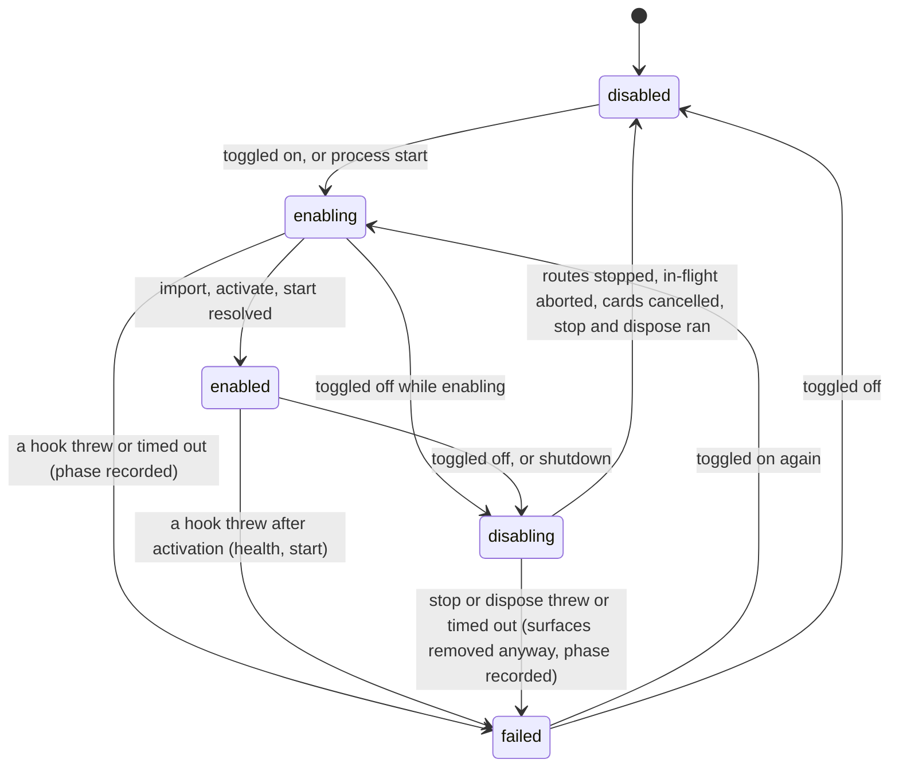

- **Owner.** The plugin runtime of each process, reconciled against config. A toggle takes effect live (owner, 2026-09-30). In-flight work is aborted.
- **Live today for server halves (B19 slice A, 2026-10-09).**
  - A config write through Settings or the config API that changes `plugins` reconciles the web runtime, then asks the daemon (`POST /plugins/reconcile` on its socket), and answers after both.
  - `reconcileStep` decides each plugin: `enable`, `disable`, `keep`, or `awaits-restart`. The last applies to a plugin that hands core a face (workspace provider or machine registry; owner question 22) and to a new revision of a running plugin, and the card keeps saying Restart required.
  - `disabling` is the call gate closing: new operation and route calls answer 409 `plugin-not-active` (with the state), running calls get the plugin's abort signal and up to the lifecycle timeout to settle, then `stop` runs once.
  - A route mounted at boot asks the runtime for the live route on every request; a plugin first enabled after boot has no routes until slice B. Browser halves follow live since slice C: after reconciling, the daemon publishes `plugins.changed`; each page browsing that machine reads its manifest again, loads what is listed and disposes what its manifest loaded and no longer lists (core plugins registered in code are never touched; a manifest that could not be read disposes nothing). A missed announcement re-reads the manifest too. A machine that advertises `plugins.live-toggle` (web and sessiond both) gets no reload when Settings closes; an older one still does.
- For a plugin that runs in both processes, the page shows the worse of the two states (`failed` beats `enabled`) and names the process.
- **Where a plugin shows, and nowhere else** (owner, 2026-09-30: "once a plugin declares it, a new plugin button appears, and tapping it opens the plugin's own custom display"):
  - **A page.** A declared entry in the ≡ Go to page. Tapping it opens the plugin's own page, which the plugin draws.
  - **Appendages to fixed core states:** status-line notes and counts, row actions, docked cards (D2) and a settings page.
  - Nothing else: no bars, strips or drawers over or under the transcript (rule 7). The `drawerSections` contribution point is removed.
- **Global prompts** such as an update offer are machine-scoped. The Updates plugin stores "asked for version v" per machine in its own storage and asks once per machine and version, never once per session.
- **A page's own status belongs to the page.** The host draws no title row and no summary under the app bar (owner, 2026-10-01), so `summary` is no longer drawn. Each page says its own status inside itself (owner, 2026-10-02: this is the plugin's own design):
  - Git writes its branch and its ahead and behind counts (`main · ↑2 ↓1`) at the end of its own toolbar, as VS Code's status bar and lazygit's status panel do.
  - Git and Files write "out of date" in the same place while their listing predates a change they were told about, beside the Refresh that clears it.

### A page that takes the whole canvas (no-row review, 2026-10-02)

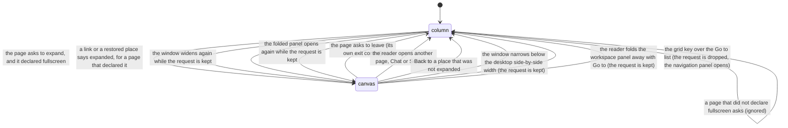

- **Owner.** The host keeps the request. Whether the page *holds* the canvas is derived on every read (`workspacePanelHoldsCanvas`): the request was made for this very page, the page declared `fullscreen`, the window is wide enough to show it, and the workspace panel is on screen. Neither a stale link nor a page that vanished (its plugin hidden, the workspace no longer a git checkout) can leave the reader under a hidden app bar with no way out, and a declared page shown in place of a missing one does not inherit the missing page's request (found in review).
- **The host draws no enter or exit control and favours no plugin** (owner, 2026-10-02: PI WEB stays general and gives no particular plugin special support). A page declares `fullscreen: true` and draws its own controls: enter only while `host.workspacePanelFullscreenAvailable()` says the window can show it (the desktop side-by-side width, 1181 px and up), exit whenever `host.workspacePanelFullscreen()` is true. Above the page the host keeps its own bar with the corner keys (owner, 2026-10-16): Back to the Go to list, Go to to fold the column, and over the list the grid key, so a page that holds the canvas never leaves the reader without a way back.
- **Git** declares it. Its Expand key opens the review layout, every changed file's diff in one scroll, and reads "Exit expanded" there. No other bundled page declares it.
- **Producers of the stuck state found in review (`4d54a383`):**
  1. The removed header key was the only entry and the only exit, for every page.
  2. A link carrying `core.workspace--expanded=1` restored any page into the canvas.
  3. Opening another page through the quick switcher kept the flag for the next page.
  4. A link restored into the canvas while the reader had folded the workspace panel away: the fold's rule hid the page and the canvas rule hid everything else, leaving an empty window (found in review).

### A shell tab's name (R12, owner 2026-10-09: both entries)

```mermaid
stateDiagram-v2
    [*] --> showing
    showing --> editing: double-click, a held finger (500 ms, 10 px), F2, or Rename… in the tab's right-click menu
    editing --> showing: Escape (nothing sent)
    editing --> showing: Enter or leaving the field with an empty or unchanged name (nothing sent)
    editing --> saving: Enter or leaving the field with a new name
    saving --> showing: the daemon answers; the tab shows the name it answered with
    saving --> showing: the daemon refuses (empty, over 80 characters, the shell gone, a route an older daemon lacks); the old name stays and the panel says why
    saving --> resending: no answer; the panel says Reconnecting… and reads the shell list again
    resending --> showing: the list shows the new name, or no such shell
    resending --> saving: the list still shows the old name; the rename is sent again (it is idempotent)
```

- **The daemon keeps the name** (`POST /terminals/:id/rename`, federated for a remote machine). Every page that lists the shell reads it. No frame announces it: a page already showing the shell's tabs on another device shows the new name when it next lists them, as it does for a shell opened or closed there. A daemon restart ends its shells, names included.
- **The right-click menu is the host's** (`PluginHostUi.actionMenuStyles` and `placeActionMenu`): its subject line names the shell, then Rename… and Close. A tab is its name and one × cell (owner, 2026-10-13: the ⋯ is gone; it only repeated × and the rename gestures). A finger's long-press opens the name field and only keeps the browser's own menu away. A host that offers no menu leaves the browser's; the double-click, F2 and the hold still rename.

## D8. Where the reader is (navigation)

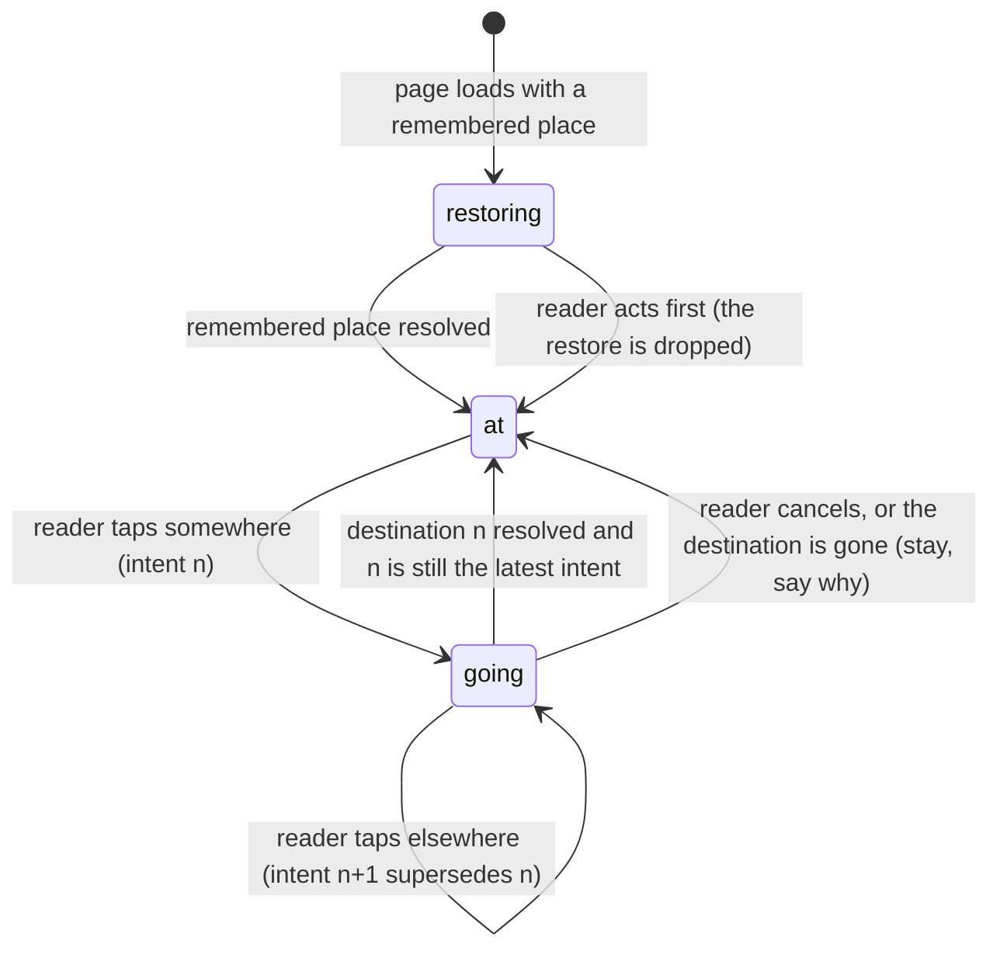

- **Owner.** One navigation controller. Every move is an *intent*, stamped with a sequence number from one counter: reader taps, back and forward, boot restore and machine-switch restore all draw from it. An async step commits a visible change only while its intent is still the latest.
- **The frame and its content change together.** The header, the page and everything actionable on it describe the same place at every moment. The previous place's content is never shown, and never actionable, under the next place's frame (owner, 2026-09-30: "it switched but the page content hadn't refreshed, then I kept operating on it… what I operate on is completely out of sync with what is really there"). A seed from the destination's own cache (same key) is allowed; another place's content is not.
- **Producers found (B29), as they were before the fix:**
  1. `openSessionFromQuickSwitcher` closed the Sessions page at tap time, uncovering the *previous* session's chat, live and sendable. It then awaited the machine move and `selectSession` (which returns only after the whole transcript read), and `focusChatComposer` forced the chat view even if the reader had gone elsewhere meanwhile.
  2. `restoreRouteFor` (boot restore, back and forward, machine switch, a terminal's workspace) awaited the machine and plugin loads and then set the view. `routeRestoreSeq` guarded only against a newer restore, not against a reader tap made meanwhile.
  3. The deep link to a fresh session that opens another one (audit P0-1, B31): the restore falls back to a different session while the URL still names the requested one.
  4. Deferred restores: a remote machine or project listing that failed at boot was retried on a timer, and the retry restored the boot route whenever it succeeded, however long after.
  5. A terminal run started with `open: true`, or a workspace removal, opened its terminal after awaited requests, even if the reader had moved on meanwhile.
  6. A second, half-built intent counter (`navigationSelectionSeq`) that only one unused method bumped.
- **Only the reader's intent moves the page.** A late answer to a superseded intent, a background refresh, a restore that the reader already overtook, or a list that reloaded never changes where the reader is (owner, 2026-09-30: "I didn't press anything… it suddenly jumped me to some screen I didn't recognise"; B29).
- **`going` stays in place and says so** (owner, 2026-09-30: "staying in place is fine, but how does the user perceive that they tapped this button?"). The screen stays where it is, live and bound to the place it shows (React Navigation's pending-navigation model). The tap is acknowledged within Nielsen's limits:
  - **within one frame (< 0.1 s):** the tapped item takes its `going` look: the selected highlight, and a spinner in place of its trailing mark, with `aria-busy` and an "Opening <name>" announcement. An indeterminate progress line runs along the top edge of the app. It is chrome-owned, so it stays visible even if the item scrolls away;
  - **after 1 s:** the item's text adds "Opening…";
  - **after 10 s:** the item reads "Still opening…"; going anywhere else cancels it;
  - **on failure:** the item reads "Couldn't open · retry" on its one secondary line (a tile never changes height), and the screen stays;
  - **a destination with a same-key seed** (a cached transcript, a loaded list) switches in the same frame. Only an unseeded destination waits, so the common case never waits;
  - **a tap elsewhere supersedes:** the earlier item returns to normal. A second tap on the same item does nothing, and a tap on a failed item tries again. Back, Escape or closing the list cancels `going` and closes the layer as usual.
- A tap that looks like it did nothing is how a later jump happens; `going` makes every tap visible.
- **Implementation (B29):**
  - One owner, `NavigationIntents` (`src/client/src/navigationIntent.ts`), holds the counter and the pending intent `{seq, key, phase}`. The phase is `going`, `slow`, `stalled` or `failed`, from the pure `navigationPhase(elapsed, failed)` classifier. `OPENING_WORDS` is its text table for the row, and `openingAnnouncement` is the one spoken line, naming the target in every phase.
  - Every reader navigation begins an intent:
    - a view choice (`selectMainView`);
    - opening or leaving the Sessions page;
    - back and forward;
    - closing a layer or the switcher (cancel);
    - a session tap;
    - choosing a project or widening;
    - browsing another machine's tab;
    - choosing or refreshing a machine;
    - New session;
    - opening Settings or Add project from the Sessions page.

    Code that only shows a view on the reader's behalf uses `showView`, which begins nothing, so a restore or a commit never cancels itself.
  - Opening a session:
    1. begin an intent;
    2. if the transcript cache has a seed for the session, commit at once;
    3. otherwise await the first page (`readFirstPage`, stored where selecting looks) and commit only if the intent is still the latest.

    "Commit" is closing the Sessions page and the switcher, showing the chat and selecting the session, in one synchronous step after the machine move, and only while the intent is current. The intent stays pending after the commit until the session is open (owner, 2026-10-14: "Opening" went before the composer's model, thinking level and token counts arrived): its transcript tail, status and thinking levels have each answered or failed (`selectionReadiness.ts`, keyed by machine, folder, session and selection sequence). The tapped item keeps its opening look and the progress line runs until then; a failed read ends the wait as an answer does, and its notice speaks. A superseded selection settles nothing. The move goes to the machine the row was read from, whatever tab is showing when the read lands. Focusing the composer happens only inside a current commit. Selecting still reads the page again as it joins the live stream, behind the seeded transcript; B7 removes that second read.
  - `restoreRouteFor` takes the intent current when it was asked for and checks it at every checkpoint. The boot restore captures its intent before its first await and hands the same intent to both deferrals, so a tap made at any point of a flaky boot retires the retry.
  - A terminal run checks, once accepted, that the intent current at its start still is; `openRuntimeTerminal` checks again after restoring the terminal's workspace, and a workspace removal checks before opening its terminal.
  - The chrome draws the progress line from the intent. The tapped row draws its `going` look by comparing its key with the intent's target.
- **A deep link to a session opens that session, or says why it cannot.** It never silently opens another one (audit, B31).
- **One intent adds at most one history entry** (seen 2026-10-03 on a dev stack under load: Back from a chat opened on the phone board landed on "chat, no session"). A tap writes the URL once, when it commits, naming the place it committed to, as a new entry even when another write landed less than 400 ms before (`forcePush`). Its steps (the machine move, the view, the selection) write nothing on their own; a workspace pick that did not land still writes once so the URL names the machine it is on. A tap overtaken after it moved the machine writes only when the intent that took over will not: no route restore runs, no other open is on its way, and the URL still names another machine (`supersededMoveOwesUrl`); an overtaken workspace open picks nothing. A step that later corrects the place replaces that entry: a placement, the session target a not-found read publishes, and the locate's reopen of that session where it lives (`correctsUrl`). A restore that opens a session in another workspace is not a correction: its caller (a machine switch, a terminal run) writes the entry (found in review). A placement or a correction rewrites only an entry that names its session (the session layer reads the address, `urlSessionId`): a restore's placement landing before its caller wrote leaves the entry to the caller, and a located session that answers after the reader went elsewhere opens nothing. An open that fails after overtaking a machine move names the machine the page is on (found in review). A session the resolver finds opens only on the machine it was followed on: a machine switch whose route names no session leaves a pending retry behind, and its answer belongs to the machine the reader left. A selection whose caller left the push to it and whose first read answers not-found pushes that one entry (found in review). The clock that merges writes 400 ms apart (`historyWrites.ts`) stays for the pieces of one surface (a tool and its arguments); it cannot tell one intent from two once a read takes longer. Producers found:
  1. a session tap: `showView("chat")` pushed the chat view before the selection, then the selection pushed the session once its first read settled; a cross-machine tap first pushed the machine as well;
  2. a workspace opened from the switcher: the machine move pushed, then the project or workspace pick pushed;
  3. a tapped row that answered not-found: the target's publication pushed, and the locate's reopen in another workspace pushed again (found in review);
  4. a machine choice whose restore finished after a tap made during it wrote second, inverting the entries and, when the restore preserved an unrestored place, naming that place instead of the tapped one; the choice now keeps the intent it began with and, once overtaken, writes only as an overtaken move does (`nameMachineAfterSupersededMove`).


### What the Navigate page acts on while it shows another machine (owner, 2026-10-09)

Choosing a machine on the Machines tab browses it: the header names it, and the Projects and Sessions tabs list its own (R18), while the selected machine stays where it was until something is opened there. The owner, on production: once a machine is chosen, what is shown must be that machine's; that is basic. The invariant: **every action on the page acts on the machine the page shows** (`browsedMachineId`), never on the selected machine behind it.

New session says where it starts before it is pressed (`CREATE_BUTTON` in `AppNavigatePage.ts`; owner, 2026-10-14):

| the list | the button | pressing it |
|---|---|---|
| narrowed to a project | "New session" with "in <project>" | starts in that project (`startSessionInProject`) |
| all projects, another machine shown, or no project open | "New session…" with "Choose a project" | opens the new-session project sheet, which offers a new project first and lists the shown machine's projects, the one used last first; choosing one moves to that machine and starts the session there |

The session is created on the machine as soon as it opens, so its model, thinking level and commands are there at once.

The other actions: Add project moves to the shown machine first and awaits that machine's plugins, which own the dialog; Copy path reads the shown machine's listing. Open, Continue from, pins, rename and mark-read already did. Archive, restore and delete are not offered while the page shows another machine (`canArchiveSessions`), and Close project only for the selected machine's projects.

Producers found (a dev stack, phone, 2026-10-09, old build vs new): New session sent `POST /api/machines/local/sessions` while the page showed another machine (new: none until a project is chosen, then `POST /api/machines/<that machine>/sessions`); Add project opened the dialog on local (new: on the machine shown); Copy path looked the project up in the selected machine's list and copied nothing.

### The target of a session link (P2 slice b, B31; owner Q8)

A link, a boot restore, a switcher pick or a board pick names one session. Whether it can be opened is one value, `SessionTarget`, decided by one pure classifier from typed answers only:

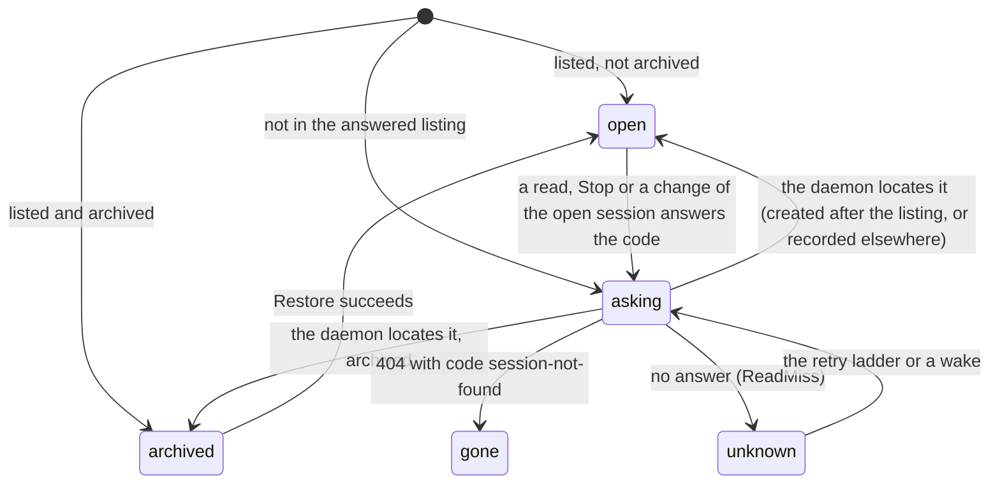

| state | the chat surface | the composer slot | the URL |
|---|---|---|---|
| `open` | the transcript | the composer | names the session |
| `archived` | the transcript, read-only | "This session is archived." with Restore | names the session |
| `asking` | "Loading this session…" | nothing | names the target |
| `unknown` | "Loading this session…"; the app row says why (`ReadMiss`) | nothing | names the target |
| `gone` | "This session no longer exists on *machine*." with a way back to the workspace's sessions | nothing | names the target |
| `not-listed` (an older daemon) | "This session isn't in *workspace* on *machine*." with the way back | nothing | names the target |
| `not-started-here` (a new session's pending id this page does not hold) | "This new session is not being started from this page. If it was started elsewhere it appears in the list once it starts." with the way back; never located | nothing | names the target |
| `folder-gone` | "This session's folder no longer exists, so it cannot be opened." with the way back | nothing | names the target |
| `refused` | "*machine* asked you to sign in before it opens this session.", or "*machine* refused to open this session.", with the way back | nothing | names the target |

The way back forgets the target: the URL stops naming it, and the phone shows the workspace's Sessions page.

A link that names a workspace but no session lands where the layout puts the reader, and the URL says so (built 2026-10-03). The wide layout (wider than 760 px, and at least 1080 px on a touch screen) shows a chat, so it opens the workspace's latest session and the restore names it in the URL, replacing the entry only while the URL still holds the route being restored and the restore is still the reader's latest intent: a machine switch or a terminal run restores a route the URL does not hold yet, and its caller pushes its own entry (found in review). A reload then opens the same session after a newer one appears. The phone layout (narrow, or a touch screen under 1080 px) shows the workspace's Sessions board and selects nothing: before, it selected the latest session behind the board and read its transcript (a 17.8 MB seed session on a dev stack) for nobody, and the URL could not name it.

- **Absence is not negation.** A target missing from the listing is `asking`: the daemon is asked where that id is, machine-wide (`GET /sessions/:id/locate`), because the listing is of one workspace's tree and a read by the workspace's cwd cannot see a session recorded in a subdirectory, or an archived one recorded there. Only the daemon's code makes it `gone`. A located session opens where it lives, as a switcher pick does. The fallback to the latest session applies only when no session was named.
- **An older daemon without the locate route** answers the route-not-found envelope. For one release, the answered listing is then the evidence, and the words say only what it proves: "This session isn't in *workspace* on *machine*."
- **Nothing else is selected** while the target is `asking`, `unknown` or `gone`. On the phone, the chat view stays on screen for the target instead of falling back to the Sessions page, so the answer is visible.
- **`gone` is final for that id** until the reader navigates. It is not retried, and it never becomes another session.
- **The open session answered the code** (P2 slice b part 2; owner, 2026-10-01: report it as an error that says it was deleted).
  - The code came from a read by that session's own directory. It proves only that the session is not there, not that it is gone from the machine: it may have been archived on another device.
  - So the open session becomes a named target, `asking`, and the same machine-wide locate decides it: `gone` shows the gone words and the way back; `archived` opens it read-only with Restore; found elsewhere opens it there.
  - Every read and change of the selected session reports its failure through one seam, which does this only when the failure is the code and the call concerned the selected session. A rename or archive of another row that answers the code stays a notice about that row. A client pending row (a temporary id the machine cannot locate) and sends are outside the seam.
  - The URL names the id once the target is published, so a reload shows the same answer, including after a pick that had already written the previous session's route.
  - A session the resolver opened after that locate and that answers the code as it opens is `gone` at once: asking again would only loop. A locate that got no answer, or an open that failed for another reason, arms nothing.
  - With no selected workspace to send the reader back to, the old words stand ("Couldn't load this session." with the daemon's reason).
  - The page learns of a deletion only at its next read of the session (a socket reconnect, a resync, a tab resume, Stop or another change). The daemon pushes no deletion; that is the heads work (B28).
- **A message sent to a session deleted meanwhile** is an open owner question: where its text goes once the composer gives way to the gone words. Until it is answered, a send keeps its failed row, and the next read of the session routes the page to `gone`.
- **Restore is in the composer slot** (owner, 2026-10-01): an archived session shows "This session is archived." and Restore where the composer would be.
- **Producers before the fix:** `selectPreferredSession` fell through to the latest session (seen on a dev stack: a link to a deleted id opened another session while the URL kept the deleted id); a refresh of the open session that answered the code read "Couldn't load this session."; a pick of a row deleted since the board was read read "Couldn't open"; an archived session opened with a disabled composer and no reason; Stop on a missing session answered "stopped".

## D7. A goal (pi-goal's flow, as PI WEB shows it)

Owner, 2026-10-09 (Q28): PI WEB is generic, adapts to no particular extension, and follows pi. These are pi-goal's states, then, not a flow PI WEB replaces it with. pi-goal declares its drafting questions and its task confirmation as interactive cards (interactive-card.md), which PI WEB draws as it draws any extension's; pi-goal records a created goal's focus and keeps focus through a compaction. The Goals page is a plugin that reads pi-goal's files (B27, below); it is now the separate pi-web-goals package, not part of this repository.

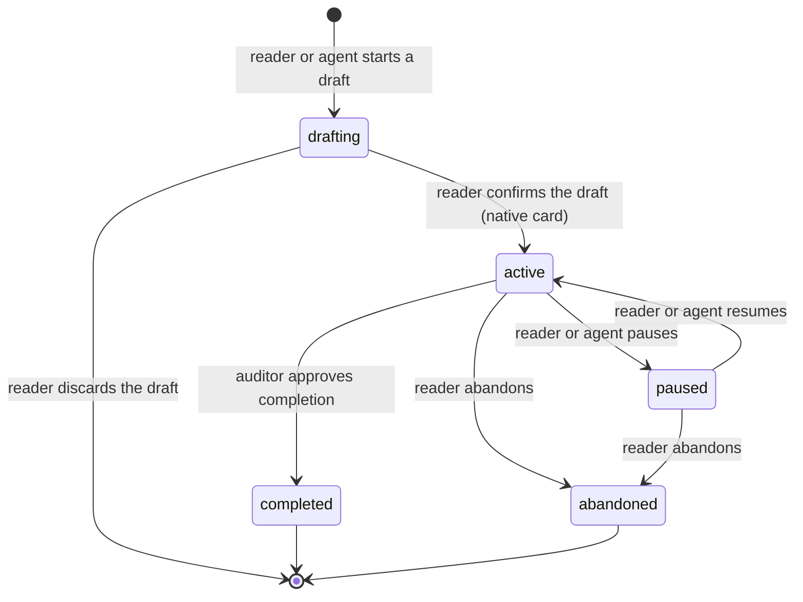

- **Focus** is a separate region: `unfocused` ⇄ `focused(session)`.
  - Focusing in another session releases the first one.
  - Focus is released only by a named arrow (focus elsewhere, pause, complete, abandon). A reconcile against a cache it cannot trust yields `unknown`, never a silent release.
  - A report ("created and focused") is derived from the stored state after the write.
- **Continuation** is a region too: `idle` → `waiting-quiescence` (no subagent run or background task active) → `injected`, or `fallback-fired` after a bounded wait.
- **The goal record format belongs to the goal plugin, and so does its reader.** Nothing else parses the files. A file that cannot be read is shown as unreadable, never as "no goals" (B27).

## D9. A list in batch mode (selection and reorder)

Owner, 2026-09-30 (bulk selection) and 2026-10-09 (R11): "long press (enters batch mode); dragging is moving; tapping the others is multi-select for a batch action". Desktop: press and drag moves a row, a click opens it, Shift or Cmd/Ctrl-click selects, and the row menu stays on ⋯ and right-click (R14).

Two pure machines, composed by the list. Each is its own module, and the list is a dumb executor of both.

**Selection** (`selectionModel.ts`), per list, one group at a time (live sessions, archived sessions, projects, machines):

| state | event | next |
|---|---|---|
| `browsing` | hold, or a modifier-click, on a row | `selecting(group, {row})` |
| `selecting(ids)` | tap a row of the same group | the row toggled |
|  | Select all | every visible row of the group |
|  | a refresh drops rows | those ids pruned |
|  | an action | `acting(action, ids)` |
|  | ✕ Done, Escape, back, another list (kind, project or machine) | `browsing` |
| `acting(action, ids)` | done: the action started, its rows moved at once ([instant-actions.md](instant-actions.md)) | `browsing`; the machine's answer settles the rows, and a refusal moves them back with the reason |
|  | cancelled: the machine is known to be out of reach, so the press is refused with nothing moved | `selecting(ids)` |

Selecting is a page of its own (owner, 2026-10-09): a header with the way out (✕) where the grid key stands, the count as its title and Select all, and under it a row of equal-size action keys, lie over the path bar, the kinds, the scope switch, the search and the create key. Those stay in place, inert under a translucent scrim, so no row moves when the page enters or leaves selecting and the row under the finger stays under it (owner, 2026-10-09). A hold is a touch or pen press held 500 ms; a mouse never holds, so on the desktop a press stays the row's own and Shift or Cmd/Ctrl-click enters selecting, with a quiet Select key in the list header for a mouse that does not know the gesture. Entering selecting pushes a history frame, so back leaves the selection first. A session pinned on another machine is not selectable here: it is acted on where it lives.

**Reorder** (`listReorder.ts`), per reorderable list (pinned sessions, pinned projects, projects, machines):

| state | event | next |
|---|---|---|
| `idle` | a press that may drag: on the phone in `selecting`, the press that entered it, or a later one held 200 ms; on a phone list without batch mode (machines), a press held 500 ms, whose release then opens nothing; on the desktop, any press on a row | `pressing(row, origin)` |
| `pressing` | the pointer moves past 4 px (desktop) or is still down after the hold (phone) | `dragging(row, slot)` |
|  | release before that | `idle`, and the press is a tap (desktop: open; phone in batch mode: toggle) |
|  | a quick swipe on the phone | `idle`; the list scrolls |
| `dragging(row, slot)` | move | `dragging(row, slot')` |
|  | release over the list | `dropped(order)`: the whole new order is sent, not a move |
|  | Escape, pointer cancel, release outside | `idle`, order unchanged |
| `dropped(order)` | at once | the list stands in the new order before the lifted row is set down, so nothing slides back and moves again (owner, 2026-10-09) |
|  | the server answers | `idle`; the server's order wins; a refusal puts the order back and says why |

**Why the whole order.** A move ("put X after Y") replayed twice or applied against a list another device has changed scrambles it; the full order is idempotent, and the server answers with the order it kept.

**Where the order lives.** With the data it orders, so every device sees it: session pins in the pin file's arrays; projects in `projects.json`; machines in the machines plugin's `machines.json` (`order`, the local machine's id among them, so it can move too). Pinned projects are in the pin file too (`pinnedProjectIds`, in their order); a machine that answers without the field keeps them in this browser. A browser hands its old pins to a machine once per kind and remembers it (`pi-web.pinsHandedOver`), so a pin removed on another device while this browser was closed does not come back from this browser's stale copy. A pinned section stands in its pin order; its rows still show state marks but no longer move on activity.

## D10. Drafts (kept in the browser)

Owner, 2026-10-10: every draft stays in the browser that typed it, and the daemon keeps none (server-drafts.md). There is no sync state: each draft is this browser's copy under the key of its scope.

| Draft | Key | Written | Emptied |
|---|---|---|---|
| composer text | machine + session | every keystroke | a send; a message the machine refuses for good, or one taken back, puts its words back |
| composer attachments | machine + session | every change, once this page has read the record | a send or a removal; a message refused for good, or taken back, puts them back |
| an input or editor dialog's typed answer | machine + session + dialog | every keystroke | the dialog closes, as this page sees it; else after 30 days |
| an interactive card's half answers | machine + session + dialog (`cardDrafts.ts`) | every change | the card is answered from this page |

Invariants: a fresh page never writes over an attachment record it has not read, and shows what it read before anything attached meanwhile; an attachment record it cannot read is never written. A session that was still starting takes its text and attachments to its real id.

## D11. A failed attempt pi retries

Owner, 2026-10-10 (Q16, option "follow-pi"; his 2026-09-30 rule "don't show the errors from before the retries have completely failed"): a reply that failed and that pi took back to try again stays hidden only once a newer attempt replaced it. When none will, it is the turn's outcome and shows, with a row saying why; a Stop during the wait adds "Retry cancelled" before its own row. When every retry failed, only the last failure shows. pi's own TUI prints `Retry failed after N attempts: <reason>` at the end of an unsuccessful retry ("Retry cancelled" for a cancel), and a reload of pi rebuilds without the attempts it took back.

pi takes an attempt back in two places, both by appending a `context_edit` with no replacement for the errored reply, announced as `entry_appended`: auto-retry (`auto_retry_start`, then the edit, then the backoff, all inside the run) and overflow recovery (the edit, then a compaction, then the retry). The last of pi's retries is not taken back: it stays as the turn's failure. A file cannot tell afterwards whether the promised retry came, so the daemon classifies per runtime (`retryRecoveryStep`, pure, in `retryRecovery.ts`):

| State | Meaning |
|---|---|
| `clear` | no failed attempt is waiting for its retry |
| `pending` | pi took these failed attempts back; no newer attempt has landed |

| Event \ state | `clear` | `pending` |
|---|---|---|
| pi takes an errored reply back (`entry_appended`, a `context_edit` with no replacement whose target is an errored assistant reply) | `pending` | `pending`, the attempt added |
| an assistant reply lands (`message_end`, failed or not) | stays | `clear`: replaced, it stays hidden |
| the recovery ends with no newer attempt: `auto_retry_end` that did not succeed, an overflow `compaction_end` that will not retry, `agent_settled`, the session closing (the daemon shutting down included) | stays | `clear`: unreplaced, the daemon appends `pi-web.retry.unreplaced { attemptIds, reason, at }` |

The first run a runtime starts (`agent_start`) also records any attempt its file left waiting, with no reply after it and no record (the daemon was killed during the wait), before a newer reply could hide it. The step runs before a Stop settles on the same event.

The reason is pi's words when pi gave them ("Retry cancelled", its overflow compaction failure, "Retry cancelled" for an aborted compaction), else the daemon's: the run ended, the session closed, or the session was opened again before the retry.

**Wire.** `attempt.retry { state, messages }`: `pending` when the daemon hides an attempt (the attempt's reply), `unreplaced` when none came (the replies, then the reason row). A replaced attempt needs no frame: the page already hid it. The page finds an attempt's rows by the reply's timestamp: `pending` removes them, and an older daemon's `auto_retry_start` still removes the newest failed rows; `unreplaced` puts them back in front of the reader's queued messages with the reason row after them, or, when the page still shows them (it read them from history), adds the reason row after them. A page that does not know the frame ignores it.

**History** (pages, the transcript head, counts): an attempt pi took back is hidden when no `pi-web.retry.unreplaced` names it and it is pending now or a newer assistant reply follows it in the branch; otherwise it shows. The record's row is drawn right after the last attempt it names, so a Stop's row (drawn at its own earlier entry) follows it, as live. A file from before this has no records: an attempt with a newer reply after it stays hidden, as before, and one with none after it shows. The pending set changes only with an appended entry, so the head stays cached by pi's leaf.

## D12. How many messages a session row says (Q19)

Owner, 2026-10-10 (Q19, `readable-everywhere`): wherever a session's message count shows (the session list, Go to, an archived row, the line above the conversation) it says what the conversation shows, before and after the session is opened.

- **One rule.** `readableMessageCount` over the branch, beside the walk `branchTranscript` renders: messages, compactions, branch summaries, displayed custom messages, PI WEB's refused-dialog and unreplaced-retry rows, and a Stop's lone row. A failed attempt pi retried is not counted (D11), and replies on a branch the reader left are not on the branch.
- **Producers.**
  - An open session: its status, over the live branch with the attempts pending retry hidden, memoized per leaf and entry count. The page puts every status's count on that session's row.
  - A closed session: the summary scanner folds the file with `ReadableCountFold` over the branch the file loads as (its last entry and that entry's parents, the SDK's rule). Message lines and extensions' custom entries are read from their bytes; only small entries the rule reads whole, and any line not in pi's layout, are parsed. The count is memoized with the summary by file identity and size, as before.
  - An archived session: the file's count while the file is listed, else the count the archive recorded.
  - A session the daemon holds open but has not written yet: its live branch.
- **Where the two still differ, briefly.** While pi waits to retry a failed attempt, the open session hides the attempt and its file cannot know a retry is coming; after a `/tree` move that appended nothing, the live leaf is not the file's last entry. Both happen only while the session is open, when its row takes the status count.
- **Cost** (a large store, about 3,000 sessions, 7 GB): a cold listing of the whole store 2.1 s → 3.6 s, once per daemon start; re-reading the 905 MB session after it grew 120 → 264 ms; a warm listing still reads only the files whose size changed. Checked against a JSON parse of every line: the same count for all 2,915; 365 of them changed (327 up, 38 down).
- **Before** (`b5795a408`, 2026-08-28): only an open session had the readable count; a closed session counted every `message` line in its file, so the number changed on open (owed review C 2).

## Methodology folded in

- **Statecharts** (statecharts.dev; Stately testing docs):
  - each domain here is a tagged union, not a set of booleans;
  - the classifier owns events and guards, and components only execute;
  - every domain gets one table-driven test over every (state, event) pair, so an unhandled pair fails CI;
  - nothing the UI must show is a transient state.
- **Nielsen #1, #3, #4, #5** (NN/g):
  - the status line narrates (D3);
  - every mode has a visible exit (selection `✕ Done`, card Cancel, back-to-bottom);
  - one meaning per gesture on both platforms (long press selects; ⋯ is a row's actions; ≡ is navigation);
  - destructive actions are offered only in states where they make sense.
- **Mature chat apps** (Telegram `random_id` and `pts`/`seq`; WhatsApp ticks; iMessage "Not Delivered · Try Again"):
  - reconcile by client id;
  - order by server sequence;
  - a small monotonic ladder of marks;
  - failure as an actionable state on the row (the earlier D1; superseded for messages by message-states.md, where a message never fails).
- **Stick to bottom** (TanStack Virtual end anchoring; use-stick-to-bottom):
  - follow only when pinned;
  - tell user scrolls from ours;
  - keep keyed items in place on prepend;
  - do not rely on CSS `overflow-anchor`, which Safari lacks and many layout changes suppress (D4).
- **Sheets and nested scroll** (Material 3; MDN `overscroll-behavior`):
  - an inline card is a standard sheet, usable alongside the transcript;
  - its height is capped and its body scrolls inside it;
  - `contain` on a region that does not overflow blocks chaining, so it is for overlays only (D2).
- **Selection mode** (Material selection; Android contextual action mode): the contextual bar replaces the top bar; a tap toggles once in the mode; the mode exits on Done, Back or an empty selection, and after an action runs (docs/design/bulk-selection.md). Material prefers undo to confirmation; the owner chose confirmation with a count for Delete permanently, and that stands.
- **Navigation** (NN/g contextual menus and banner blindness; WCAG 3.2.3): the ≡ menu is global navigation, and plugin pages are its entries, in a stable order. Banners are ignored and take space, so none are injected (rule 7).

## Bug index

Every owner report, the domain it breaks, and its producers (file:line as of the report).

| # | Owner report | Domain | Broken | Producers |
|---|---|---|---|---|
| B1 | "Queued · 2" drawn above "Queued · 1" | D1 | pending ordered by `seq` | `userMessageRegister.ts:95-124` (source-precedence Map order); `ChatView.ts:1596-1598`; daemon status list composed lane by lane (`piSessionService.ts:6409-6420`); `restoreFront` at the head (`:3220`) |
| B2 | an earlier message drawn below a later one (it carried a dialog) | D1, D2 | one row, placed by state | `transcriptReconcile.ts:65-86` (waiting rows appended at the end on rebuild); `userMessageRegister.ts:119-121` |
| B3 | a consumed message still reads "Queued" | D1 | one state; `committed` and `consumed` are daemon facts; a snapshot never regresses | no `handed`, `committed` or `consumed` frame (`apiTypes.ts:1552-1554`); `messageDelivery.ts:374-380`; `userMessageRegister.ts:115-121`; commit claimed by text (`committedPromptIdentity.ts:39-45`); duplicate send answered `accepted` (`piSessionService.ts:3148-3149`) |
| B4 | old messages suddenly reappear in the queue | D1 | a return keeps identity and times; automatic resend bounded | outbox replay (`PromptEditor.ts:1208-1246`, `pendingOutbox.ts:387-391`); `carryUnsettledForward`; take-back fallback re-mints `acceptedAt` (`piSessionService.ts:3518`); restart hand-off not shown as queued |
| B5 | one message, two timestamps | D1 | one timestamp that never moves | `messageDelivery.ts:45` versus `:419-426` |
| B6 | a message shown twice; states not strict | D1 | one authority | S1/S2/S8 are three authorities; no committed-entry join on rebuild |
| B7 | a long-open page keeps hours-old rows until a reload | D5 | head compared; tail loss detected | the heartbeat `head` has no client consumer; delta replay from a stale persisted page (`sessionController.ts:1688-1734`, `:1768`) |
| B8 | the All-projects list shows only pins | D5 | one state per source | `PiWebApp.ts:2855-2875` |
| B9 | a terminal screen first, the native card only after Close | D2 | one native card per question | host lacks `piWebScreens` (unreleased since `.28`); `openCustomScreen` mounts the TUI (`piSessionService.ts:2127-2168`); pi-goal falls back to `select` |
| B10 | "dialog title exceeds its length limit", invisible to the reader | D2 | a refusal is visible | `pendingExtensionDialogStore.ts:108, 300-307`; pi-goal's fallback title |
| B11 | the wheel over a card scrolls nothing | D2, D4 | one inner region that chains | `ExtensionDialogCard.ts:514-527, 695`; `AskUserCard.ts:613-619` |
| B12 | a special message pushes the ask card down; the reader has to scroll | D4, D2 | only reader intent releases `following` | render-time unpin `ChatView.ts:1107`; untagged programmatic scrolls `:2714`, `:2725-2726`; four writers |
| B13 | the view jumps while the reader is above | D4 | nothing moves a reader | snap on a newer page (`viewportDecision.ts:110`); prepend settle during a gesture (`ChatView.ts:2890-2906`) |
| B14 | the dock says working while the session is idle | D3 | one classifier; labels are output | `ChatView.ts:1942-1970, 3024` |
| B15 | activity flaps between idle and working within a turn | D3 | one `idle` per turn | `piSessionService.ts:5558` |
| B16 | state decided by comparing text (20 sites) | all | words are output; identity is an id | status-and-strings inventory, Scope B |
| B17 | "Goal created and focused" but nothing is focused | D7 | a report derives from stored state; focus released only by a named arrow | `pi-goal/goal-drafting.ts:384-397`; `goal-state.ts:421`; `storage/goal-files.ts:53`; `goal-service.ts:292-303` |
| B18 | the update prompt pops up in every session | D6 | global prompts are machine-scoped | pi-updater's per-session `session_start` prompt |
| B19 | a plugin toggle needs a restart and leaves the plugin on the page | D6 | toggles are live | `serverRestartRequired`; `registry.disposePlugin` never called |
| B20 | core counts subagent runs | D3, D6 | the background count is plugin-contributed | slice 1 `2708111f` (the count, `backgroundWork`); slice 2 removed core's run reader, its routes and types; slice 3 watch paths are declared (`agentFacts.workPaths`); B20b background tasks are the Background runs plugin's (reader, count, `tasks.list`, the Files/Git noise rule) |
| B21 | a custom-screen redraw may not repaint | D2 | the rendered state equals the owner's | `askCardIdentity.ts:43-54` omits `lines` and `screen` |
| B22 | a closed card is still tappable | D2 | a closed card is inert | the held copy kept live handlers, and was kept only once every card had closed (`ChatView.renderWaitingForYou`); fixed by `waitingSlotHold` (9012de88 and its follow-up) |
| B23 | the Goals plugin draws a banner bar over the transcript; two header bars | D6, rule 7 | plugins show only as Go to page entries and appendages | `drawerSections` (`plugins/types.ts:375`), rendered by `ChatView.renderTopDrawer` (`ChatView.ts:1465`) |
| B24 | the context meter reads "ctx 291.5%" after a model change | D3 | the meter shows pi's own share, as pi's footer does: over 100 % included, amber above 70 %, red above 90 %, `?` when pi cannot tell (2026-10-10; owner Q28: follow pi) | not stale (traced 2026-10-03): pi divides the conversation's tokens by the current model's window and compacts before the next send |
| B25 | "message queued · 10m 51s" while the agent works; queued messages wait with no reason | D3 | the status line narrates the step and what comes next | activity label published once at acceptance (`piSessionService.ts:3178`) and re-published by the heartbeat (`:5415-5431`) |
| B26 | an ask answered long ago appears only now | D1, D2 | an answer is a queued message, handed at the next injection point | `submitAsk` → `sendCustomMessage(…, { deliverAs: "followUp" })` (`piSessionService.ts:1995-1997`); subsession notices likewise (`:2688`) |
| B27 | "No goals in this workspace" while a goal is active | D7, rule 5 | the goal plugin owns its format; an unreadable file is not "none" | pi-goal appends a `# Goal Prompt` section after the JSON; `pi-web-plugins/goals/server-plugin.ts:31-40` parses the whole file as JSON, counts both as broken, and the page says "No goals" |
| B28 | the All-projects session list is not ordered by latest activity, or is stale | D5 | every surface is live; list order comes from a daemon activity fact carried on the list head | the machine-wide list is fetched once and cached for `QUICK_SWITCHER_REFRESH_MS` (`PiWebApp.ts:2820-2826`), not event-driven; order is `modified` at fetch time |
| B29 | the page jumps to another screen with no tap from the reader | D8 | only reader intent navigates; superseded or overtaken intents never move the page | to trace: late navigation completions and restores (`PiWebApp` selection paths, boot restore) |
| B30 | a manual Stop gives no feedback: no message, no status, straight to idle | D1, D3 | a Stop is a visible settled outcome whatever it cut | the "You stopped this turn" row (`af070d94`) is unreleased; on main a Stop that cuts no reply (during a tool call, before any text) leaves no row, and the status shows `idle` without saying why |
| B31 | a URL naming a new session shows another session, with live actions | D8, D5 | a named session opens or says why not | boot restore falls back to another session while the URL keeps the requested id (found in an audit) |
| B32 | streamed text is not shown until the turn ends | D1 | a streaming reply is one row growing in place | not PI WEB: a third-party pi extension wrapped every provider's fetch with a diagnostic that awaited `response.clone().text()` before returning, so pi saw each reply only when it was complete. Reproduced on a real provider; a pi CLI bisect showed only that extension batches. Fixed in that extension |
| B33 | queued messages are handed one per request | D1 | batch handoff at the injection point | three requests 16-20 ms apart (audit fake.log) |
| B34 | the final model error is raw JSON | D1 | an error is a sentence plus Details | `Model response failed: 500: {...}` |
| B35 | phone targets under 44 px | rule: coarse floor | hit areas at the floor, drawn sizes unchanged (owner 2026-10-11: the reach is ours to judge, a key's drawn size never changes; 85a5554c withdrew the hit areas and was itself reverted the same day, before any release; the message header keys keep their size and reach) | 22, 24 and 36 px targets (three audits) |
| B36 | a queued row has two near-identical take-back keys | D1 words | one take-back action | Recall and Put back side by side |
| B37 | a top-level menu is missing from some screens | D8 | every screen reaches Go to and Settings | no Go to on the board, no Settings in a phone chat |
| B38 | a failed plugin toggle leaves a contradictory card | D6 | a failed save reverts and says why | EACCES on a read-only config; card says "Desired enabled" beside an unticked box |
| B39 | the Actions palette has no touch opener | D8 | every surface reachable by touch | `actions.show` is the only opener |
| B40 | permanent delete uses `window.confirm` | chrome | the app's own dialog | `PiWebApp.ts:2742` |
| B41 | the URL does not describe the Sessions board | D8 | a place survives a reload | not reproduced since D8 (2026-10-03, 5 of 5 runs): the phone shows the board only when no session is selected (the way back forgets the target; ≡ opens the Go to page over a chat), so the board's URL names no session and a reload keeps it. The audit's path, "Sessions" in Go to from an open session, no longer exists |
| B42 | `#` search has no suggestions and misses shown states | - | tags are discoverable | only three derived tags |
| B43 | Archived hides at 0 and sits seven screens down | bulk | a stable home for Archived | group removed when empty |
| B44 | phone board chrome takes 20 % of the screen | D4 | owner: keep as it is | 171 px pinned |
| B45 | desktop first boot says "Select a project" beside a populated list | D8 | the empty centre says what to do next | `workspacePanelEmptyState` |
| B46 | the board's grid key is a no-op | D8 | a key does something or is absent; superseded 2026-10-16 (owner): the key always holds its corner, and with no page to return to it stands pressed and inert (`aria-disabled`) | `aria-pressed` with no effect |
| B47 | `machineSections` is never rendered | D6 | render it or remove it | no caller of `getMachineSections` |
| B48 | a read that got no answer freezes a surface at "Couldn't read…" | D5 | a surface is live, syncing or reconnecting, never failed; it retries by itself | `projectsLoad: "failed"` and twelve siblings (D5 table) |
| B49 | a pinned session in a closed project vanishes from PINNED, and a link to it lands on the board | D8 | pins are global and outlive projects: PINNED is resolved from the pinned ids by the daemon, tapping opens the session without reopening its project, closing a project says nothing about pins, and global and project pins are two separate kinds (owner, 2026-09-30) | PINNED is built from the open projects' lists; the pin stays in `session-pins.json` |
| Fixed | Enter picking an IME word sent the message | composer | the IME owns its key | fixed in `3c449543` |
| Fixed | the row menu did not fold on a second tap; no Archive or Delete | menus | one transition per tap | fixed in `a97f6c60` |

## Decisions taken here (2026-09-30)

1. ~~A message's shown time is the client send time for this device's sends, and `acceptedAt` otherwise.~~ Superseded by message-states.md "Time": the time the agent got it (`handedAt`).
2. ~~Automatic resend only for `notSent` records of this device under 10 minutes old.~~ Superseded by message-states.md "What goes away": every `sending` record is resent, with no age limit.
3. Every open card renders, FIFO.
4. Sending a message is reader intent: the view follows.
5. Precedence: asking > error > working > background > idle.
6. The pre-owner "Received" word maps to `handed`.
